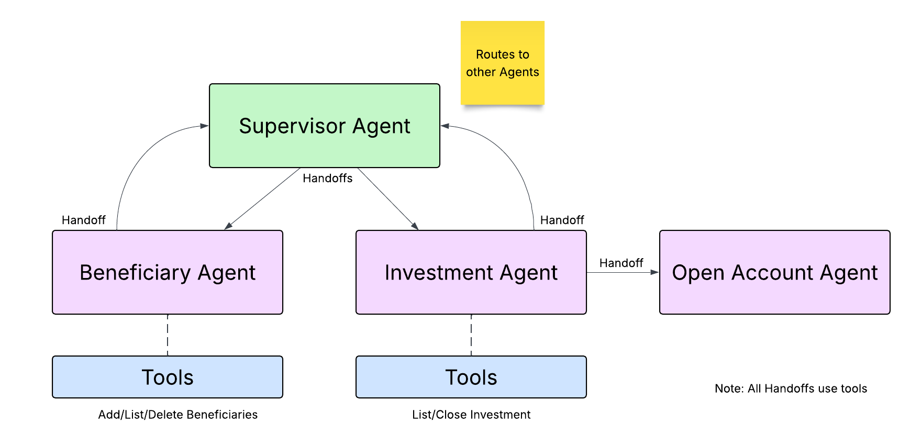

# Wealth Management Agent Example using Google ADK for TypeScript

A multi-agent banking chat built with the [Google Agent Development Kit for TypeScript](https://github.com/google/adk-js)
(`@google/adk`) and [Temporal](https://temporal.io), using Temporal's
[Google ADK integration](https://docs.temporal.io/develop/typescript/integrations/google-adk-agents)
(`@temporalio/google-adk`). It is one of several ports of the same demo, each built on a different
agent framework; the reference is
[temporal-sa/oai-temporal-wealth-management](https://github.com/temporal-sa/oai-temporal-wealth-management).

A customer lists, adds and deletes beneficiaries, and lists, opens and closes investment accounts. A
Supervisor Agent routes each request to a Beneficiary Agent or an Investment Agent, and the Investment
Agent hands account openings to an Open Account Agent. ADK hands off between agents with its built-in
`transfer_to_agent` tool, inside one turn.

Scenarios:

* List, add and delete beneficiaries (deleting asks for confirmation first)
* List and close investment accounts (closing asks for confirmation first)
* Open an investment account: KYC, a compliance officer's approval from outside the chat, and a saga
  that creates, funds and registers the account, rolling back if a step fails
* Off-topic questions are politely declined by the Supervisor Agent

There are two versions:

* **[Standalone](src/adk_supervisor/README.md)**: the agents with ADK alone, as a command-line chat.
  It opens accounts directly with a tool: no KYC, compliance review or saga.
* **[Temporal](src/temporal_supervisor/README.md)**: the agents run inside a Temporal workflow, so every
  model and tool call is durable. Each account opening is a child workflow. A web UI with a chaos
  panel switches failures on and off at runtime (outages, a rate limit, a saga rollback, a bug in
  workflow code) to show how Temporal recovers.



## Optional components

This port includes every optional component of the demo:

* The [Java open-account worker](java/README.md): a Java version of the open-account workflow on its
  own task queue, interchangeable with the TypeScript one
* The [claim check and codec server](src/temporal_supervisor/README.md#claim-check-optional): payloads
  stored in Redis instead of the event history
* [Temporal Cloud](src/temporal_supervisor/README.md#running-on-temporal-cloud) start scripts and the
  cloud compliance-approval script

## Prerequisites

* [Node.js](https://nodejs.org/) 22.12 or later (tested with 26) and npm
* [Temporal CLI](https://docs.temporal.io/cli) 1.4 or later, for the Temporal version
* [Redis](https://redis.io/) 7 or later, for the Temporal version (the conversation the UI reads, the
  chaos flags, and the optional claim check)
* A [Gemini API key](https://aistudio.google.com/apikey)
* JDK 25, only for the optional Java worker (the Gradle wrapper is included)

Install the dependencies from the repository root, and the web UI's in `frontend/`:

```bash
npm install
```

```bash
cd frontend && npm install
```

## Set up your Gemini API key

```bash
cp setgeminikey.example setgeminikey.sh
```

Put your key in `setgeminikey.sh`. It is git-ignored; never commit a real key. The worker start
scripts source it; for the standalone chat and the live tests, source it yourself.

The model is Gemini, `gemini-3.8-flash` by default, the same as the other ADK ports. To use another
Gemini model, set `GEMINI_MODEL` (in `setgeminikey.sh`, for example `export GEMINI_MODEL=gemini-2.5-pro`).
Every agent uses the same model.

## Getting started

* [Standalone version](src/adk_supervisor/README.md): run the agents from the command line
* [Temporal version](src/temporal_supervisor/README.md): run the worker, the API and the web UI
* [Java open-account worker](java/README.md): run the child workflow in Java

Also see the [API](api/README.md) and [web UI](frontend/README.md) READMEs.

## Demo data

The JSON files in `data/` are the system of record: beneficiaries, clients, investment accounts and
each client's linked bank account. They are tracked by git and the demo changes them. Reset them from
the repository root:

```bash
git checkout data/
```

Client `123` (Don Doe, 123 Main Street) has Checking, Savings and 401K accounts and a linked bank
account holding $250,000.

## Tests

```bash
npm test
```

The default suite needs no model key, no Redis and no running Temporal service: it uses the SDK's
local test server (downloaded on the first run), a scripted model, and a copy of the demo data in
`src/temporal_supervisor/mocha/fixtures/data`. See [Tests](src/temporal_supervisor/README.md#tests)
for what it covers and for the live tests, which call Gemini:

```bash
source setgeminikey.sh && LIVE_TEST_RUNS=3 npm run test:live
```

The web UI and the Java worker have their own tests:

```bash
cd frontend && CI=true npm test
```

```bash
cd java && ./gradlew clean build test
```

## Repository layout

| Path | Holds |
| --- | --- |
| `src/adk_supervisor/` | The standalone version and its README |
| `src/temporal_supervisor/` | The Temporal version: workflows, activities, worker, runners, shell scripts, tests (`mocha/`), README |
| `src/api/` | The API the web UI calls; its start scripts and README are in `api/` |
| `src/common/` | Prompts, the agent tree, the data store, chaos flags, client and claim-check config |
| `frontend/` | The shared React web UI |
| `data/` | Demo data |
| `java/` | The optional Java open-account worker |
