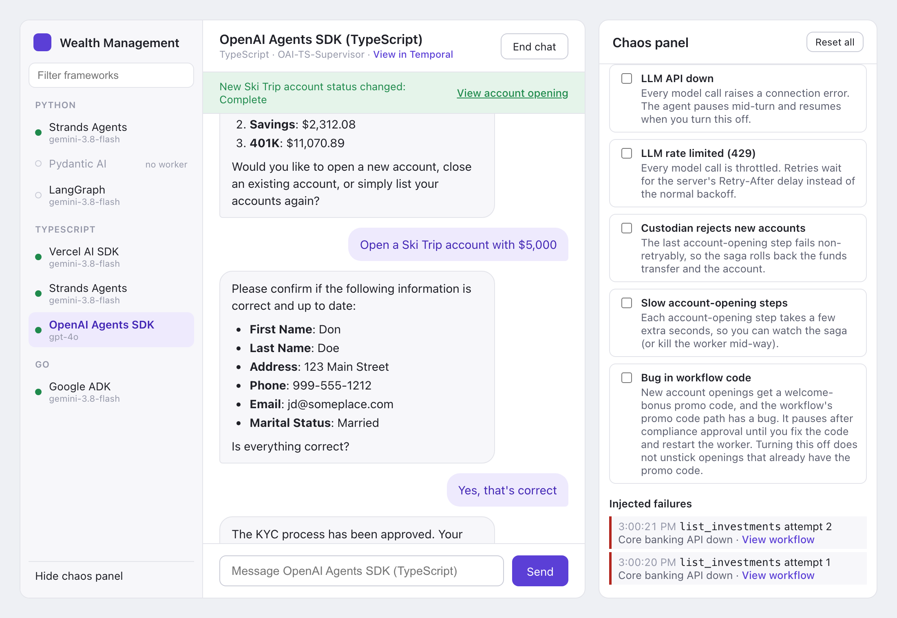

# React Web App for Wealth Management

An easy to use web based front end for the Wealth Management Agent. 
It uses the [API](../src/python/api/README.md) to interact with Temporal.

## Prerequisites 

[Node.js](https://nodejs.org/en/download): Version 18 or higher, with npm.

The web application relies on the API to communicate with Temporal. 
Be sure to follow the instructions to run the API, which can be found [here](../src/python/api/README.md).
The one API serves every framework, including the TypeScript and Go ones.
Start it for the framework whose worker you're running, because that decides which task queue chats start on
and how their workflow IDs are named:

```bash
cd src/python/api
./startlocalapi.sh openai_agents   # OpenAI Agents SDK: oai-temporal-agent-<random> on OAI-Supervisor
./startlocalapi.sh pyai            # Pydantic AI: pyai-temporal-agent-<random> on PYAI-Supervisor
./startlocalapi.sh strands_agents  # Strands Agents: strands-temporal-agent-<random> on Strands-Supervisor
./startlocalapi.sh google_adk      # Google ADK: adk-temporal-agent-<random> on ADK-Supervisor
./startlocalapi.sh pure            # Pure Python (LiteLLM): pure-temporal-agent-<random> on Pure-Supervisor
./startlocalapi.sh vercel_ai       # Vercel AI SDK (TypeScript): vai-temporal-agent-<random> on VAI-Supervisor
./startlocalapi.sh google_adk_ts   # Google ADK (TypeScript): adk-ts-temporal-agent-<random> on ADK-TS-Supervisor
./startlocalapi.sh google_adk_go   # Google ADK (Go): adk-go-temporal-agent-<random> on ADK-Go-Supervisor
```

Note that the web application communicates directly with the API and the API is what 
communicates with Temporal running locally or in the cloud.

The API URL is set in [`src/config.js`](src/config.js) (`API_BASE_URL`, default `http://127.0.0.1:8000`).
The API's CORS settings allow the web application on port 3000 (`http://localhost:3000` and
`http://127.0.0.1:3000`), so run it on that port.

## Install Dependencies
From the repository root:
```bash
cd frontend
npm install
```

## Running the Web App
```bash
cd frontend
npm start
```

A browser window opens at http://localhost:3000. The header shows the AI framework the API serves
(for example "AI framework: Google ADK"). Click **Start Chat** to start a conversation. Each
chat starts a new chat workflow with a random ID named after the AI framework the API serves, for example
`oai-temporal-agent-<random>` or `pyai-temporal-agent-<random>` (the prefix comes from the API's
`GET /config`); **End Chat** ends it.

Click **Chaos** in the chat header to open the chaos panel, which turns failure scenarios on and off
at runtime and lists the failures as they happen. See
[Failure scenarios](../src/python/openai_agents/durable/README.md#failure-scenarios-chaos-panel).

When you open a new investment account, it waits for compliance review after KYC. While the status bar says
**Waiting Compliance Review**, click **Approve compliance review** in it, or send the approval from a terminal to
the Open Account child workflow (see
[How to find the Child Workflow ID](../src/python/openai_agents/durable/README.md#approve-compliance)).

### Send the Compliance Reviewed Signal (Local)
```bash
cd src/python/openai_agents/durable
./localsendcomplianceapproval.sh <Child Workflow ID>
```

or
### Send the Compliance Reviewed Signal (Cloud)
```bash
cd src/python/openai_agents/durable
./cloudsendcomplianceapproval.sh <Child Workflow ID>
```

## Tests
```bash
cd frontend
npm test
```

`npm test` starts Jest in watch mode; press `q` to quit (or run `CI=true npm test` to run once).

## Example

Here's the web application running against the Pydantic AI framework, with the chaos panel open. The header
shows the AI framework the API serves (from its `GET /config`), and **Chaos** opens or hides the chaos panel,
which turns failures on and off while you chat:


