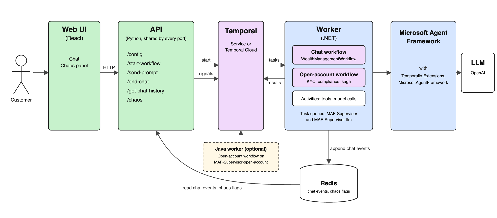

# Wealth Management Agent Demo: Microsoft Agent Framework (.NET) — experimental

> **Experimental.** This framework is built on Temporal's
> [Microsoft Agent Framework integration](https://docs.temporal.io/develop/dotnet/integrations/microsoft-agent-framework)
> (`Temporalio.Extensions.MicrosoftAgentFramework`), which is a pre-release (version 0.0.1): its interfaces may change
> before General Availability. `startdemo.sh all` and the API's `all` leave it out; name it, or use
> `startdemo.sh --experimental all`, to run it.

A multi-agent banking chat built with [Microsoft Agent Framework](https://github.com/microsoft/agent-framework)
(`Microsoft.Agents.AI`) in C# and [Temporal](https://temporal.io), using Temporal's Microsoft Agent Framework
integration.

A customer lists, adds and deletes beneficiaries, and lists, opens and closes investment accounts. A Supervisor Agent
hands each request to a Beneficiary Agent or an Investment Agent, and the Investment Agent hands account openings to an
Open Account Agent. As in the Strands frameworks ([Python](../../python/strands_agents/README.md) and
[TypeScript](../../typescript/strands_agents/README.md)), the agents are "agents as tools": an agent calls another agent
as one of its tools and gets its reply back. Agent Framework's multi-agent "Workflows" aren't supported by the
integration, so this is how its agents work together here.

It shares the [API](../../python/api/README.md) (written in Python), the [web application](../../../frontend/README.md),
the [Java worker](../../../interop/open_account/java/README.md), `scripts/` and `data/` with every framework. There is no
other .NET code in the repository, so the shared pieces (the data store, the Redis event stream, the chaos flags, the
claim check) have C# versions here, in [`Common/`](Common), with the same keys and formats as the other languages'. Its
chat workflows keep the same Temporal contract as the other frameworks, which is what lets the Python API serve it.

Its chat workflows run on the `MAF-Supervisor` task queue by default (`TaskQueues.DefaultTaskQueue` in
[`Common/Settings.cs`](Common/Settings.cs)), so its worker can run next to another framework's. Start the API for it
with the `agent_framework_dotnet` AI framework (`./startlocalapi.sh agent_framework_dotnet`); the web app then names its
chats `maf-temporal-agent-session-<session>-chat-<random>`.

Scenarios:

- List, add and delete beneficiaries (deleting asks the customer to confirm first, with the integration's approvals)
- List and close investment accounts (closing asks the customer to confirm first)
- Open an investment account: KYC, a compliance officer's approval from outside the chat, and a saga that creates,
  funds and registers the account, rolling back if a step fails
- Off-topic questions are politely declined by the Supervisor Agent

There are two versions:

- **[Standalone](docs/standalone.md)**: the agents with Microsoft Agent Framework alone, as a command-line chat. It opens
  accounts directly with a tool: no KYC, compliance review or saga.
- **[Temporal](docs/temporal.md)**: the agents run inside a Temporal workflow, so every model and tool call is durable.
  Each account opening is a child workflow. A web UI with a chaos panel switches failures on and off at runtime
  (outages, a rate limit, a saga rollback, a bug in workflow code) to show how Temporal recovers.



## Prerequisites

- The [.NET 10 SDK](https://dotnet.microsoft.com/download/dotnet/10.0), the current long-term-support release.
  [`src/dotnet/global.json`](../global.json) pins the SDK to 10.0 and accepts newer 10.0 updates.
- [Temporal CLI](https://docs.temporal.io/cli) 1.4 or later, for the Temporal version
- [Redis](https://redis.io/) 7 or later, for the Temporal version (the conversation the UI reads, the chaos flags, and
  the optional claim check)
- An [OpenAI API key](https://platform.openai.com/api-keys)
- JDK 25, only for the optional Java worker

`dotnet` restores the NuGet packages on the first build; there is nothing else to install.

## Set up your OpenAI API key

From the repository root, copy the shared OpenAI key file (the OpenAI Agents and Pydantic AI frameworks use it too) and
put your key in it. `scripts/setoaikey.sh` is git-ignored; never commit a real key.

```bash
cp scripts/setoaikey.example scripts/setoaikey.sh
```

The worker and chat scripts source it. The model is `gpt-4o` by default, as in the OpenAI Agents frameworks. To use
another OpenAI model, set `OPENAI_MODEL` (in `scripts/setoaikey.sh`, for example `export OPENAI_MODEL=gpt-4.1`). Every
agent uses the same model.

## Running the demo

Each command runs in its own terminal, from the repository root:

```bash
temporal server start-dev
```

```bash
redis-server
```

```bash
./src/dotnet/agent_framework/scripts/startlocalworker.sh
```

```bash
./src/python/api/startlocalapi.sh agent_framework_dotnet
```

```bash
cd frontend && npm install && npm start
```

Or, in one terminal, with Temporal and Redis running:

```bash
scripts/startdemo.sh agent_framework_dotnet
```

Open http://localhost:3000 and chat. To approve an account opening as the compliance officer, click **Approve
compliance review** in the status line, or:

```bash
./src/dotnet/agent_framework/scripts/localsendcomplianceapproval.sh "<open-account workflow ID>"
```

The [Temporal guide](docs/temporal.md) covers the details, including the Java worker, the claim check and Temporal
Cloud. The [standalone guide](docs/standalone.md) covers the command-line chat.

## Demo data

The JSON files in [data/](../../../data) are the system of record: beneficiaries, clients, investment accounts and each
client's linked bank account. They are tracked by git and the demo changes them. Reset them from the repository root:

```bash
git checkout data/
```

Client `123` (Don Doe, 123 Main Street) has Checking, Savings and 401K accounts and a linked bank account holding
$250,000.

## Tests

From `src/dotnet/agent_framework`:

```bash
dotnet test
```

The suite needs no model key, no Redis and no running Temporal service: it uses the SDK's local test server (downloaded
on the first run), a scripted chat client in place of OpenAI, and a copy of the demo data in `Tests/fixtures/data`. See
[Tests](docs/temporal.md#tests) for what it covers.

## Layout

| Path | Holds |
| --- | --- |
| [Common/](Common) | Code both versions use: the records, settings, the data store, the event stream, the chaos flags, the claim check and the agents' prompts |
| [Durable/](Durable) | The Temporal version: the workflows, the activities, the chat model and the worker |
| [Standalone/](Standalone) | The standalone command-line chat |
| [Tests/](Tests) | The tests, the scripted chat client and the test copy of the demo data |
| [scripts/](scripts) | Start the worker, the standalone chat, and send a compliance approval |
| [docs/](docs) | The Temporal and standalone guides |
| [AgentFramework.slnx](AgentFramework.slnx) | The solution |
