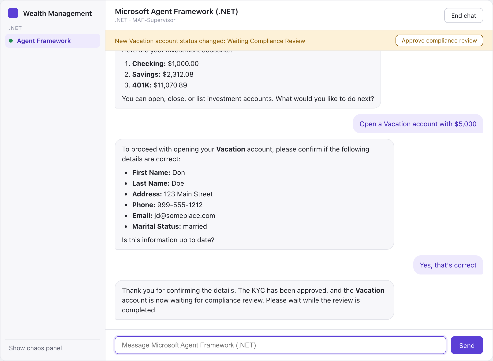
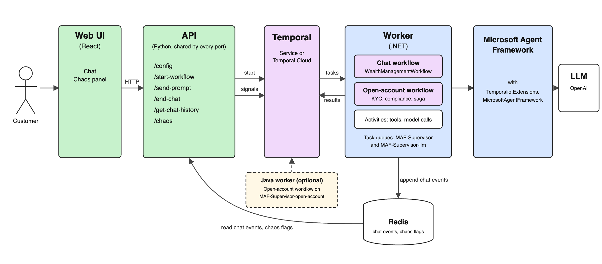
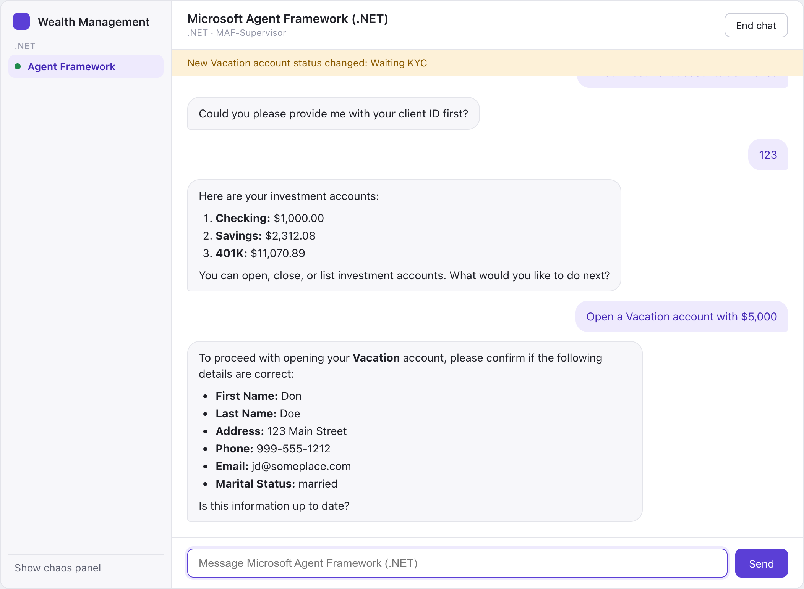
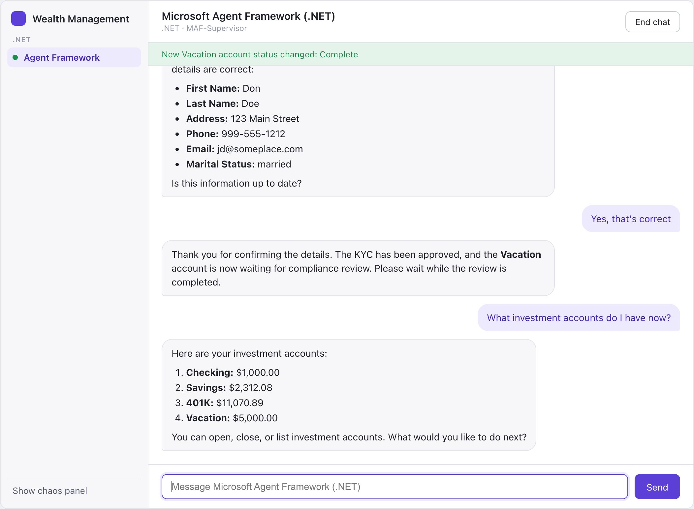
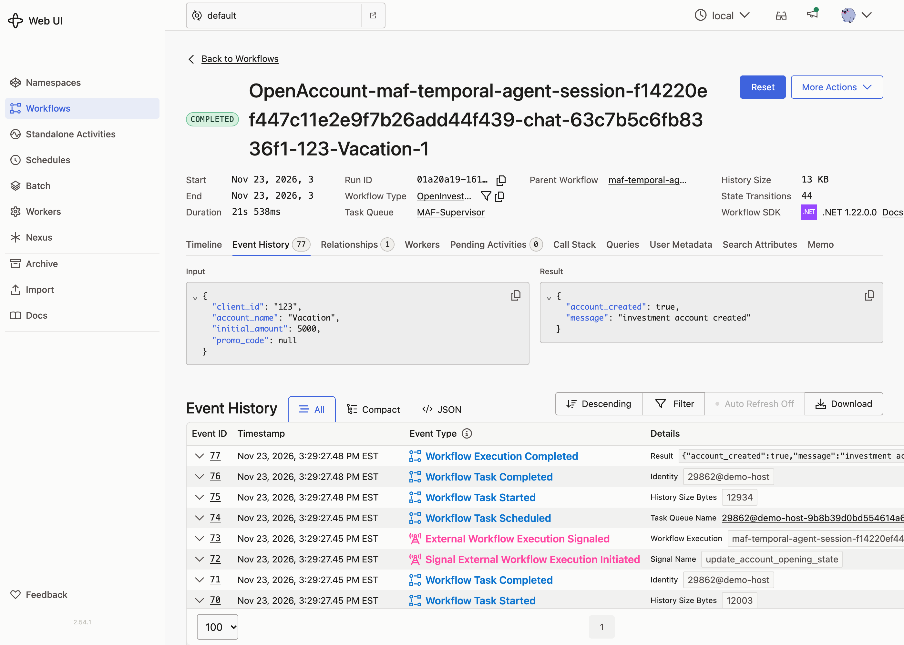

# Microsoft Agent Framework (.NET): Temporal version — experimental

In this version the agents run inside a Temporal workflow, so every model call and every tool call is durable. A turn
interrupted by an outage or a worker crash resumes where it stopped, and nothing the customer said is lost or asked
again. Opening an account starts a child workflow with KYC, a compliance officer's approval and a saga.

The agents are built with [Microsoft Agent Framework](https://github.com/microsoft/agent-framework)
(`Microsoft.Agents.AI`) and run with Temporal's
[Microsoft Agent Framework integration](https://docs.temporal.io/develop/dotnet/integrations/microsoft-agent-framework)
(`Temporalio.Extensions.MicrosoftAgentFramework`), a **pre-release** (0.0.1), which is why this framework is
experimental: `startdemo.sh all` and the API's `all` leave it out. Install the .NET 10 SDK and set up your OpenAI key as
described in the [framework's README](../README.md).



## Architecture



- **Web UI and API**: the web UI ([`frontend/`](../../../../frontend/README.md)) talks only to the API
  ([`src/python/api`](../../../python/api/README.md), the one API every framework shares), and the API only to Temporal
  and Redis. The API starts this framework's chat workflows with `agent_framework_dotnet` as its AI framework.
- **Chat workflow** (`WealthManagementWorkflow`,
  [`Durable/WealthManagementWorkflow.cs`](../Durable/WealthManagementWorkflow.cs)): one long-lived workflow per chat.
  It builds the agents and runs the supervisor on each customer message, one at a time. Every agent is a
  `TemporalAgent`, so each model call is the integration's `MicrosoftAgentFramework.InvokeModel` activity on the model
  task queue, while the agent loop and each agent's session (its conversation) stay in the workflow. The tools are
  `AIFunction`s in workflow code that run the tool activities. After each turn the workflow appends a
  `chat_interaction` event to the chat's Redis event stream. A chat with no customer message and no account-opening
  status update for an hour ends by itself, as on End chat, so chats abandoned without End chat don't run forever.
- **Open-account workflow** (`OpenInvestmentAccountWorkflow`,
  [`Durable/OpenAccountWorkflow.cs`](../Durable/OpenAccountWorkflow.cs)): a child workflow per account opening. It
  signals every state change to the chat workflow, which records it for the agent's `get_account_opening_status` tool
  and appends a `status_update` event to the stream.
- **Worker** ([`Durable/Program.cs`](../Durable/Program.cs)): runs both workflows and every tool activity on
  `MAF-Supervisor`, and the model activity on `MAF-Supervisor-llm`, where the Temporal service can rate-limit model
  calls. `MicrosoftAgentFrameworkPlugin` registers the model activity, which builds the OpenAI chat client on the worker
  from the plugin's `ChatClients` factory ([`Durable/ChatModel.cs`](../Durable/ChatModel.cs)).
- **Redis**: the chat's event stream (`events:<chat workflow ID>`) that the web UI reads through the API, the chaos flags
  (`chaos:<session>:flags`, with injected failures logged to `chaos:<session>:events`, per browser session), with
  `DEMO_DATA_STORE=redis` each session's copy of the sample data (`data:<session>:<file>`), and the optional claim check.
  The C# versions of these are in [`Common/`](../Common), with the same keys and formats as the other languages'.

### How the agents work

The agents follow the Strands frameworks' "agents as tools" design: the supervisor calls each specialized agent as a
tool, and gets its reply back as the tool's result. (Agent Framework's multi-agent "Workflows" are out of the
integration's scope, and its `AsAIFunction()` doesn't run in a workflow, so each assistant tool calls its agent's
`RunAsync` itself, as the integration's documentation recommends.)

```text
Supervisor Agent            tools: beneficiary_assistant, investment_assistant
├── Beneficiary Agent       tools: list_beneficiaries, add_beneficiary, delete_beneficiary (approval)
└── Investment Agent        tools: list_investments, close_investment (approval), open_account_assistant
    └── Open Account Agent  tools: open_new_investment_account, get_account_opening_status,
                                   get_current_client_info, approve_kyc, update_client_details
```

What the integration does, and what this framework adds:

| Concern | How |
| --- | --- |
| Agent loop | Agent Framework's own loop, in the workflow: `TemporalAgent` is an `AIAgent` whose model calls are activities |
| Delegation | Agents as tools: each assistant tool calls its agent's `RunAsync` with the client ID and the customer's request, in the agent's own session, kept for the whole chat, so each agent remembers what it asked the customer |
| Model calls | `new TemporalAgent(model, new TemporalAgentOptions { ModelActivityOptions = { TaskQueue, StartToCloseTimeout, RetryPolicy } })`: an activity per call, retried by Temporal. The worker maps the model name (`OPENAI_MODEL`) to an OpenAI chat client in the plugin's `ChatClients`, with the OpenAI client's own retries off |
| Tools | `AIFunctionFactory.Create` functions in workflow code, calling activities with `Workflow.ExecuteActivityAsync`. (The integration's `ActivityAsTool` would make the activity the tool; the tools here also keep workflow state, such as the KYC guard's turn) |
| Confirmations | The integration's approvals. `delete_beneficiary` and `close_investment` are `ApprovalRequiredAIFunction`s: the agent's run returns a `ToolApprovalRequestContent` instead of calling the tool, and the supervisor asks the customer. The customer's answer in their next message comes back as the assistant tool's `confirmed` argument, which the workflow turns into the approval's response: approved for a yes in the very next message, rejected otherwise. A rejected call never runs, and the agent is told why |
| Trace | Each tool records its call and result when it runs, and each assistant tool its handoff, for the chat history's trace and `json_response` |
| Chaos on the model | [`ChatModel.cs`](../Durable/ChatModel.cs) wraps the OpenAI chat client (`ChaosChatClient`), which runs inside the model activity, so the flags of the chat's browser session apply. The integration classifies provider errors by HTTP status and reads `Retry-After`, so "rate limited" throws the OpenAI client's own `ClientResultException` with status 429 and `Retry-After: 15`, exactly what a real 429 looks like |
| Guards | `approve_kyc` only once this opening's details were shown in an earlier turn |
| State | Each agent's session, the account-opening states and count, the turn number, the KYC guard and the pending approvals are workflow fields, deterministic on replay. The open-account agent is told the current status of each opening with every request |
| Prompts | The Python Strands framework's prompts ([`Common/Prompts.cs`](../Common/Prompts.cs)), with the confirmation steps changed for approvals |

## Running locally

Each command runs in its own terminal, from the repository root.

### Start Temporal and Redis

```bash
temporal server start-dev
```

```bash
redis-server
```

The Temporal UI is at http://localhost:8233.

### Start the worker

```bash
./src/dotnet/agent_framework/scripts/startlocalworker.sh
```

It sources `scripts/setoaikey.sh` and, if it exists, `scripts/setclaimcheck.sh`, builds the worker if needed and runs it.
It polls the `MAF-Supervisor` and `MAF-Supervisor-llm` task queues, so it can run next to other frameworks' workers, and
prints the claim-check state, the task queues and the model at startup.

### Start the API

```bash
./src/python/api/startlocalapi.sh agent_framework_dotnet
```

The argument is the AI framework the API serves; `all` leaves this experimental framework out, so name it (for example
`./startlocalapi.sh strands_agents,agent_framework_dotnet`). See the [API README](../../../python/api/README.md) for its
endpoints.

### Start the web UI

```bash
cd frontend && npm install && npm start
```

Open http://localhost:3000. **Start chat** starts a chat workflow with the ID
`maf-temporal-agent-session-<session>-chat-<random>`. For example: "Who are my beneficiaries?", "123", "What investments
do I have?", then "Open Vacation with $13,000" and "Yes" when the agent shows your details.

`scripts/startdemo.sh --experimental` (or `scripts/startdemo.sh agent_framework_dotnet`) starts the worker, the API
and the web UI in one terminal, and `scripts/startdemo.sh --experimental all` runs it with every other framework.

### Approve compliance

The quickest way: while the status line says **Waiting Compliance Review**, click **Approve compliance review** in it.
The API (`POST /approve-compliance`) finds the chat's account openings that wait for review and sends them the
`compliance_approved` signal. To send the signal yourself, as a compliance system would:

```bash
temporal workflow list --query 'WorkflowType="OpenInvestmentAccountWorkflow" AND ExecutionStatus="Running"'
```

```bash
./src/dotnet/agent_framework/scripts/localsendcomplianceapproval.sh "OpenAccount-maf-temporal-agent-session-<session>-chat-<random>-123-Vacation-1"
```

The saga runs, its states appear in the web UI, and the agent reports the result when asked.

### What you'll see

Waiting for the customer to confirm their details (KYC):



Waiting for compliance approval:


The account opened:



The open-account workflow in the Temporal UI:



### Deleting and closing

"Delete John Doe": the Beneficiary Agent calls `delete_beneficiary`, which needs an approval, so its run stops with the
request, and the supervisor asks "Are you sure you want to delete beneficiary John Doe?". "Yes" approves it and the
beneficiary is deleted; "No", or any answer that isn't in the very next message, rejects it and nothing is deleted. The
chat's trace shows `Asking the customer to confirm delete_beneficiary` and then whether the customer confirmed it.
Closing an account works the same way.

### Resetting the demo data

The JSON files in `data/` are the system of record, and the demo changes them. Reset them from the repository root:

```bash
git checkout data/
```

## How account opening works

1. The customer asks to open an account. The Investment Agent passes the request to the Open Account Agent
   (`open_account_assistant`), which calls `open_new_investment_account`.
2. The tool checks the deposit with the `validate_new_account` activity first: from $100 to $1,000,000. A refusal goes
   back to the agent, which explains it, and no workflow starts.
3. It starts the child workflow with the ID `OpenAccount-<chat workflow ID>-<client ID>-<account name>-<n>`, where the
   account name is as given and `<n>` counts the openings started in this chat (1, 2, ...). **Every request starts a
   new opening with its own KYC**, even for an account name used earlier in the chat. The count goes up only once the
   child has started, so a refused request doesn't use up a number. The child runs on
   `TEMPORAL_TASK_QUEUE_OPEN_ACCOUNT` (default: the chat's queue), with parent close policy `Terminate`, and its state
   is `Initializing` from the start.
4. KYC: the agent shows the customer's details (`get_current_client_info`, the child's `get_client_details` update) and
   asks whether they are correct. It approves KYC (`approve_kyc`, the `verify_kyc` signal) only when the customer
   confirms in a later message: the tool refuses until this opening's details were shown in an earlier turn. If the
   customer changes a detail instead, `update_client_details` saves it and completes KYC.
5. Each state change is signalled to the chat workflow, which shows it in the web UI. The agent reads an opening's
   status with `get_account_opening_status`, which returns the latest state the child reported, never from memory.
6. Compliance: the opening waits for a compliance officer's `compliance_approved` signal.
7. The saga: `Creating the account record.` (`open_investment`), `Transferring $<amount> from the linked bank account.`
   (`debit_linked_account`), `Registering the account with the custodian.` (`register_account`), then `Complete`. If a
   step fails for a business reason, it reports `Failed: <reason>. Rolling back.`, undoes the completed steps in
   reverse order, reporting `Rolling back: ...` before each, and ends `Rolled back. The account was not opened:
   <reason>.` Compensations are activities, retried until they succeed. Transfer IDs are
   `<workflow ID>-<run ID>-initial-deposit` (and `...-refund`), so a retried transfer never moves the money twice.

## Java open-account worker (optional)

The [Java worker](../../../../interop/open_account/java/README.md) runs `OpenInvestmentAccountWorkflow` in Java and
calls this worker's activities by name, so the chaos flags apply unchanged. Start this framework's worker with the
argument `java`, so the open-account workflow runs on `MAF-Supervisor-open-account` and this worker doesn't run it:

```bash
./src/dotnet/agent_framework/scripts/startlocalworker.sh java
```

Then start the Java worker for this framework:

```bash
TEMPORAL_TASK_QUEUE=MAF-Supervisor ./interop/open_account/java/startlocalworker.sh
```

Or both at once: `scripts/startdemo.sh --java agent_framework_dotnet`. On Temporal Cloud, use `startcloudworker.sh java`
and the Java worker's `startcloudworker.sh`.

## Failure scenarios (chaos panel)

Every failure is switched on from the chaos panel in the web UI, at runtime, with no restart. The activities and the
model read the flags from the Redis hash `chaos:<session>:flags` on every attempt (the browser session comes from the
workflow ID, see [`Common/Settings.cs`](../Common/Settings.cs)); if Redis can't be reached, the flags read as off. Each
injected failure is logged to `chaos:<session>:events` for the panel.

| Scenario | How to show it | What Temporal does |
| --- | --- | --- |
| Core banking API down | `tool_down`: the beneficiary and investment activities raise a connection error | The activity retries until the flag is off. The agent's reply waits mid-turn; nothing is lost or asked again |
| OpenAI API down | `llm_down`: every model call raises a connection error | The model activity retries; the turn resumes where it stopped |
| OpenAI rate limited (429) | `llm_rate_limited`: every model call fails with a 429 | The 429's `Retry-After` header sets a next retry delay of 15 s, overriding the backoff |
| Custodian rejects new accounts | `custodian_rejects`: `register_account` raises a non-retryable `CustodianRejected` | The saga refunds the deposit, then removes the account record |
| Slow account-opening steps | `slow_saga`: each saga step sleeps 4 s | Watch the saga, or kill the worker partway and restart it: the opening carries on |
| Bug in workflow code | `workflow_bug`: `find_promotion` returns the promo code `WELCOME-BONUS` | The workflow task fails and is retried; the opening stays Running. See below |
| Business rule | Open an account with more than $1,000,000 or less than $100 | `validate_new_account` fails on the first attempt (`DepositLimitExceeded`, `DepositBelowMinimum`), and the agent explains why |
| Insufficient funds | Client 123 opens an account with $300,000 (the linked bank account holds $250,000) | The debit fails with a non-retryable `InsufficientFunds`, and the saga rolls back |
| Proactive rate limiting | Set `LLM_MAX_CALLS_PER_SECOND` for the worker | Model calls run on their own task queue, so the Temporal service caps their rate across all workers |

The 429's retry delay needs no interceptor: the integration's model activity fails with `MicrosoftAgentFrameworkModelError`
and the delay from the `Retry-After` header, as it does for a real 429.

### Bug in workflow code

With the flag on, new openings get the promo code `WELCOME-BONUS`. In
[`Durable/OpenAccountWorkflow.cs`](../Durable/OpenAccountWorkflow.cs), at the `*** Bug-In-Workflow-Code ***` comment, the
promotion is keyed `WELCOME_BONUS` (an underscore), so looking it up throws a `KeyNotFoundException` right after
compliance approval. In .NET an exception that isn't a Temporal failure fails the workflow task, not the workflow: the
workflow stays **Running**, with the compliance approval kept, and Temporal retries the task.

Turning the flag off doesn't unstick an opening that already has the promo code. Fixing the code does: uncomment the
`Promotions` line above the buggy one, delete the buggy one, and restart the worker. The opening resumes on the next
workflow-task retry and opens the account with the bonus (1% of the deposit, up to $500). Re-arm the bug afterwards:

```bash
git checkout src/dotnet/agent_framework/Durable/OpenAccountWorkflow.cs
```

## Claim check (optional)

With the claim check on, a payload codec stores each payload in Redis and puts only its key in the event history. Every
component must agree: the worker, the API, the scripts and the Java worker all source `scripts/setclaimcheck.sh` if it
exists, and each prints at startup whether the claim check is on, with the `USE_CLAIM_CHECK` value. To turn it on:

```bash
cp scripts/setclaimcheck.example scripts/setclaimcheck.sh
```

`USE_CLAIM_CHECK` accepts `true`, `yes` or `1`. Restart every component after changing it.

This framework has no codec server of its own: its codec ([`Common/ClaimCheckCodec.cs`](../Common/ClaimCheckCodec.cs))
writes the same format as every other framework's, so any of their codec servers decodes its payloads (the Python,
TypeScript and Go ones are checked with it). To see the payloads in the Temporal UI, start one, for example:

```bash
./src/typescript/vercel_ai/durable/startcodecserver.sh
```

Then, in the Temporal UI at exactly http://localhost:8233 (the codec servers allow only that origin and
https://cloud.temporal.io), open the data encoder settings and set the codec server to `http://127.0.0.1:8081`. Or
start the local Temporal service with it already set:
`temporal server start-dev --ui-codec-endpoint http://127.0.0.1:8081`.


## Running on Temporal Cloud

```bash
cp scripts/setcloudenv.example scripts/setcloudenv.sh
```

Fill in `scripts/setcloudenv.sh` (git-ignored) with your namespace address, namespace and either the paths to your mTLS
certificate and key or an API key. Redis still runs locally. Then use the cloud scripts in place of the local ones:

```bash
./src/dotnet/agent_framework/scripts/startcloudworker.sh
```

```bash
./src/python/api/startcloudapi.sh agent_framework_dotnet
```

```bash
./src/dotnet/agent_framework/scripts/cloudsendcomplianceapproval.sh "<open-account workflow ID>"
```

## Environment variables

| Variable | Default | Purpose |
| --- | --- | --- |
| `OPENAI_API_KEY` | none | The worker's model activity and the standalone chat. Set in `scripts/setoaikey.sh` |
| `OPENAI_MODEL` | `gpt-4o` | The OpenAI model every agent uses |
| `TEMPORAL_ADDRESS` | `localhost:7233` | Every Temporal client and worker |
| `TEMPORAL_NAMESPACE` | `default` | Every Temporal client and worker |
| `TEMPORAL_TLS_CLIENT_CERT_PATH`, `TEMPORAL_TLS_CLIENT_KEY_PATH` | none | mTLS, for Temporal Cloud. Set in `scripts/setcloudenv.sh` |
| `TEMPORAL_API_KEY` | none | An API key, for Temporal Cloud, in place of mTLS |
| `TEMPORAL_TASK_QUEUE` | `MAF-Supervisor` | The chat workflow, the open-account workflow and the tool activities |
| `TEMPORAL_TASK_QUEUE_OPEN_ACCOUNT` | `TEMPORAL_TASK_QUEUE` | The open-account workflow. `java` means `<TEMPORAL_TASK_QUEUE>-open-account`, the Java worker's queue for this framework (set by the worker scripts' argument) |
| `TEMPORAL_TASK_QUEUE_LLM` | `<TEMPORAL_TASK_QUEUE>-llm` | The model calls |
| `LLM_MAX_CALLS_PER_SECOND` | none | A cap on model calls per second across all workers |
| `REDIS_URL` | none | `redis://:<password>@<host>:<port>/<db>`; wins over the three below |
| `REDIS_HOST`, `REDIS_PORT`, `REDIS_PASSWORD` | `localhost`, `6379`, none | The event stream, the chaos flags and the claim check |
| `DEMO_DATA_STORE` | `file` | Where the sample data (`data/*.json`) lives: `file` uses the files themselves; `redis` gives each browser session its own copy in Redis (`data:<session>:<name>`, starting from the files, expiring a day after its last change), for a shared demo |
| `USE_CLAIM_CHECK` | off | The claim check (`true`, `yes` or `1`). Set in `scripts/setclaimcheck.sh` |
| `CLAIM_CHECK_TTL_SECONDS` | `604800` (7 days) | How long Redis keeps claim-checked payloads; `0` keeps them forever. A workflow needs its payloads to replay, and the Temporal UI to show its history, so keep it well beyond how long a chat runs |
| `DATA_DIR` | the repository's `data/` | The demo data folder |

## Tests

```bash
cd src/dotnet/agent_framework && dotnet test
```

The suite needs no model key, no Redis and no running Temporal service: it uses the SDK's local test server (and its
time-skipping server for the idle chat), the real workflows and activities over a copy of the demo data
([`Tests/fixtures/data`](../Tests/fixtures/data)), an in-memory event stream and chaos flags, and a scripted chat client
in place of OpenAI ([`Tests/Harness.cs`](../Tests/Harness.cs), [`Tests/Scripts.cs`](../Tests/Scripts.cs)), given to
the plugin's `ChatClients` and run like OpenAI, on its own `-llm` task queue.

| Test | Checks |
| --- | --- |
| [`ChatTests.cs`](../Tests/ChatTests.cs) | The supervisor delegates to an agent as a tool and the trace records it; every model call runs on the model task queue; the sub-agents remember earlier turns; a delete runs after the customer's yes, a close doesn't after a no, and a late answer is rejected; the KYC guard; the open-account agent is told each opening's status; the business-rule refusal |
| [`FailureTests.cs`](../Tests/FailureTests.cs) | Retries through a tool and a model outage; the model flags read inside the model activity for the chat's own workflow; the 429's 15 s retry delay; the saga's success; the rollback after a custodian rejection and after insufficient funds; the saga states reported to the chat; the bug pausing the workflow without failing it; repeat openings with their own KYC; a chat ending by itself after an hour |
| [`CommonTests.cs`](../Tests/CommonTests.cs) | The session in a workflow ID, the open-account task queue, dollar amounts, the claim check's settings, and the data files |

## Temporal contracts

The names and payloads match the other frameworks, in snake_case, so the scripts, the API, the web UI and the Java
worker work with every framework. They are defined in [`Durable/Shared.cs`](../Durable/Shared.cs),
[`Common/Models.cs`](../Common/Models.cs) and [`Durable/Activities.cs`](../Durable/Activities.cs).

* `WealthManagementWorkflow`: signals `process_user_message` (`{user_input}`), `end_workflow`,
  `update_account_opening_state` (`{account_name, state, workflow_id}`); query `get_chat_history`.
* `OpenInvestmentAccountWorkflow` (`{client_id, account_name, initial_amount, promo_code}` →
  `{account_created, message}`): query `get_current_state`; updates `get_client_details`, `update_client_details`;
  signals `verify_kyc`, `compliance_approved`.
* Activities: `list_beneficiaries`, `add_beneficiary`, `delete_beneficiary`, `list_investments`, `close_investment`,
  `validate_new_account`, `find_promotion`, `open_investment`, `remove_investment`, `get_client`, `update_client`,
  `debit_linked_account`, `credit_linked_account`, `register_account`, `get_current_client_info`, `approve_kyc`,
  `update_client_details`, `append_chat_interaction`, `append_status_update`, `delete_conversation`. The worker also
  registers `get_worker_config`, which hands the chat workflow its task queues and model, and the integration's
  `MicrosoftAgentFramework.InvokeModel` (with its MCP activities, which this framework doesn't use).

Retries: tool activities use a 1 s initial interval, a backoff coefficient of 2, a 5 s maximum interval and no attempt
limit; model calls the same with a 10 s maximum interval. Timeouts are start-to-close only, so an outage is waited out.
