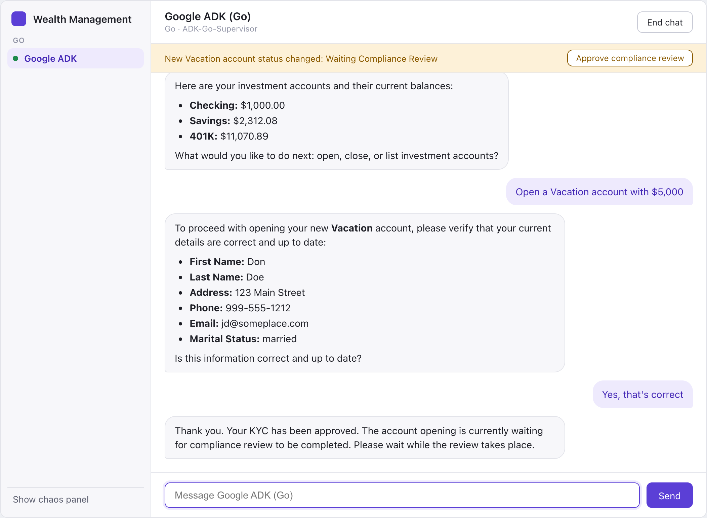
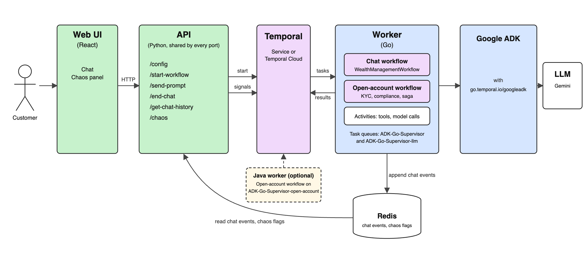
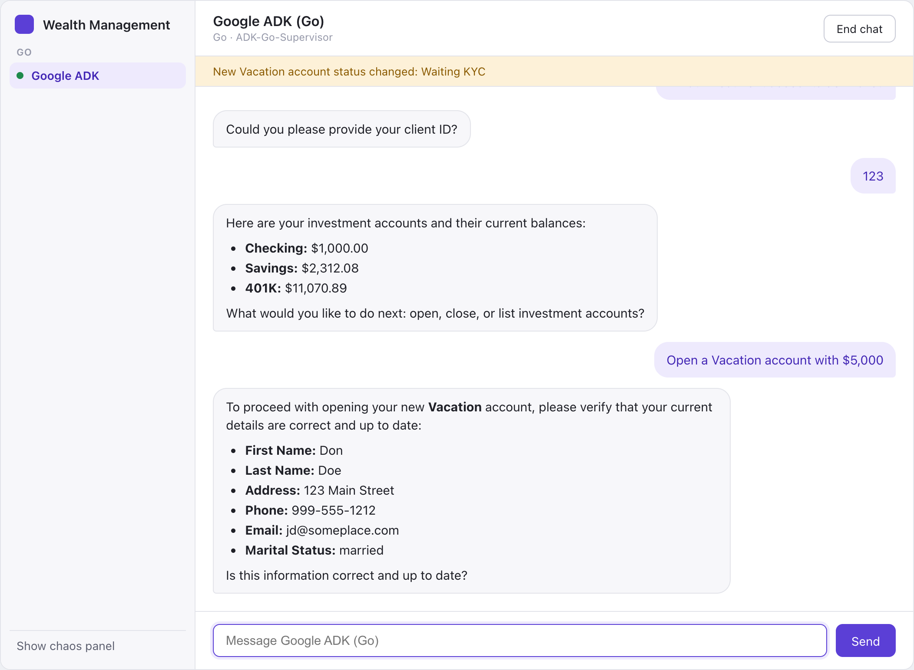
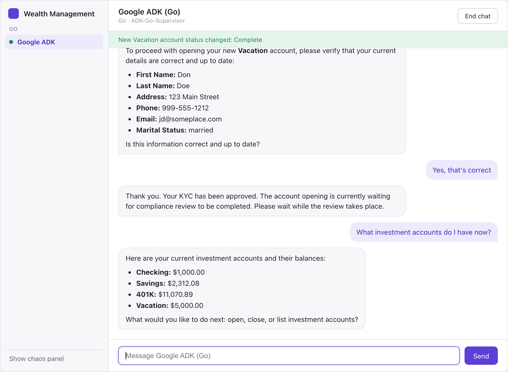
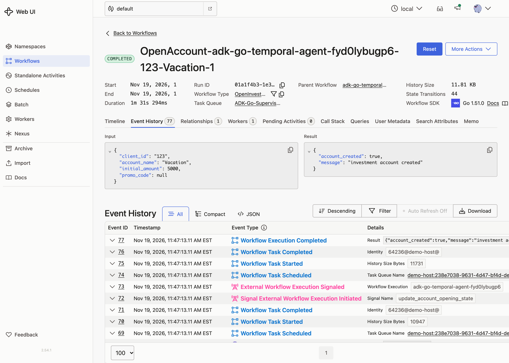

# Google ADK (Go): Temporal version

In this version the agents run inside a Temporal workflow, so every model call and every tool call that does
I/O is a durable activity. The chat is one long-lived workflow, `WealthManagementWorkflow`, and each account
opening is a child workflow, `OpenInvestmentAccountWorkflow`, with KYC, a compliance officer's approval and a
saga.

The agents are built with the [Google Agent Development Kit for Go](https://google.github.io/adk-docs/) and
run with Temporal's [Go integration for Google ADK](https://docs.temporal.io/develop/go/integrations/google-adk)
(`go.temporal.io/googleadk`). Do the setup in the [framework's README](../README.md) first (prerequisites and
Gemini key).



## Architecture



* **Web UI and API**: the web UI ([`frontend/`](../../../../frontend/README.md)) polls the API
  ([`src/python/api`](../../../python/api/README.md), the one API every framework shares). The API starts the chat
  workflow, signals each customer message to it, and reads the conversation from the chat's Redis event
  stream. It serves this framework with `google_adk_go` as its AI framework.
* **Chat workflow** (`WealthManagementWorkflow`, [`internal/workflows/chat.go`](../internal/workflows/chat.go)):
  runs the ADK agent tree for each customer message, one message at a time. Agents hand off with ADK's
  built-in `transfer_to_agent`, in the same turn as the request. Each agent's model is a
  `googleadk.NewModel`, so its calls run as the integration's `googleadk.InvokeModel` activity on their own
  task queue. The tools run in the workflow and call the activities listed under
  [Temporal contracts](#temporal-contracts). After each turn the workflow appends a `chat_interaction` event
  to Redis.
  A chat with no customer message and no account-opening status update for an hour ends by itself, as on
  End chat (`ChatIdleTimeout` in `chat.go`), so chats abandoned without End chat don't run forever.
* **Open-account workflow** (`OpenInvestmentAccountWorkflow`,
  [`internal/workflows/openaccount.go`](../internal/workflows/openaccount.go)): reads the client's details,
  waits for KYC and then for compliance approval, and runs the saga. It signals every state change to the
  chat, which records it and appends a `status_update` event.
* **Worker** ([`cmd/worker`](../cmd/worker/main.go)): runs both workflows and the tool activities on
  `ADK-Go-Supervisor`, and the model calls on `ADK-Go-Supervisor-llm`.
* **Redis**: the chat's event stream (`events:<chat workflow ID>`) that the web UI reads through the API,
  the chaos flags (`chaos:<session>:flags`, with injected failures logged to `chaos:<session>:events`), and the optional claim
  check.

### How the agents work

```text
Supervisor_Agent
├── Beneficiary_Agent       tools: list_beneficiaries, add_beneficiary, delete_beneficiary
└── Investment_Agent        tools: list_investments, close_investment
    └── Open_Account_Agent  tools: open_new_investment_account, get_account_opening_status,
                                   get_current_client_info, approve_kyc, update_client_details
```

| Concern | How |
|---|---|
| Agent loop and handoffs | ADK's runner in the workflow ([`internal/agents`](../internal/agents/agents.go)). Agents hand off with `transfer_to_agent`, in the same turn. A specialist hands back to its parent, never sideways |
| Model calls | `googleadk.NewModel`: each call is the `googleadk.InvokeModel` activity on the model task queue, retried by Temporal. The Gen AI SDK's own HTTP retries are off |
| Tools | Tools in workflow code ([`internal/workflows/tools.go`](../internal/workflows/tools.go)) that call the activities |
| Client ID | The customer gives it once. A before-tool callback saves it from the first tool call that uses it, and every agent's instructions include it from then on |
| Chaos on the model | The chaos-aware Gemini model ([`internal/llm`](../internal/llm/llm.go)). `googleadk.InvokeModel` wraps any error the model returns in its own `ApplicationError`, so a retry delay set inside the model would be lost: an activity interceptor on the model worker sets the 15 s next retry delay on a rate-limited call's final error |
| Prompts | [`internal/prompts`](../internal/prompts/prompts.go), shared with the standalone version |

## Running locally

Each command runs in its own terminal, from the repository root.

### Start Temporal and Redis

```bash
temporal server start-dev
```

```bash
redis-server
```

The Temporal UI is at http://localhost:8233.

### Start the worker

```bash
./src/go/google_adk/scripts/startlocalworker.sh
```

It sources `scripts/setgeminikey.sh` and, if it exists, `scripts/setclaimcheck.sh`. It polls the
`ADK-Go-Supervisor` and `ADK-Go-Supervisor-llm` task queues, so it can run next to other frameworks' workers.

### Start the API

```bash
./src/python/api/startlocalapi.sh google_adk_go
```

The argument is the AI framework the API serves. See the [API README](../../../python/api/README.md) for its
endpoints.

### Start the web UI

```bash
cd frontend && npm install && npm start
```

Open http://localhost:3000. **Start chat** starts a chat workflow with the ID
`adk-go-temporal-agent-session-<session>-chat-<random>`. Then, for example:

1. *Who are my beneficiaries?* The supervisor hands off to the Beneficiary Agent, which asks for your client ID.
2. *123* It lists John, Jane and Joan Doe.
3. *What investments do I have?* The Beneficiary Agent hands back to the supervisor, which hands off to the
   Investment Agent, which lists Checking, Savings and 401K, all in this one turn.
4. *Open Vacation with $13,000* The Open Account Agent starts an opening and shows your details for KYC.
5. *Yes* KYC is approved and the opening waits for compliance approval.

### Approve compliance

The quickest way: while the status line says **Waiting Compliance Review**, click **Approve compliance review**
in it. The API (`POST /approve-compliance`) finds the chat's account openings that wait for review and sends
them the `compliance_approved` signal. To send the signal yourself, as a compliance system would, use the
script below.

Compliance approval comes from outside the chat, from a compliance officer. The open-account workflow's ID is

```text
OpenAccount-<chat workflow ID>-<client ID>-<account name>-<n>
```

for example `OpenAccount-adk-go-temporal-agent-session-<session>-chat-<random>-123-Vacation-1`. Find it in the chat's JSON output or
the Temporal UI, or list the running openings:

```bash
temporal workflow list --query "WorkflowType='OpenInvestmentAccountWorkflow' AND ExecutionStatus='Running'"
```

Then send the approval, quoting the ID:

```bash
./src/go/google_adk/scripts/localsendcomplianceapproval.sh "OpenAccount-adk-go-temporal-agent-session-<session>-chat-<random>-123-Vacation-1"
```

Ask the agent for the status: it reads it with `get_account_opening_status`, and reports `Complete`.

### What you'll see

Waiting for the customer to confirm their details (KYC):



Waiting for compliance approval:


The account opened:



The open-account workflow in the Temporal UI:



### Resetting the demo data

The JSON files in `data/` are the system of record, and the demo changes them: adding or deleting a
beneficiary, closing or opening an account, updating client details during KYC, and the open-account
scenarios. Reset them from the repository root:

```bash
git checkout data/
```

## How account opening works

1. The customer asks to open an account. The Investment Agent hands off to the Open Account Agent, which
   calls `open_new_investment_account`.
2. The tool first runs `validate_new_account`. A deposit under $100 or over $1,000,000 fails it on the
   first attempt (a non-retryable `DepositBelowMinimum` or `DepositLimitExceeded`), and the agent explains
   the refusal. No workflow starts.
3. It starts the child workflow with the ID `OpenAccount-<chat workflow ID>-<client ID>-<account name>-<n>`,
   where `<n>` counts the openings started in this chat, so two "Vacation" openings are `...-Vacation-1` and
   `...-Vacation-2`. **Every request starts a new opening with its own KYC**, even if an account with the
   same name was opened, or is still being opened, earlier in the chat. A refused request doesn't use up a
   number. The child is started with parent close policy `TERMINATE` on `TEMPORAL_TASK_QUEUE_OPEN_ACCOUNT`,
   and its state is `Initializing` from the start.
4. KYC: the agent shows the customer's details (`get_current_client_info`, which runs the child's
   `get_client_details` update) and asks if they are correct. `approve_kyc` (the `verify_kyc` signal)
   refuses unless this opening's details were shown in a reply and the customer has answered since. If the
   customer changes a detail instead, `update_client_details` saves it and completes KYC.
5. Each state change is signalled to the chat workflow, which shows it in the web UI. The agent reads an
   opening's status with `get_account_opening_status`.
6. Compliance: the opening waits for a compliance officer's `compliance_approved` signal.
7. The saga runs, reporting each state:

   ```text
   Compliance review has been approved. Creating Investment Account
   Creating the account record.                            (open_investment)
   Transferring $13,000.00 from the linked bank account.   (debit_linked_account)
   Registering the account with the custodian.             (register_account)
   Complete
   ```

   If a step fails with a non-retryable error, it reports `Failed: <reason>. Rolling back.`, runs the
   completed steps' compensations in reverse order (`Rolling back: <description>.` before each), and ends
   with `Rolled back. The account was not opened: <reason>.` Compensations retry until they succeed.
   Transfers use the IDs `<workflow ID>-<run ID>-initial-deposit` and `...-refund`, so a retried transfer
   never moves money twice.

### Testing the open-account workflow on its own

The open-account runner ([`cmd/openaccount`](../cmd/openaccount/main.go)) runs
`OpenInvestmentAccountWorkflow` directly, with no chat and no model key, for three scenarios: KYC approved,
client details updated, and compliance approval sent by hand. It starts its own worker and stops it on exit:

```bash
./src/go/google_adk/scripts/startlocalopenaccount.sh
```

When the third scenario waits for compliance approval, send it from another terminal:

```bash
./src/go/google_adk/scripts/localsendcomplianceapproval.sh testing-open-investment-account-workflow3
```

Scenario 2 changes Don Doe's last name to Doenut, so reset the data afterwards.

To run the scenarios on the Java worker, start the Java worker for this framework first (below) and pass `java`:

```bash
./src/go/google_adk/scripts/startlocalopenaccount.sh java
```

## Java open-account worker (optional)

The [Java worker](../../../../interop/open_account/java/README.md) runs `OpenInvestmentAccountWorkflow` in
Java and calls this framework's activities by name, so the chaos flags apply unchanged. Start the Go worker with
the argument `java`, so the open-account workflow runs on `ADK-Go-Supervisor-open-account` and the Go worker
doesn't run it:

```bash
./src/go/google_adk/scripts/startlocalworker.sh java
```

Then start the Java worker for this framework:

```bash
TEMPORAL_TASK_QUEUE=ADK-Go-Supervisor ./interop/open_account/java/startlocalworker.sh
```

The chat workflow, the tool activities and the model calls stay on the Go worker. On Temporal Cloud, use
`startcloudworker.sh java` and the Java worker's `startcloudworker.sh`.

## Failure scenarios (chaos panel)

Open the chaos panel with **Show chaos panel** at the bottom of the web UI's sidebar. Each switch takes effect at once, with no
restart: activities and every model call read the flags from the Redis hash `chaos:<session>:flags` on each attempt.
If Redis can't be reached, the flags read as off. Each injected failure is logged to the Redis list
`chaos:<session>:events` for the panel. Watch the retries in the Temporal UI.

| Scenario | How to show it | What Temporal does |
|---|---|---|
| Core banking API down | `tool_down`: investment and beneficiary activities return a connection error | The activities retry until you turn it off. The agent's reply waits mid-turn; nothing is lost or asked again |
| Gemini API down | `llm_down`: every model call returns a connection error | The `googleadk.InvokeModel` activity retries, and the turn resumes where it stopped |
| Gemini rate limited (429) | `llm_rate_limited`: every model call fails with a 429 | Its next retry waits 15 s, like a `Retry-After` header, overriding the backoff. The Gen AI SDK's own HTTP retries are off, so Temporal decides when to retry |
| Custodian rejects new accounts | `custodian_rejects`: `register_account` fails with a non-retryable `CustodianRejected` | The saga refunds the deposit, then removes the account record |
| Slow account-opening steps | `slow_saga`: each saga step sleeps 4 s | Watch the saga, or stop the worker partway and restart it: the opening carries on |
| Bug in workflow code | `workflow_bug`: `find_promotion` returns the promo code `WELCOME-BONUS` | The workflow task fails and is retried; the opening stays Running. See below |
| Business rule | Open an account with more than $1,000,000 or less than $100 | `validate_new_account` fails on the first attempt, and the agent explains the refusal |
| Insufficient funds | Open an account with $300,000 (the linked bank account holds $250,000) | The debit fails with a non-retryable `InsufficientFunds`, and the saga rolls back |
| Proactive rate limiting | Set `LLM_MAX_CALLS_PER_SECOND` for the worker | Model calls run on their own task queue with that dispatch rate, so the Temporal service queues them instead of letting them hit the provider's limit |

The 15 s delay after a 429 is set by an activity interceptor on the model worker
([`internal/llm`](../internal/llm/llm.go)), because `googleadk.InvokeModel` wraps the model's error in its
own `ApplicationError`.

### Bug in workflow code

With `workflow_bug` on, new openings get the `WELCOME-BONUS` promo code, and the welcome-bonus code in
[`internal/workflows/openaccount.go`](../internal/workflows/openaccount.go) has a deliberate bug, marked
`*** Bug-In-Workflow-Code ***`:

```go
// promo := promotions[*in.PromoCode]
promo := promotions["WELCOME_BONUS"]
```

It looks the promotion up under `WELCOME_BONUS`, but the promo code is `WELCOME-BONUS`, so it gets a nil
pointer and panics. A panic fails the **workflow task**, not the workflow: the opening stays **Running**,
right after compliance approval, with the approval kept, and Temporal retries the task. The Temporal UI shows
the failed workflow task and its stack trace.

Turning the flag off doesn't unstick an opening that already has the promo code. To fix it, uncomment the
first line, comment out the second, and restart the worker. On the next workflow task retry the opening
carries on and opens the account with the bonus (1% of the deposit, up to $500). Re-arm the bug afterwards:

```bash
git checkout src/go/google_adk/internal/workflows/openaccount.go
```

The Java version has its own bug in workflow code: see the
[Java README](../../../../interop/open_account/java/README.md#bug-in-the-workflow-code-chaos-panel).

## Claim check and codec server (optional)

The claim check substitutes every payload sent to Temporal (workflow and activity inputs and results,
signals, queries and updates) with an ID: the
[Claim Check pattern](https://www.enterpriseintegrationpatterns.com/patterns/messaging/StoreInLibrary.html).
A [payload codec](https://docs.temporal.io/develop/go/converters-and-encryption#custom-payload-codec)
([`src/go/internal/common/claimcheck`](../../internal/common/claimcheck/claimcheck.go)) stores the original
payload in Redis under a new UUID and puts only the UUID in the event history. Its format matches the other
frameworks' Python and Java codecs, so the Java worker works with it too. To turn it on:

```bash
cp scripts/setclaimcheck.example scripts/setclaimcheck.sh
```

`scripts/setclaimcheck.sh` sets `USE_CLAIM_CHECK=true` and where Redis is. It is git-ignored. Every start
script sources it if it exists, so the worker, the API, the compliance and open-account scripts, the codec
server and the Java worker all use the codec. They must all agree: a component without it can't read the
others' payloads. Restart anything already running after you create or delete the file. Every program prints
a `Claim check: ON` or `Claim check: OFF` line when it starts, so you can check they agree.

The demo uses one Redis for the chat events, the chaos flags and the claim check. A claim check adds a Redis
call for every payload, and Redis being down then stops the workflows, so use a reliable Redis in production.
The stored payloads expire after `CLAIM_CHECK_TTL_SECONDS` (default 7 days; `0` keeps them forever). A workflow
can't replay, and the Temporal UI can't show its history, once its payloads are gone, so keep the expiry well beyond
how long a chat runs. To clear them sooner, run `redis-cli flushdb` when the demo is done (this also clears the chat
events and chaos flags).

With the claim check on, the Temporal UI only shows each payload's UUID. The codec server lets it show the
real data:

```bash
./src/go/google_adk/scripts/startcodecserver.sh
```

It listens on http://127.0.0.1:8081 (`CODEC_SERVER_ADDRESS` changes it). Open the Temporal UI at exactly
http://localhost:8233 (not 127.0.0.1), or https://cloud.temporal.io for Temporal Cloud: the codec server only
accepts requests from those origins. Click the glasses icon at the top right, choose **Use my browser setting
and ignore Cluster-level setting**, enter `http://127.0.0.1:8081` with no trailing spaces, turn off **Pass
the user access token** and **Include cross-origin credentials**, and click **Apply**.


## Running on Temporal Cloud

```bash
cp scripts/setcloudenv.example scripts/setcloudenv.sh
```

`scripts/setcloudenv.sh` sets `TEMPORAL_ADDRESS`, `TEMPORAL_NAMESPACE`, `TEMPORAL_TLS_CLIENT_CERT_PATH` and
`TEMPORAL_TLS_CLIENT_KEY_PATH` (or `TEMPORAL_API_KEY`, if your namespace uses an API key instead of mTLS). It
is git-ignored: never commit it. Redis still runs locally. Then use the cloud scripts in place of the local
ones:

```bash
./src/go/google_adk/scripts/startcloudworker.sh
```

```bash
./src/python/api/startcloudapi.sh google_adk_go
```

```bash
./src/go/google_adk/scripts/cloudsendcomplianceapproval.sh "OpenAccount-<chat workflow ID>-123-Vacation-1"
```

Watch the workflows in the Temporal Cloud UI, in your namespace. For the Java worker on Temporal Cloud, see
the [Java README](../../../../interop/open_account/java/README.md#running-with-temporal-cloud).

## Environment variables

| Variable | Default | Purpose |
|---|---|---|
| `GEMINI_API_KEY` | none | Gemini API key for the worker and CLI (or `GOOGLE_API_KEY`). Set in `scripts/setgeminikey.sh` |
| `GEMINI_MODEL` | `gemini-3.8-flash` | The Gemini model every agent uses |
| `TEMPORAL_ADDRESS` | `127.0.0.1:7233` | Temporal service address, for every program |
| `TEMPORAL_NAMESPACE` | `default` | Temporal namespace, for every program |
| `TEMPORAL_TLS_CLIENT_CERT_PATH`, `TEMPORAL_TLS_CLIENT_KEY_PATH` | none | mTLS client certificate and key, for Temporal Cloud. Set in `scripts/setcloudenv.sh` |
| `TEMPORAL_API_KEY` | none | An API key, for Temporal Cloud, in place of mTLS |
| `TEMPORAL_TASK_QUEUE` | `ADK-Go-Supervisor` | Task queue of the chat workflow and the tool activities |
| `TEMPORAL_TASK_QUEUE_OPEN_ACCOUNT` | the chat's queue | Task queue of the open-account workflow. `java` means `<TEMPORAL_TASK_QUEUE>-open-account`, the Java worker's queue for this framework; `startlocalworker.sh java` sets it, and the worker then doesn't run that workflow |
| `TEMPORAL_TASK_QUEUE_LLM` | `<TEMPORAL_TASK_QUEUE>-llm` | Task queue of the model calls |
| `LLM_MAX_CALLS_PER_SECOND` | unlimited | Rate limit the Temporal service applies to model calls, across all workers |
| `REDIS_URL` | none | `redis://:<password>@<host>:<port>/<db>`; wins over the three below |
| `REDIS_HOST`, `REDIS_PORT`, `REDIS_PASSWORD` | `localhost`, `6379`, none | Where Redis is, for the worker and the API |
| `DEMO_DATA_STORE` | `file` | Where the sample data (`data/*.json`) lives: `file` uses the files themselves; `redis` gives each browser session its own copy in Redis (`data:<session>:<name>`, starting from the files, expiring a day after its last change), for a shared demo |
| `USE_CLAIM_CHECK` | off | `true`, `yes` or `1` turns on the claim-check codec. Set in `scripts/setclaimcheck.sh` |
| `CLAIM_CHECK_TTL_SECONDS` | `604800` (7 days) | How long Redis keeps claim-checked payloads; `0` keeps them forever. A workflow needs its payloads to replay, and the Temporal UI to show its history, so keep it well beyond how long a chat runs |
| `CODEC_SERVER_ADDRESS` | `127.0.0.1:8081` | Where the codec server listens |
| `DATA_DIR` | `data/` above the working directory | Folder of the demo data files, for the worker and CLI |
| `LIVE_TEST_RUNS` | `1` | How many times each live test repeats its conversation |

## Tests

### Default tests

```bash
cd src/go && go test ./...
```

The default suite needs no API key, no Redis and no running Temporal service. It uses the Temporal Go SDK's
test environment, stub activities and a scripted model. The bug test starts a Temporal dev server itself,
using the `temporal` CLI on your PATH (or downloading it). The tests live next to the code they test
(`*_test.go`).

| Test | Checks |
|---|---|
| `TestSagaSuccess`, `TestSagaRollbackCustodianRejects`, `TestSagaRollbackInsufficientFunds`, `TestSagaStateSequence` | The saga, both rollbacks and the reported states |
| `TestToolOutageRetries`, `TestModelOutageRetries`, `TestRateLimitRetryDelay` | Retries during a tool and a model outage, and the 15 s delay after a 429 |
| `TestBusinessRuleRefusal` | Deposits over $1,000,000 or under $100 are refused before any workflow starts |
| `TestWorkflowBugPausesWorkflow` | The bug fails the workflow task while the workflow stays Running |
| `TestKYCGuardAndRepeatOpening` | `approve_kyc` refuses until this opening's details were shown in an earlier turn; two "Vacation" openings start `-Vacation-1` and `-Vacation-2`, each with its own KYC |
| `TestClientIDSharedAcrossAgents` | Every agent is told the client ID once a tool has used it; handoffs happen in one turn |
| `TestOffTopicPrompt` (both versions), `TestPRDPromptLines` | The Supervisor Agent's prompt declines off-topic questions; the PRD's required prompt lines |
| `TestOpenAccountTaskQueue`, `TestLoadUsesThePortsQueues` | The open-account task queue rule (`java` and the default) and this framework's task queues |
| `TestFormat`, `TestDecodeOtherPorts`, `TestDataConverterRoundTrip` | The claim-check payload format, decoding the Python and Java codecs' payloads, and a round trip (with an in-memory Redis) |
| `TestMoney`, `TestDemoData`, `TestTransfersAreIdempotent`, `TestBeneficiariesAndClients` | The shared data store, over the test copy of the demo data |

### Live tests

The live tests call the paid Gemini API, so they are kept out of the default run. They run the real chat
workflow on a dev server they start, with an in-memory event stream and the chaos flags off, and print each
run's transcript.

```bash
cd src/go/google_adk && source ../../../scripts/setgeminikey.sh && LIVE_TEST_RUNS=3 go test -tags live ./tests/ -v
```

* `TestLiveAgentHandoffs`: "Who are my beneficiaries?", "123", "What investments do I have?". The
  beneficiaries are listed; in the last turn the Beneficiary Agent hands back to the supervisor, which hands
  off to the Investment Agent, which lists Checking, Savings and 401K without asking for the client ID again;
  no reply mentions a transfer.
* `TestLiveRepeatOpening`: the same three messages, then "Open Vacation with $13,000", "Yes" and "Open
  Vacation with $13,000". Both open replies show the KYC details, and openings `-Vacation-1` and
  `-Vacation-2` were started.

## Temporal contracts

These names and payloads match the other frameworks exactly, so the API, the web UI, the scripts and the Java
worker work with this one.

| Workflow | Kind | Name | Payload |
|---|---|---|---|
| `WealthManagementWorkflow` | Signal | `process_user_message` | `{user_input}` |
| | Signal | `end_workflow` | none |
| | Signal | `update_account_opening_state` | `{account_name, state, workflow_id}` |
| | Query | `get_chat_history` | list of `{user_prompt, text_response, json_response, agent_trace}` |
| `OpenInvestmentAccountWorkflow` | Input / output | | `{client_id, account_name, initial_amount, promo_code}` / `{account_created, message}` |
| | Query | `get_current_state` | the state string |
| | Update | `get_client_details` | returns `{first_name, last_name, address, phone, email, marital_status}` |
| | Update | `update_client_details` | the changed fields; saves them and completes KYC |
| | Signal | `verify_kyc`, `compliance_approved` | none |

Activities: `list_beneficiaries`, `add_beneficiary`, `delete_beneficiary`, `list_investments`,
`close_investment`, `validate_new_account`, `find_promotion`, `open_investment`, `remove_investment`,
`get_client`, `update_client`, `debit_linked_account`, `credit_linked_account`, `register_account`,
`get_current_client_info`, `approve_kyc`, `update_client_details`, `append_chat_interaction`,
`append_status_update` and `delete_conversation`, plus the integration's `googleadk.InvokeModel` for model
calls.

Retries: tool activities retry from 1 s, doubling, up to 5 s apart; model calls up to 10 s apart. Neither has
an attempt limit, and both use start-to-close timeouts, so an outage is waited out instead of timing out.
