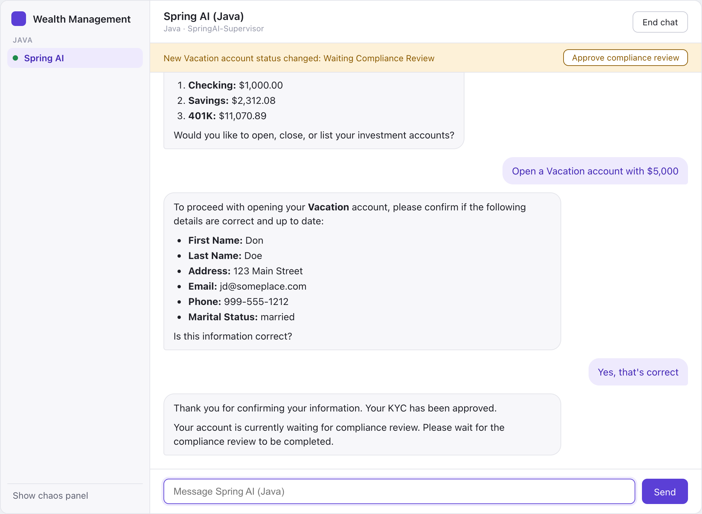
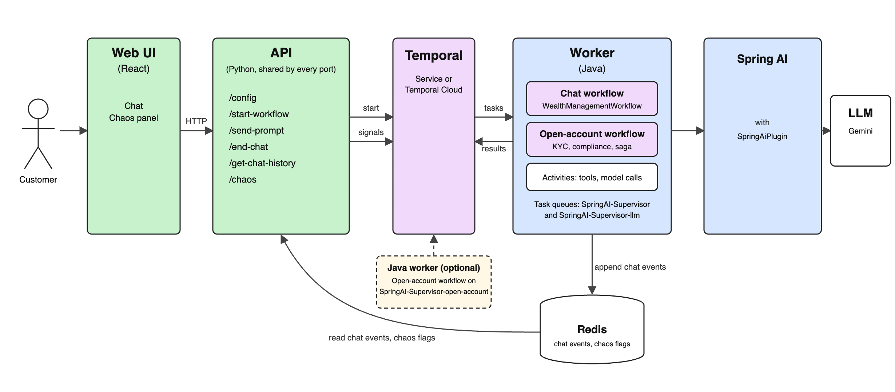
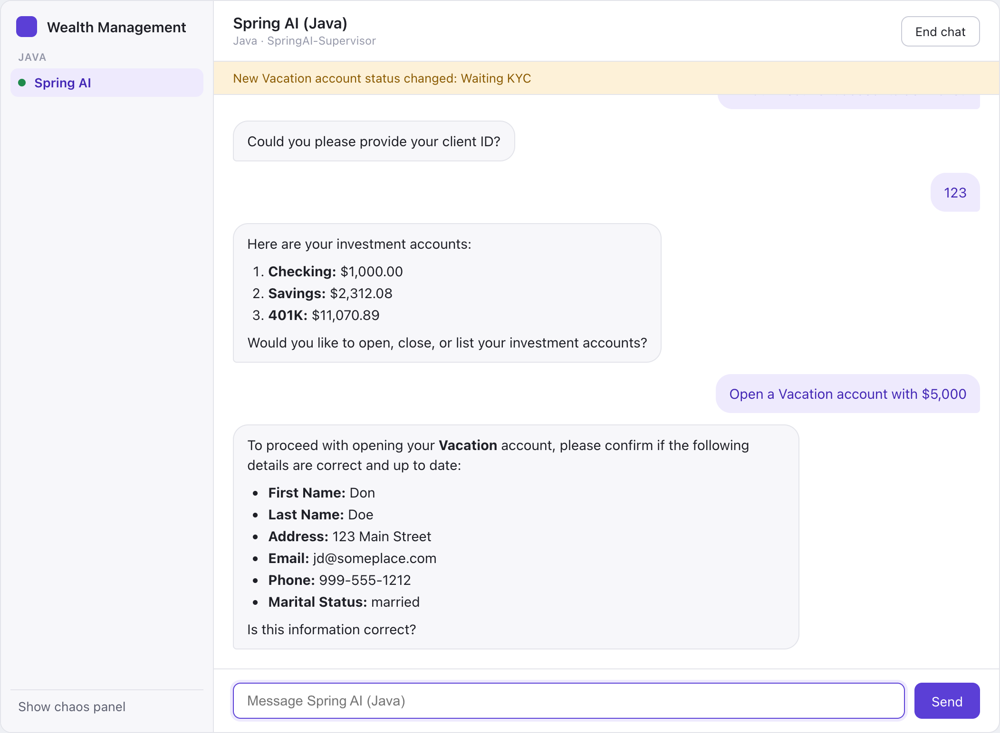
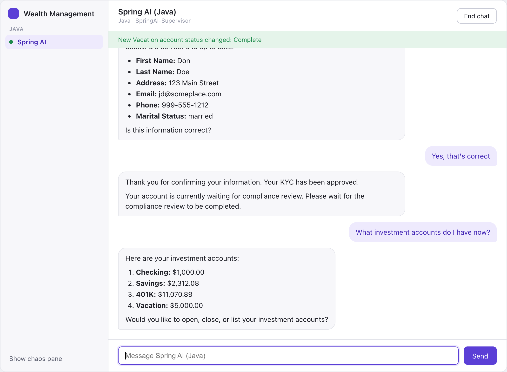
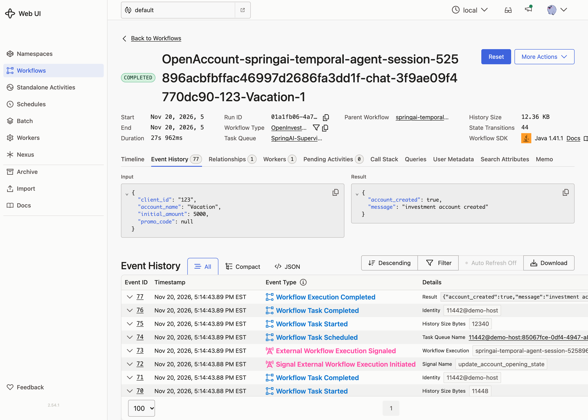

# Spring AI: Temporal version

In this version the four agents are [Spring AI](https://docs.spring.io/spring-ai/reference/) chat clients that
run inside a Temporal workflow, through Temporal's official Spring AI integration
([io.temporal:spring-ai](https://docs.temporal.io/develop/java/integrations/spring-ai), Public Preview). Every model
call and every tool call that touches a system is durable. A worker crash, a model outage or a tool outage pauses
the conversation instead of losing it, and Temporal resumes the turn where it stopped.

Each agent's chat model is the integration's `ActivityChatModel`, so every Gemini call runs as its chat model
activity, retried by Temporal. The tools are plain Spring AI `@Tool` methods, which the integration runs on the
workflow thread: the ones that touch a system run activities, and one starts the account-opening child workflow.
Prerequisites, building and the Gemini key are in the [framework README](../README.md).



## Architecture



* **The web UI and the API.** The web UI ([frontend/](../../../../frontend/README.md)) talks to the shared
  [API](../../../python/api/README.md), started with the `spring_ai` AI framework. The API starts a chat workflow
  per conversation (IDs `springai-temporal-agent-session-<session>-chat-<random>`), sends it the customer's messages, and serves the
  conversation from Redis.
* **The chat workflow** `WealthManagementWorkflow` runs for the whole conversation. Customer messages arrive
  as the `process_user_message` signal and are processed one at a time, each by the agents' turn loop. The
  conversation (messages, active agent, client ID, account openings) is workflow state, so it survives replay.
  After each turn, the reply is appended to the Redis list `events:<workflow ID>` by a local activity. A chat
  with no customer message and no account-opening status update for an hour ends by itself.
* **The open-account workflow** `OpenInvestmentAccountWorkflow` is a child workflow, one per account opening:
  KYC, compliance approval, then a saga. It reports each state change to the chat workflow with the
  `update_account_opening_state` signal.
* **The worker** ([WorkerApp.java](../src/main/java/io/temporal/demo/springai/worker/WorkerApp.java)) is a
  Spring Boot application. It gives the Gemini chat model to the integration's `SpringAiPlugin`, which registers
  the chat model activity, and runs two workers on one connection: the workflows and tool activities on
  `SpringAI-Supervisor`, and the model calls on `SpringAI-Supervisor-llm`, so they can be rate limited apart
  from the tools.
* **Redis** holds the chat's event stream that the web UI reads (through the API), the chaos flags, and,
  optionally, the claim check payloads.

### How the agents work

| Agent | Tools | Hands off to |
|---|---|---|
| Supervisor Agent | none | Beneficiary Agent, Investment Agent |
| Beneficiary Agent | `list_beneficiaries`, `add_beneficiary`, `delete_beneficiary` | Supervisor Agent |
| Investment Agent | `list_investments`, `close_investment` | Open Account Agent, Supervisor Agent |
| Open Account Agent | `open_new_investment_account`, `get_account_opening_status`, `get_current_client_info`, `approve_kyc`, `update_client_details` | Investment Agent |

* **An agent** is a Spring AI chat client, built with `TemporalChatClient.builder(...)`, with its own tools,
  which include its handoffs ([agents/Conversation.java](../src/main/java/io/temporal/demo/springai/agents/Conversation.java)).
  Its instructions ([agents/Prompts.java](../src/main/java/io/temporal/demo/springai/agents/Prompts.java)) are the
  same text as the other frameworks'.
* **The model** is the integration's `ActivityChatModel`, with activity options set in the workflow: the model
  task queue, a 60-second timeout per attempt and unlimited retries. Spring AI calls the model and runs the tools
  it asks for until the model answers; every call is the chat model activity `CallChatModel`.
* **The tools** ([workflows/ChatTools.java](../src/main/java/io/temporal/demo/springai/workflows/ChatTools.java))
  are plain `@Tool` methods, so the integration runs them on the workflow thread: they must be deterministic. A
  tool that touches a system runs an activity; `open_new_investment_account` starts the child workflow;
  `get_account_opening_status` and the KYC guard read the chat workflow's state, which signals update.
* **A handoff** is a `@Tool(returnDirect = true)` named `transfer_to_<agent_name>`. Spring AI has no multi-agent
  support, so the turn loop does it: the handoff tool records the next agent and, being return-direct, ends the
  agent's tool loop; the loop then gives the same customer message to the agent handed off to, so it answers in
  the same reply. After 5 handoffs in one message, the turn gives up with an apology.
* **The conversation** keeps the customer's messages and the agents' replies. Tool calls stay inside each turn,
  and what the agents must know later is in their notes: once a tool has used the client ID, every agent is told
  it, and every agent is told each account opening started in the chat and its current state. The system prompt
  is fixed for one agent's tool loop, so a note added by a tool reaches the next model call outside that loop.
* **Model failures**: Spring AI's own retries are off (`spring.ai.retry.max-attempts: 1`), so Temporal's retry
  policy decides. A worker interceptor around the chat model activity
  ([worker/ModelCallInterceptor.java](../src/main/java/io/temporal/demo/springai/worker/ModelCallInterceptor.java))
  injects the chaos panel's model failures and turns a 429 into a retry after 15 seconds.

## Running locally

Each command runs in its own terminal, from the repository root.

### Start Temporal and Redis

```bash
temporal server start-dev
```

```bash
redis-server
```

### Start the worker

```bash
./src/java/spring_ai/scripts/startlocalworker.sh
```

The first start downloads Gradle and the dependencies and compiles the worker, which takes a minute.

The worker polls `SpringAI-Supervisor` (`DEFAULT_TASK_QUEUE` in [TaskQueues.java](../src/main/java/io/temporal/demo/springai/common/TaskQueues.java)) for the
workflows and tools, and `SpringAI-Supervisor-llm` for the model calls, so it can run next
to other frameworks' workers. It sources `scripts/setgeminikey.sh` and, if it exists, `scripts/setclaimcheck.sh`.

### Start the API

```bash
./src/python/api/startlocalapi.sh spring_ai
```

The endpoints are in the [API README](../../../python/api/README.md).

### Start the web UI

```bash
cd frontend && npm install && npm start
```

Open http://localhost:3000 for the chat, and http://localhost:8233 for the Temporal UI.

### Approve compliance

The quickest way: while the status line says **Waiting Compliance Review**, click **Approve compliance review**
in it. The API (`POST /approve-compliance`) finds the chat's account openings that wait for review and sends
them the `compliance_approved` signal. To send the signal yourself, as a compliance system would, use the
script below.

Each account opening waits for compliance approval, which comes from outside the chat. The open-account
workflow ID is `OpenAccount-<chat workflow ID>-<client ID>-<account name>-<n>`, where `<n>` counts the
openings started in this chat (a refused request doesn't use up a number), for example
`OpenAccount-springai-temporal-agent-k3j9x2m1q8-123-College Fund-1`. Find it in the Temporal UI (a running
`OpenInvestmentAccountWorkflow`, child of the chat's `WealthManagementWorkflow`), or with:

```bash
temporal workflow list --query "WorkflowType='OpenInvestmentAccountWorkflow' AND ExecutionStatus='Running'"
```

Then approve it. Account names can contain spaces, so quote the ID:

```bash
./src/java/spring_ai/scripts/localsendcomplianceapproval.sh "<open-account workflow ID>"
```

### What you'll see

Waiting for the customer to confirm their details (KYC):



Waiting for compliance approval:


The account opened:



The open-account workflow in the Temporal UI:



### Resetting the demo data

Opening and closing accounts, changing client details during KYC, and adding or deleting beneficiaries
change the JSON files in [data/](../../../../data), which every framework shares and git tracks. To reset them:

```bash
git checkout data/
```

## How account opening works

1. The customer asks to open an account, for example "Open Vacation with $13,000". The Investment Agent
   hands off to the Open Account Agent, which calls `open_new_investment_account`.
2. The tool checks the deposit rules first (`validate_new_account`: $100 to $1,000,000). A refusal is a
   non-retryable error: it goes back to the agent, which explains it, and nothing is started.
3. The tool starts the child workflow `OpenAccount-<chat workflow ID>-<client ID>-<account name>-<n>`,
   on the chat's task queue or, with `java`, on `SpringAI-Supervisor-open-account`.
4. The child loads the client's details and moves to `Waiting KYC`. The agent shows the customer their
   details (`get_current_client_info`, which runs the child's `get_client_details` update). It approves
   KYC (`approve_kyc`, which sends `verify_kyc`) only after the customer confirms in a later message: the
   tool refuses in the turn the details were shown, or for an opening whose details weren't shown. If the
   customer changes a detail instead, `update_client_details` saves it and completes KYC.
5. Every state change is sent to the chat workflow with the `update_account_opening_state` signal. The
   chat workflow keeps the latest state of each opening and writes
   `New <account> account status changed: <state>` to the event stream, which the web UI shows. The agent
   reads the state with `get_account_opening_status`, never from memory.
6. The opening moves to `Waiting Compliance Review` and waits for the `compliance_approved` signal. The
   signal handlers wait for the steps before them, so an early signal is not lost or applied out of order.
7. The saga creates the account record (`open_investment`), transfers the deposit from the linked bank
   account (`debit_linked_account`), and registers the account with the custodian (`register_account`).
   If a step fails with a non-retryable error, the completed steps are undone in reverse order
   (`credit_linked_account`, then `remove_investment`) and the state ends with
   `Rolled back. The account was not opened: <reason>.` Transfer IDs include the workflow and run IDs,
   so a retried transfer never moves money twice. On success the state is `Complete`.
8. **Every request starts a new opening**, with its own KYC and compliance approval, even for an account
   name opened before in the same chat: opening "Vacation" twice gives `...-Vacation-1` and
   `...-Vacation-2`.

Ending the chat terminates any opening still running (`ParentClosePolicy.TERMINATE`).

## Java open-account worker (optional)

The open-account workflow can run on the shared
[Java worker](../../../../interop/open_account/java/README.md) instead. Start this framework's worker with the
argument `java`:

```bash
./src/java/spring_ai/scripts/startlocalworker.sh java
```

The open-account workflow then runs on `SpringAI-Supervisor-open-account`, and this worker doesn't register
it. Start the Java worker for this framework, so it polls that queue and calls this framework's activities:

```bash
TEMPORAL_TASK_QUEUE=SpringAI-Supervisor ./interop/open_account/java/startlocalworker.sh
```

The chat workflow, the tools and the model calls stay on this framework's worker; the open-account workflow
runs on the shared Java worker, and its activities (client details, the saga steps) still run on this
framework's worker. Any
other argument names the open-account task queue. On Temporal Cloud, use `startcloudworker.sh java` and
the Java worker's `startcloudworker.sh`.

## Failure scenarios (chaos panel)

Click **Show chaos panel** at the bottom of the web UI's sidebar to open the chaos panel. Activities and the model calls read
the flags from the Redis hash `chaos:<session>:flags` (your browser session's, found from the workflow ID;
see `common/Session.java`) on every attempt, so you can turn a failure on and off
mid-conversation with no restart. If Redis can't be reached, the flags read as off. Each injected failure
is logged to `chaos:<session>:events` and listed in the panel.

| Scenario | How to show it | What Temporal does |
|---|---|---|
| Tool / API down | Turn on **Core banking API down**, ask to list your investments, wait, turn it off | Beneficiary and investment activities raise a connection error and are retried (at most 5 s apart) until the flag is off. The reply waits mid-turn: nothing is lost or asked again. |
| LLM down | Turn on **LLM API down** and send a message | Every model call raises a connection error. The chat model activity is retried (at most 10 s apart) and the turn resumes where it stopped. |
| LLM rate limited | Turn on **LLM rate limited (429)** and send a message | The model call fails with a next retry delay of 15 s, which overrides the backoff like a `Retry-After` header. A real 429 from Gemini is handled the same way. |
| Proactive rate limit | Restart the worker with `LLM_MAX_CALLS_PER_SECOND=0.2` set and chat in several tabs | The model calls run on `SpringAI-Supervisor-llm`, which the Temporal service rate limits across all workers. Calls queue up instead of hitting Gemini's limit. |
| Business rule | Open an account with under $100 or over $1,000,000 | `validate_new_account` fails on the first attempt, non-retryably, and the agent explains why. No opening is started. |
| Saga rollback | Turn on **Custodian rejects new accounts** (and **Slow account-opening steps**), then open an account through compliance approval. Without flags: as client 123, open an account with $300,000 (the linked bank account holds $250,000) | `register_account` (or the debit) fails non-retryably. The saga refunds the deposit, then removes the account record. With slow steps on (4 s per step), you can kill the worker mid-saga and restart it. |
| Bug in workflow code | Turn on **Bug in workflow code** and open an account through compliance approval | New openings get the `WELCOME-BONUS` promo code, whose code path has a bug. The workflow task fails, not the workflow: it stays Running with its state, and Temporal retries the task. |

Notes:

* The flags live in Redis, so every worker using that Redis sees them. To avoid disturbing someone else's
  demo, use a different Redis or Temporal service.
* Tool and model retries are unlimited, so a wrong Gemini key or model name stalls a turn instead of
  failing it. Check the pending activity in the Temporal UI.
* If you change which activities or child workflows a workflow runs, end the chats started on the old
  code; they would fail on replay.

### Bug in workflow code

After compliance approval, the welcome-bonus calculation in `welcomeBonus`
([workflows/OpenInvestmentAccountWorkflowImpl.java](../src/main/java/io/temporal/demo/springai/workflows/OpenInvestmentAccountWorkflowImpl.java))
looks up the promo code `WELCOME-BONUS` in `BONUS_RATES`, which is keyed by `WELCOME_BONUS` (underscore), and
unboxing the missing rate throws a `NullPointerException`. The workflow task fails, not the workflow: it stays
Running, and the Temporal UI shows the stack trace.

Turning the flag off doesn't unstick an opening that already has the promo code, since it is part of the
workflow's input. To fix it, edit the lines marked `*** Bug-In-Workflow-Code ***`: uncomment the fixed
`BONUS_RATES` line and comment out the buggy one. Then restart the worker (with `scripts/startdemo.sh`,
`startdemo.sh restart spring_ai`), which compiles the fix as it starts. On the next workflow task retry, the
workflow resumes and opens the account with the bonus (1% of the deposit, up to $500). To re-arm the demo,
`git checkout` the file.

## Claim check (optional)

With claim check on, Temporal never sees the demo's data: every payload is stored in Redis under a new UUID,
and Temporal stores only the UUID. This framework uses the same Java codec as the
[Java open-account worker](../../../../interop/open_account/java/README.md), copied into
[claimcheck/](../src/main/java/io/temporal/demo/springai/claimcheck), in the format every framework reads.

To turn it on, make sure Redis is running and copy the example file:

```bash
cp scripts/setclaimcheck.example scripts/setclaimcheck.sh
```

The worker scripts source `scripts/setclaimcheck.sh` if it exists. Every component must agree on whether claim
check is on, so restart them all after creating or deleting it. To see claim-checked payloads in the Temporal UI,
run another framework's codec server, such as `./src/python/pure/durable/startcodecserver.sh`: they all read
the same format.

## Running on Temporal Cloud

The cloud scripts read the connection settings from `scripts/setcloudenv.sh`, which git ignores. Copy the
example and fill in your namespace, with either an mTLS client certificate and key or an API key:

```bash
cp scripts/setcloudenv.example scripts/setcloudenv.sh
```

Java's TLS needs an mTLS client key in unencrypted PKCS8 format; the cloud script says how to convert one.
Then start the worker and the API against Temporal Cloud (Redis and the web UI run locally as before):

```bash
./src/java/spring_ai/scripts/startcloudworker.sh
```

```bash
./src/python/api/startcloudapi.sh spring_ai
```

To approve an account opening, find its workflow ID in the Temporal Cloud UI (https://cloud.temporal.io)
and run:

```bash
./src/java/spring_ai/scripts/cloudsendcomplianceapproval.sh "<open-account workflow ID>"
```

Each script prints the address and namespace it connects to, and stops with instructions if
`setcloudenv.sh` is missing. `startcloudworker.sh` takes the same optional `java` argument as
`startlocalworker.sh`. The connection uses Temporal's
[environment configuration](https://docs.temporal.io/develop/environment-configuration). The connection
settings were checked to load for both mTLS and an API key, but this framework hasn't been run end to end on
Temporal Cloud.

## Environment variables

| Variable | Default | Purpose |
|---|---|---|
| `GEMINI_API_KEY` (or `GOOGLE_API_KEY`) | none | The Gemini key (`scripts/setgeminikey.sh`) |
| `GEMINI_MODEL` | `gemini-3.8-flash` | The Gemini model the agents use |
| `TEMPORAL_ADDRESS` | `127.0.0.1:7233` | Temporal service address |
| `TEMPORAL_NAMESPACE` | `default` | Temporal namespace |
| `TEMPORAL_TLS_CLIENT_CERT_PATH` / `TEMPORAL_TLS_CLIENT_KEY_PATH` | none | mTLS client certificate and key for Temporal Cloud (`scripts/setcloudenv.sh`); the key must be PKCS8, or set `TEMPORAL_KEY_PKCS8_PATH` to a converted copy |
| `TEMPORAL_API_KEY` | none | API key for Temporal Cloud, instead of mTLS (`scripts/setcloudenv.sh`) |
| `TEMPORAL_TASK_QUEUE` | `SpringAI-Supervisor` | Task queue of the chat workflow, its tools and, by default, the open-account workflow |
| `TEMPORAL_TASK_QUEUE_OPEN_ACCOUNT` | the chat queue | Task queue of the open-account workflow. `java` means `SpringAI-Supervisor-open-account`, the Java worker's queue for this framework (set by `startlocalworker.sh java`) |
| `TEMPORAL_TASK_QUEUE_LLM` | `<TEMPORAL_TASK_QUEUE>-llm` | Task queue of the model calls |
| `LLM_MAX_CALLS_PER_SECOND` | unlimited | Dispatch rate limit for model calls, across all workers |
| `REDIS_URL` | none | `redis://:<password>@<host>:<port>/<db>`; wins over the three below (the scripts pass it to Spring as `SPRING_DATA_REDIS_URL`) |
| `REDIS_HOST`, `REDIS_PORT`, `REDIS_PASSWORD` | `localhost`, `6379`, none | Redis for the event stream, the chaos flags and claim check |
| `DATA_DIR` | the `data/` folder above the working directory | Where the sample data files are |
| `DEMO_DATA_STORE` | `file` | Where the sample data (`data/*.json`) lives: `file` uses the files themselves; `redis` gives each browser session its own copy in Redis (`data:<session>:<name>`, starting from the files, expiring a day after its last change), for a shared demo |
| `USE_CLAIM_CHECK` | `false` | Store payloads in Redis and send Temporal only their IDs (`scripts/setclaimcheck.sh`) |
| `CLAIM_CHECK_TTL_SECONDS` | `604800` (7 days) | How long Redis keeps claim-checked payloads; `0` keeps them forever. A workflow needs its payloads to replay, and the Temporal UI to show its history, so keep it well beyond how long a chat runs |

The API has its own settings; see the [API README](../../../python/api/README.md).

## Tests

The tests need nothing running: no Gemini key, no Redis and no Temporal service. They use Temporal's test server,
stub activities, and a scripted chat model given to the real `SpringAiPlugin` in place of Gemini
([ScriptedChatModel.java](../src/test/java/io/temporal/demo/springai/ScriptedChatModel.java)).

```bash
cd src/java/spring_ai && ./gradlew test
```

| Test class | Checks |
|---|---|
| `ChatWorkflowTest` | The real chat workflow through the real plugin: a handoff and a tool call answer the same message, every model call is the chat model activity on `SpringAI-Supervisor-llm` while the tool runs on the chat queue, the next message starts at the agent that answered last and is told the client ID; `approve_kyc` refuses until this opening's details were shown in an earlier turn |
| `OpenAccountWorkflowTest` | The saga, its rollback in reverse after a custodian rejection, and the workflow bug pausing the workflow instead of failing it |
| `CommonTest` | The data store keeps the files exactly as the Python frameworks write them, transfers are idempotent and can't overdraw, client updates, the session from a workflow ID, money formatting and the open-account queue rule |

## Temporal contracts

The API, the web UI, the scripts and the Java worker rely on these names and payloads.

**Chat workflow** `WealthManagementWorkflow` (no input), on `SpringAI-Supervisor`:

| Kind | Name | Payload |
|---|---|---|
| Signal | `process_user_message` | `{user_input}` |
| Signal | `update_account_opening_state` | `{account_name, state, workflow_id}` |
| Signal | `end_workflow` | none |
| Query | `get_chat_history` | returns a list of `{user_prompt, text_response, json_response, agent_trace}` |

Each turn's `{user_prompt, text_response, json_response, agent_trace}` and each status update `{status}`
are appended to the Redis list `events:<chat workflow ID>`, which the API serves to the web UI.

**Open-account workflow** `OpenInvestmentAccountWorkflow`, input
`{client_id, account_name, initial_amount, promo_code}`, result `{account_created, message}`, workflow ID
`OpenAccount-<chat workflow ID>-<client ID>-<account name>-<n>`:

| Kind | Name | Payload |
|---|---|---|
| Signal | `verify_kyc` | none |
| Signal | `compliance_approved` | none |
| Query | `get_current_state` | returns the state string |
| Update | `get_client_details` | returns the client record (name, address, phone, email, marital status) |
| Update | `update_client_details` | the changed fields; returns a message and completes KYC |

**Activities:** `list_beneficiaries`, `add_beneficiary`, `delete_beneficiary`, `list_investments`,
`validate_new_account`, `find_promotion`, `open_investment`, `remove_investment`, `close_investment`,
`debit_linked_account`, `credit_linked_account`, `register_account`, `get_client`, `add_client`,
`update_client`, `get_current_client_info`, `update_client_details`, `approve_kyc`,
`append_chat_interaction`, `append_status_update` and `delete_conversation` on `SpringAI-Supervisor`, and
the integration's chat model activity `CallChatModel` on `SpringAI-Supervisor-llm`. The Java open-account workflow calls the client and saga
activities by these names.

## Framework notes

* The chat workflow deletes any earlier conversation stored in Redis under its ID when it starts, since the web
  UI can reuse chat IDs.
* Each chat runs in a single workflow run. A production system would need continue-as-new for long
  conversations (see the TODO in
  [WealthManagementWorkflowImpl.java](../src/main/java/io/temporal/demo/springai/workflows/WealthManagementWorkflowImpl.java)).
* The integration is in Public Preview. It doesn't support streaming, which the demo doesn't use.
* The worker builds its workers with the plain Temporal SDK rather than the Temporal Spring Boot starter, so it
  can give the plugin the Gemini model and add the model call interceptor. The integration's own Spring
  auto-configuration is excluded.
* This framework has Java versions of the shared pieces the other languages have in their `common/` folders: the
  data store (file or per-session Redis copies), the event stream, the chaos flags, sessions and the task queue
  rule, in [common/](../src/main/java/io/temporal/demo/springai/common), with the same Redis keys and file
  formats.
* The [standalone version](standalone.md) runs the same agents and turn loop as a command-line chat with a
  plain Spring AI chat client and no Temporal.
