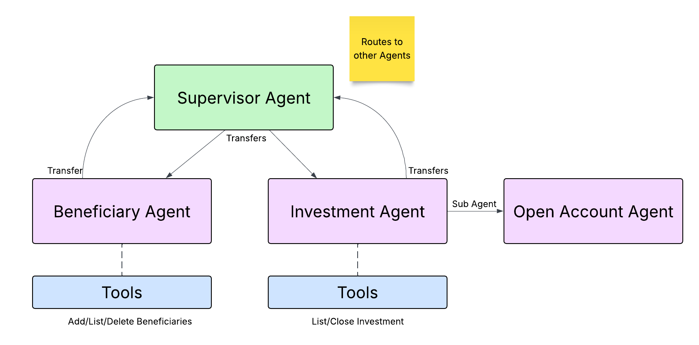

# Wealth Management Agent Example using Google ADK
Demonstrates how to use [Google ADK](https://adk.dev/) using subagents and instructions to delegate to other agents. 
Shows an example of just using the Google ADK and another version that leverages [Temporal](https://temporal.io) to 
wrap the agentic flow with Temporal and make it durable. 



This framework was imported from [temporal-sa/adk-wealth-management](https://github.com/temporal-sa/adk-wealth-management)
(up to its parity round 2, before it was adapted for hosting). It shares `src/python/common`, the
[API](../api/README.md), the [web application](../../../frontend/README.md), the
[Java worker](../../../interop/open_account/java/README.md) and `data/` with the other frameworks. Its own code:

| Folder | What it is |
|---|---|
| `standalone/` | The Google ADK version without Temporal |
| `durable/` | The Temporal version: workflows, activities, worker and scripts |
| `prompts/` | The agents' instructions, and the callback that remembers the client ID (`client_id_memory.py`) |
| `tests/` | The framework's tests |

Its chat workflows run on the `ADK-Supervisor` task queue by default (`DEFAULT_TASK_QUEUE` in
`durable/task_queues.py`), so its worker can run next to another framework's. Start the API for it with
`./startlocalapi.sh google_adk`; the web app then names its chats `adk-temporal-agent-<random>`.

Scenarios currently implemented include
* Add Beneficiary - add a new beneficiary to your account
* List Beneficiaries - shows a list of beneficiaries and their relationship to the account owner
* Delete Beneficiary - delete a beneficiary from your account
* Open Investment Account - opens a new investment account - using a **child workflow** in the Temporal version. 
  The child workflow can optionally run in [Java](../../../interop/open_account/java/README.md), showing a polyglot (Python + Java) application.
* List Investments - shows a list of accounts and their current balances
* Close Investment Account - closes an investment account
* Off-topic questions - anything not about beneficiaries or investment accounts is politely declined by the
  supervisor agent (handled in the agents' prompts)

The Google ADK only version opens accounts directly with a simple tool (no KYC, compliance review or saga).

The Temporal version also has a **Chaos Panel** that injects failures at runtime (API and LLM outages,
rate limits, a saga rollback, a bug in workflow code) to show how Temporal handles them. See
[Failure Scenarios](durable/README.md#failure-scenarios-chaos-panel).

You can run through the scenarios with the Temporal version using the shared web application in `frontend/`
(see [Running the Demo](durable/README.md#running-locally)).

## Prerequisites

* [uv](https://docs.astral.sh/uv/) - Python package and project manager
* Python 3.14 or later (`requires-python` in `pyproject.toml`; uv can install it for you)
* [Google / Gemini Key](https://console.cloud.google.com/apis/credentials) or [AI Studio](https://aistudio.google.com/api-keys) - Your key to access Gemini models
* [Temporal CLI](https://docs.temporal.io/cli#install) - Local Temporal service (Temporal version)
* [Redis](https://redis.io/downloads/) - Stores conversation history and status updates (Temporal version)
* [Node.js](https://nodejs.org/) and npm - Runs the web frontend (Temporal version)
* Java JDK 25 - optional, only to run the Open Account workflow in [Java](../../../interop/open_account/java/README.md) (the Gradle wrapper is included, no separate Gradle install)

## Set up Python Environment
```bash
cd src/python/google_adk
uv sync
```

## Set up your Gemini API Key

From the repository root:

```bash
cp scripts/setgeminikey.example scripts/setgeminikey.sh
chmod +x scripts/setgeminikey.sh
```

Now edit `scripts/setgeminikey.sh` and paste in your Gemini API Key.
It should look something like this:
```text
export GEMINI_API_KEY="Your API Key Goes Here"
```

## Getting Started

* Google ADK only: [standalone/README.md](standalone/README.md)
* Temporal version: [durable/README.md](durable/README.md)
* Open Account workflow in Java: [interop/open_account/java/README.md](../../../interop/open_account/java/README.md)
* API used by the web application: [src/python/api/README.md](../api/README.md)
* Web application: [frontend/README.md](../../../frontend/README.md)

## Resetting the Demo Data

Both versions keep the demo data in JSON files in `data/` and change them as you go (opening and closing
accounts, adding and deleting beneficiaries, and, in the Temporal version, moving money from the linked bank
account). To put everything back, run this in the repository root:

```bash
git checkout data/
```

## Running the Tests

The Python tests start a local Temporal dev server, which is downloaded on the first run.

```bash
cd src/python/google_adk
uv run pytest                                      # Python: the supervisor workflow with a scripted model (no Gemini key or Redis needed)
durable/startlocalopenaccount.sh                   # Manual: the open-account workflow on its own against a running Temporal (no Gemini key; changes data/)
source ../../../scripts/setgeminikey.sh && LIVE_TEST_RUNS=10 uv run pytest tests/live_agent_handoffs.py -s   # Live agent-handoff test (calls the paid Gemini API)
```

The Java open-account workflow (`cd interop/open_account/java && ./gradlew test`) and the web application
(`cd frontend && npm install && CI=true npm test`) have their own tests.
