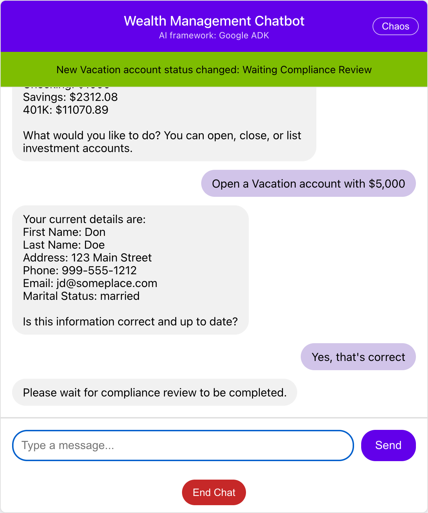
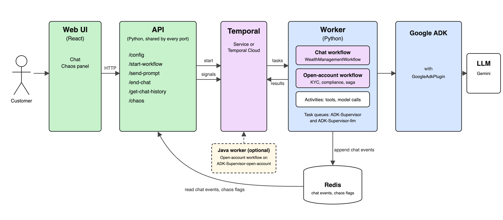
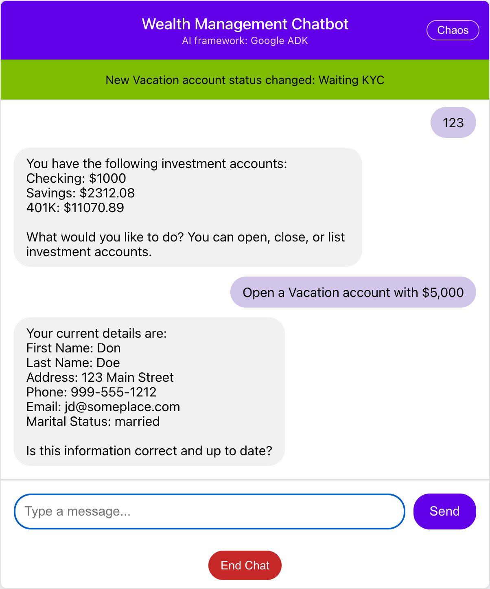
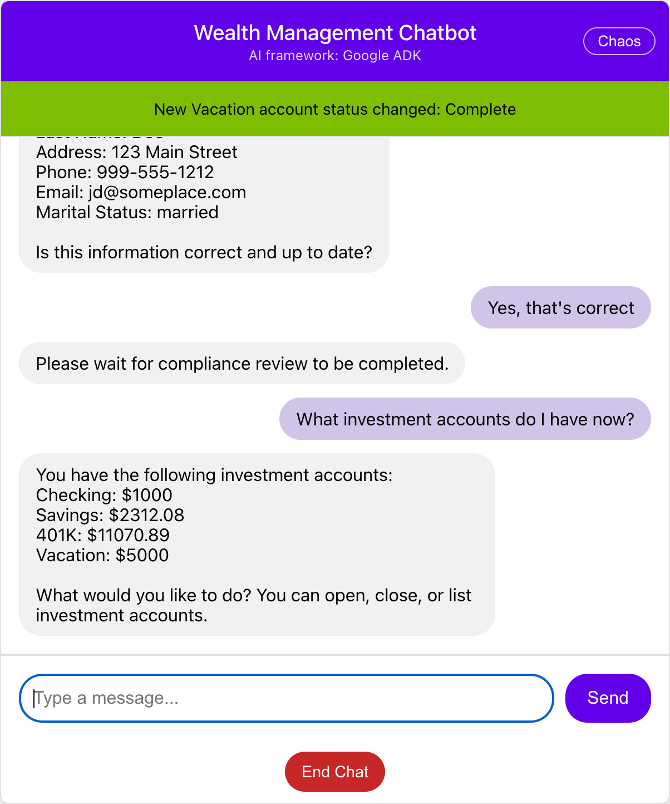
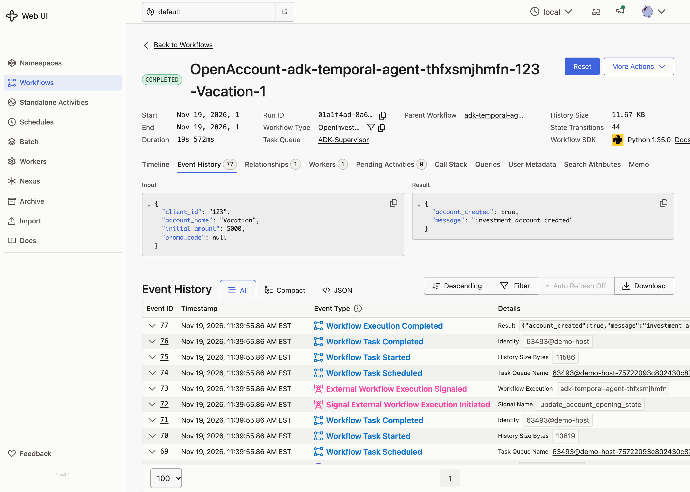
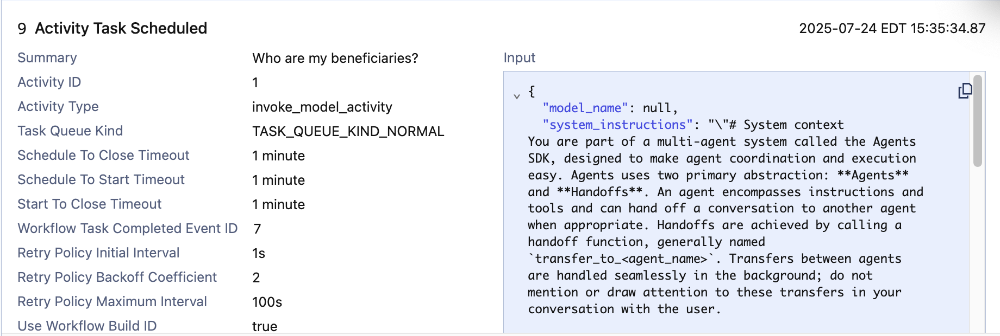
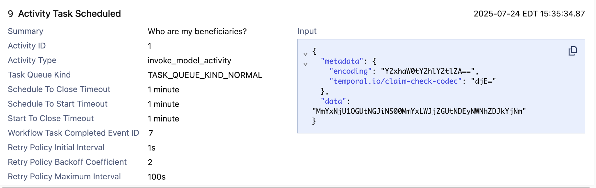

# Google ADK (Python): Temporal version

This is the [Google ADK](https://adk.dev/) wealth management assistant running inside a Temporal
workflow. The ADK agents and runner run in the chat workflow, and every model call and tool call is a
Temporal activity, so each step is recorded in the workflow history and survives crashes, restarts and
outages. The integration is Temporal's Google ADK plugin (`temporalio.google_adk`): `GoogleAdkPlugin` on
the client and worker, and a `TemporalModel` for each agent that runs its model calls as activities.

Setup (Python, dependencies and the Gemini key in `scripts/setgeminikey.sh`) is in the
[port's README](../README.md). The version without Temporal is in [standalone/](../standalone/README.md).



## Architecture



- **Web UI and API.** The customer chats in the shared web UI ([frontend/](../../../../frontend/README.md)).
  It calls the shared [API](../../api/README.md), started with the argument `google_adk`, which starts chat
  workflows named `adk-temporal-agent-<random>` and sends them the customer's messages as signals.
- **Chat workflow** (`WealthManagementWorkflow`, `workflows/supervisor_workflow.py`). It builds the ADK
  agents and a `Runner` with an `InMemorySessionService` inside the workflow, and runs one turn of the
  agents per customer message. Agents hand the conversation to each other with ADK's `transfer_to_agent`
  (see [How the agents work](#how-the-agents-work)). Each agent's `TemporalModel` runs its model calls as
  activities on the LLM task queue; tools call activities on the main task queue.
- **Open-account workflow** (`OpenInvestmentAccountWorkflow`, `workflows/open_account_workflow.py`). A child
  workflow that runs KYC, waits for compliance approval and then runs a saga to create, fund and register
  the account. It can also run in Java.
- **Worker** (`run_worker.py`). Polls two task queues: `ADK-Supervisor` for the workflows and tools, and
  `ADK-Supervisor-llm` for the model calls, so model calls can be rate limited on their own.
- **Redis.** Holds the chat's event stream (messages and account-opening status updates) that the web UI
  reads through the API, the chaos flags, and, if turned on, the claim check payloads.

The chat keeps the whole conversation in one workflow run. A production version would need
continue-as-new for long conversations (see the TODO in `workflows/supervisor_workflow.py`).

### How the agents work

The agents are ADK `LlmAgent`s arranged as sub-agents (`init_agents` in `workflows/supervisor_workflow.py`).
An agent hands off by calling ADK's `transfer_to_agent` tool, and the agent it transfers to answers in the
same turn. The transfers match the OpenAI Agents SDK port's handoffs:

| Agent | Can transfer to | Tools |
|---|---|---|
| Supervisor Agent | Beneficiary Agent, Investment Agent | none |
| Beneficiary Agent | Supervisor Agent | `list_beneficiaries`, `add_beneficiary`, `delete_beneficiary` |
| Investment Agent | Open Account Agent, Supervisor Agent | `list_investments`, `close_investment` |
| Open Account Agent | Investment Agent | `open_new_investment_account`, `get_account_opening_status`, `get_current_client_info`, `approve_kyc`, `update_client_details` |

- **Model calls.** Each agent has its own `TemporalModel` for `gemini-2.5-flash`, which runs the call in the
  plugin's `invoke_model` activity on `ADK-Supervisor-llm`, with `LLM_RETRY_POLICY` and the agent's name as
  the activity summary. The worker registers `ChaosAwareGemini` (`model_config.py`) in ADK's model
  registry, so the chaos flags apply and a real Gemini 429 becomes a rate-limit error.
- **Tools.** Activities become tools through `_activity_tool` (`activities/activity_tool.py`), which keeps
  the activity's signature for ADK's schema and returns an error string to the model when the activity
  fails, instead of failing the chat. `add_beneficiary`, `update_client_details` and the open-account tools
  are plain functions that run in the workflow and call activities themselves. `tool_error_to_model`
  (`on_tool_error_callback`) also gives other tool errors to the model, but lets cancellation and Temporal's
  internal errors through.
- **Client ID.** `remember_client_id` (`prompts/client_id_memory.py`, a `before_tool_callback`) saves the
  client ID in ADK session state the first time a tool gets it, and every agent's instructions read it back,
  so the customer is asked for it once.
- **Empty replies.** If the model ends a turn with no text, the workflow nudges it once, then falls back to
  a fixed reply, so the customer never sees an empty message.
- **Prompts.** Every agent's instructions start with `HANDOFF_PROMPT_PREFIX`. Off-topic questions are
  declined by the supervisor's instructions (`prompts/agent_constants.py`); there is no guardrail code.
- **Confirming a delete or close.** The agent confirms which beneficiary or account, asks the customer to
  confirm, and calls `delete_beneficiary` or `close_investment` only after the customer agrees. In this port
  that is done by the agents' instructions; there is no confirmation guard in code.

## Running locally

Each command runs in its own terminal, from the repository root.

### Start Temporal and Redis

```bash
temporal server start-dev
```

```bash
redis-server
```

### Start the worker

```bash
./src/python/google_adk/durable/startlocalworker.sh
```

The worker polls `ADK-Supervisor` and `ADK-Supervisor-llm`, so it can run next to other ports' workers on
the same Temporal service. The script stops if `scripts/setgeminikey.sh` doesn't exist, and sources
`scripts/setclaimcheck.sh` if it exists.

### Start the API

```bash
./src/python/api/startlocalapi.sh google_adk
```

The API listens on http://127.0.0.1:8000. Its endpoints are listed in the [API README](../../api/README.md).

### Start the web UI

```bash
cd frontend && npm install && npm start
```

The web UI opens at http://localhost:3000. Click
**Start Chat**, then use client ID `123` or `234`.

### Approve compliance

Compliance approval is sent from a terminal; there is no button in the web UI. The open-account workflow's
ID is `OpenAccount-<chat workflow ID>-<client ID>-<account name>-<n>`, where `<n>` counts the account
openings started in the conversation, this one included, for example
`OpenAccount-adk-temporal-agent-k3j9x2p1q8z-123-Vacation-1`. The web UI doesn't show it. Find the
**Running** `OpenInvestmentAccountWorkflow` in the [Temporal UI](http://localhost:8233) (a child of your
chat workflow), or list them:

```bash
temporal workflow list --query "WorkflowType='OpenInvestmentAccountWorkflow' AND ExecutionStatus='Running'"
```

Then send the approval:

```bash
./src/python/google_adk/durable/localsendcomplianceapproval.sh <child workflow ID>
```

Quote the ID if the account name contains spaces. If the customer opened the same account name more than
once, several may be running: the highest `<n>` is the latest request. If you send the signal before KYC
is done, the workflow holds it until KYC completes.

### What you'll see

Waiting for the customer to confirm their details (KYC):



Waiting for compliance approval:


The account opened:



The open-account workflow in the Temporal UI:



### Resetting the demo data

Opening and closing accounts, adding and deleting beneficiaries, changing client details during KYC, and
the saga's transfers (balances in `data/funding_accounts.json`) change the JSON files in `data/`. Restore
them from the repository root:

```bash
git checkout data/
```

## How account opening works

1. The customer asks to open an account. The supervisor transfers to the Investment Agent, which transfers
   to the Open Account Agent.
2. Its `open_new_investment_account` tool (`activities/open_account.py`) runs in the chat workflow. It runs
   `validate_new_account` (at least $100, at most $1,000,000); a violation is a non-retryable error, and the
   reason goes back to the agent. It then looks up any promotion (`find_promotion`) and starts
   `OpenInvestmentAccountWorkflow` as a child workflow with the ID
   `OpenAccount-<chat workflow ID>-<client ID>-<account name>-<n>`, and returns that ID.
3. Every request to open an account starts a new opening with its own KYC, even when an earlier opening
   with the same name is still in progress or has finished (for example after a rollback): two Vacation
   openings are `...-123-Vacation-1` and `...-123-Vacation-2`. A request refused by the business rules
   starts nothing and doesn't use up a number.
4. **KYC.** The child loads the client and waits in *Waiting KYC*. The agent calls `get_current_client_info`
   (the child's `get_client_details` update), shows the details and asks whether they are correct. **The
   KYC guard:** details count as shown only if the reply the customer sees contains the first name, last
   name and email, and `approve_kyc` (the `verify_kyc` signal) is refused until they were shown in an
   earlier turn and the customer has answered since. The guard is per opening: confirming one doesn't
   approve another. If something is wrong, `update_client_details` (an update) saves the changes and
   completes KYC.
5. **Status updates.** The child signals each state change to the chat workflow
   (`update_account_opening_state`). The web UI shows it as `New <account> account status changed: <state>`,
   and the agent reads it with `get_account_opening_status` rather than from the conversation history. For
   a finished opening the tool also tells the agent to start a new opening if the customer is asking again.
6. **Compliance approval.** The child waits in *Waiting Compliance Review* for the `compliance_approved`
   signal (see [Approve compliance](#approve-compliance)).
7. **Saga.** The child creates the account record (`open_investment`), transfers the deposit from the
   linked bank account (`debit_linked_account`) and registers the account with the custodian
   (`register_account`). If a step fails non-retryably, the completed steps are undone in reverse order
   (`credit_linked_account`, then `remove_investment`) and the state ends with *Rolled back*. Otherwise it
   ends with *Complete*.

Ending the chat terminates its pending openings (`ParentClosePolicy.TERMINATE`).

### Testing the open-account workflow on its own

`startlocalopenaccount.sh` runs `OpenInvestmentAccountWorkflow` without the chat, the API, the web UI or
the model (no Gemini key needed). It starts a worker in the background with `SKIP_AGENTS=True` (no
`GoogleAdkPlugin`), runs `run_open_account_workflow.py`, prints each state change (the `get_current_state`
query) and the result, and stops the worker when it finishes. It runs three scenarios for client `123`:

1. KYC approved (`verify_kyc`), then compliance approved.
2. Client details read (`get_client_details`) and changed (`update_client_details`, which completes KYC:
   client 123's last name becomes "Doenut"), then compliance approved.
3. KYC approved, then the workflow waits in *Waiting Compliance Review* until you send the approval
   yourself. The script prints the command, for example
   `./src/python/google_adk/durable/localsendcomplianceapproval.sh testing-open-account-<run>-3`.

Temporal must be running (Redis too, for the chaos flags; without it chaos is off).

```bash
./src/python/google_adk/durable/startlocalopenaccount.sh
```

With the argument `java`, the workflow runs on `ADK-Supervisor-open-account`, so the same scenarios run on
the Java worker (start it first; see [Java open-account worker](#java-open-account-worker-optional)):

```bash
./src/python/google_adk/durable/startlocalopenaccount.sh java
```

Further arguments go to `run_open_account_workflow.py`: `--scenario N` (repeatable) runs only some
scenarios, and `--amount X` sets the initial deposit, for example `--scenario 1 --amount 300000` to see the
saga roll back. Each run uses new workflow IDs (`testing-open-account-<run>-<scenario>`). It uses the same
connection and claim check settings as the worker. Like the demo, the scenarios change `data/*.json`.

## Java open-account worker (optional)

[interop/open_account/java](../../../../interop/open_account/java/README.md) has a Java version of
`OpenInvestmentAccountWorkflow` with the same states, updates, signals, saga and status updates. It calls
the Python activities by name on `ADK-Supervisor`. Start this port's worker with the argument `java`:

```bash
./src/python/google_adk/durable/startlocalworker.sh java
```

The chat workflow then starts the open-account workflow on `ADK-Supervisor-open-account`, and the Python
worker doesn't register its own version (it still runs all the activities). Start the Java worker for this
port (JDK 25):

```bash
TEMPORAL_TASK_QUEUE=ADK-Supervisor ./interop/open_account/java/startlocalworker.sh
```

Without the argument, everything runs in Python. On Temporal Cloud, use `startcloudworker.sh java` and the
Java worker's `startcloudworker.sh`.

## Failure scenarios (chaos panel)

Click **Chaos** in the chat header to open the chaos panel. Its switches inject failures at runtime: the
activities and the model read the flags from Redis on every attempt, so you can turn a failure on and off
mid-conversation without restarting anything. The panel lists each injected failure as it happens. Open
the [Temporal UI](http://localhost:8233) alongside it to show the pending activity, its attempt count and
the last failure. **Reset all** turns every flag off. The flags (Redis keys `chaos:flags` and
`chaos:events`) are shared by every port using the same Redis.

| Scenario | How to show it | What Temporal does |
|---|---|---|
| Tool / API down | Turn on *Core banking API down*, then ask to list your investments (or open an account, so it fails after compliance approval). Turn it off. | The activity retries (1s backoff, capped at 5s) for as long as the outage lasts. The agent waits mid-turn and answers once the API is back. |
| LLM down | Turn on *LLM API down* and send a message. Turn it off. | The model call is an activity, so it retries the same way (capped at 10s). The conversation picks up where it was. |
| LLM rate limited (reactive) | Turn on *LLM rate limited (429)* and send a message. | The model raises an `ApplicationError` with `next_retry_delay` (15s, like a `Retry-After` header), which overrides the retry policy's backoff. Real Gemini 429s (`RESOURCE_EXHAUSTED`) get the same error from `ChaosAwareGemini`. |
| LLM rate limited (proactive) | Start the worker with `LLM_MAX_CALLS_PER_SECOND=0.2 ./src/python/google_adk/durable/startlocalworker.sh`, then chat in several browser tabs at once. | Model calls run on `ADK-Supervisor-llm`. The Temporal service dispatches at most that many per second across all workers, so calls queue up instead of hitting the provider's limit. Tools aren't slowed down. |
| Business rule (non-retryable) | Ask to open an account with $2,000,000 (or less than $100). | `validate_new_account` raises a non-retryable `ApplicationError`: one attempt, no retries. The agent explains the reason. |
| Saga | Turn on *Custodian rejects new accounts* (and *Slow account-opening steps* to watch), then open an account through compliance approval. Without flags: as client `123`, open an account with $300,000 (the linked bank account has $250,000). | The completed steps are undone in reverse order (refund, then remove the account). Compensations are activities, so they are retried until they succeed; kill the worker mid-rollback and it still finishes. |
| Bug in workflow code | Turn on *Bug in workflow code*, then open an account through compliance approval. | The workflow pauses at the failing line, keeping its state, until a worker with fixed code picks it up. See below. |

Transfers are idempotent: the transfer ID is `<child workflow ID>-<run ID>-initial-deposit` (refunds add
`-refund`), so a retried debit or refund never moves money twice. All the scenarios work the same with the
Java open-account workflow, because it calls the same Python activities and model activity.

### Bug in workflow code

While **Bug in workflow code** is on, `find_promotion` gives new openings the `WELCOME-BONUS` promo code,
which is part of the open-account workflow's input. The welcome-bonus path (`_welcome_bonus` in
`workflows/open_account_workflow.py`) reads `inputs.initial_deposit`, a field that doesn't exist. Right
after compliance approval it raises `AttributeError`. In the Python SDK this fails the workflow task, not
the workflow, so the workflow stays **Running** with the compliance approval intact, and the Temporal UI
shows the failing workflow task and its stack trace. Other chats and openings without the promo code keep
working.

Turning the switch off doesn't help, because the promo code is in the workflow's input. Fix the code:
change `inputs.initial_deposit` to `inputs.initial_amount` and restart the worker. The workflow resumes on
the next workflow-task retry (these back off up to 10 minutes; a fix within a couple of minutes resumes
within about a minute) and opens the account with the bonus. Re-arm the bug afterwards:

```bash
git checkout src/python/google_adk/durable/workflows/open_account_workflow.py
```

In the Java version, `BONUS_RATES` in `OpenInvestmentAccountWorkflowImpl.java` is keyed by `WELCOME_BONUS`
instead of `WELCOME-BONUS`, so `welcomeBonus` throws a `NullPointerException`; the fix is the commented-out
line above it (see the [Java README](../../../../interop/open_account/java/README.md)).

## Claim check and codec server (optional)

The [claim check pattern](https://www.enterpriseintegrationpatterns.com/patterns/messaging/StoreInLibrary.html)
stores each payload sent to Temporal (workflow and activity inputs and results, signals, updates, model
calls) in Redis and sends only its ID. A
[custom payload codec](https://docs.temporal.io/develop/python/converters-and-encryption#custom-payload-codec)
(`src/python/common/claim_check/`) does the substitution. The worker and the open-account activities'
clients always add `ClaimCheckPlugin`, which adds the codec only when `USE_CLAIM_CHECK=true`. To turn it on:

```bash
cp scripts/setclaimcheck.example scripts/setclaimcheck.sh
```

The worker, API, compliance approval, open-account scenarios, codec server and Java worker scripts source
it if it exists. Every component must agree: a client without the codec can't read claim-checked
payloads. Redis must be running, and every payload costs a round trip to it, so a production deployment
needs a highly available store.

With claim check on, the Temporal UI shows only IDs. To see the payloads, start the codec server
(http://127.0.0.1:8081; it stops if `scripts/setclaimcheck.sh` doesn't exist):

```bash
./src/python/google_adk/durable/startcodecserver.sh
```

Open the Temporal UI at exactly http://localhost:8233 (not 127.0.0.1; the codec server accepts requests
only from there and from https://cloud.temporal.io). Click the glasses icon in the upper right, choose "Use
my browser setting and ignore Cluster-level setting", enter `http://127.0.0.1:8081` with no trailing
spaces, turn off "Pass the user access token" and "Include cross-origin credentials", and click **Apply**.






## Running on Temporal Cloud

Redis still runs locally. Create the cloud settings file and fill in your namespace and address, and
either the mTLS certificate paths or `TEMPORAL_API_KEY` (with the `<region>.<cloud>.api.temporal.io:7233`
address):

```bash
cp scripts/setcloudenv.example scripts/setcloudenv.sh
```

Start the worker and the API (the web UI starts as before). The worker script stops if
`scripts/setcloudenv.sh` or `scripts/setgeminikey.sh` doesn't exist.

```bash
./src/python/google_adk/durable/startcloudworker.sh
```

```bash
./src/python/api/startcloudapi.sh google_adk
```

Send the compliance approval with the cloud script, and find the workflow ID in the Temporal Cloud UI:

```bash
./src/python/google_adk/durable/cloudsendcomplianceapproval.sh <child workflow ID>
```

For the Java open-account worker, start the worker with `startcloudworker.sh java` and the Java worker with
`TEMPORAL_TASK_QUEUE=ADK-Supervisor ./startcloudworker.sh`.

## Environment variables

| Variable | Default | Purpose |
|---|---|---|
| `GEMINI_API_KEY` | required | Gemini API key for the worker (`scripts/setgeminikey.sh`) |
| `TEMPORAL_ADDRESS` | `127.0.0.1:7233` | Temporal service address |
| `TEMPORAL_NAMESPACE` | `default` | Temporal namespace |
| `TEMPORAL_API_KEY` | none | API key authentication |
| `TEMPORAL_TLS_CLIENT_CERT_PATH`, `TEMPORAL_TLS_CLIENT_KEY_PATH` | none | mTLS authentication |
| `TEMPORAL_PROFILE` | none | A profile from the Temporal SDK's [environment configuration](https://docs.temporal.io/develop/environment-configuration) file |
| `TEMPORAL_TASK_QUEUE` | `ADK-Supervisor` | Main task queue (workflows and tools); `DEFAULT_TASK_QUEUE` in `task_queues.py`. The worker, API and Java worker must agree |
| `TEMPORAL_TASK_QUEUE_LLM` | `<TEMPORAL_TASK_QUEUE>-llm` | Task queue for model calls |
| `TEMPORAL_TASK_QUEUE_OPEN_ACCOUNT` | `<TEMPORAL_TASK_QUEUE>` | Task queue for the open-account workflow. `java` means `<TEMPORAL_TASK_QUEUE>-open-account`; set by the worker scripts' argument. When it differs from the main queue, the Python worker doesn't register `OpenInvestmentAccountWorkflow` |
| `LLM_MAX_CALLS_PER_SECOND` | unset (no limit) | Most model calls per second dispatched from the LLM queue, across all workers |
| `SKIP_AGENTS` | `False` | `True` runs the worker without the `GoogleAdkPlugin` or the LLM queue (set by `startlocalopenaccount.sh`). The older name `SKIP_ADK_PLUGIN` still works |
| `REDIS_HOST`, `REDIS_PORT` | `localhost`, `6379` | Redis for the event stream, chaos flags and claim check payloads |
| `USE_CLAIM_CHECK` | `false` | `true` turns on the claim check codec (`scripts/setclaimcheck.sh`) |

The scripts pass the environment through, so you can prefix any of them, for example
`LLM_MAX_CALLS_PER_SECOND=0.2 ./src/python/google_adk/durable/startlocalworker.sh`.

## Tests

### Default tests

```bash
cd src/python/google_adk && uv run pytest
```

Nothing needs to be running: the tests use a scripted model and stub activities, so no Gemini key or Redis
is needed. The Temporal dev server is downloaded on the first run.

| File | Covers |
|---|---|
| `tests/test_chat_turns.py` | The client ID is asked for once and shared with every agent, empty replies are nudged then replaced, the status tool reports what the open-account workflow signalled, and every request to open an account starts a new opening with its own KYC |
| `tests/test_kyc_guard.py` | The KYC guard: approved only after the details were shown in a reply and the customer answered; one opening's confirmation doesn't approve another |
| `tests/test_tool_errors_and_handoffs.py` | A failing tool's error goes to the model and the chat carries on; the allowed transfers match the OpenAI Agents SDK port's handoffs |
| `tests/test_failure_scenarios.py` | Saga rollback, a new transfer ID per run, idempotent transfers, business rules, tool and LLM outages, rate limits (chaos and real 429s), the workflow bug |
| `tests/test_api_client.py` | The shared API's calls against the real chat workflow |
| `tests/test_off_topic_prompt.py` | Off-topic questions are declined by the supervisor's instructions; every agent starts with the handoff prefix |

The Java workflow has its own tests; see the [Java README](../../../../interop/open_account/java/README.md).

### Live tests

These run the real `WealthManagementWorkflow` against the real Gemini model, so they call the paid API.
pytest doesn't collect them by default (they aren't named `test_*.py`), and they are skipped when
`GEMINI_API_KEY` isn't set. The Redis event stream and chaos flags are stubbed, so no Redis is needed.
`LIVE_TEST_RUNS=<n>` repeats each conversation n times (default 1). Run them from `src/python/google_adk`.

```bash
cd src/python/google_adk && source ../../../scripts/setgeminikey.sh && uv run pytest tests/live_agent_handoffs.py -s
```

Agent handoffs: the customer asks for their beneficiaries, gives client ID `123`, then asks for their
investments. It checks that the beneficiaries (John, Jane, Joan) are listed, and that in the same turn the
Beneficiary Agent hands off to the supervisor, which hands off to the Investment Agent, so the reply lists
Checking, Savings and 401K without mentioning a transfer or asking for the client ID again. It also checks
what each agent said, so an agent that announces the transfer fails even when a later reply hides it.

```bash
cd src/python/google_adk && source ../../../scripts/setgeminikey.sh && uv run pytest tests/live_repeat_opening.py -s
```

Repeat opening: the customer opens a Vacation account, confirms their details, and while that opening waits
for compliance review asks to open Vacation again. It checks that a second opening (`...-Vacation-2`)
starts and shows the client details for KYC again. Compliance is never approved and the activity that
writes client details is stubbed, so no data changes.

## Temporal contracts

| Workflow | Kind | Name | Payload |
|---|---|---|---|
| `WealthManagementWorkflow` | input | | none |
| | signal | `process_user_message` | `{"user_input": str}` |
| | signal | `update_account_opening_state` | `{"account_name": str, "state": str, "workflow_id": str}` |
| | signal | `end_workflow` | none |
| | query | `get_chat_history` | list of `{"user_prompt", "text_response", "json_response", "agent_trace"}` |
| `OpenInvestmentAccountWorkflow` | input | | `{"client_id": str, "account_name": str, "initial_amount": float, "promo_code": str or null}` |
| | result | | `{"account_created": bool, "message": str}` |
| | query | `get_current_state` | the current state, a string |
| | update | `get_client_details` | returns the client (`first_name`, `last_name`, `address`, `phone`, `email`, `marital_status`) |
| | update | `update_client_details` | a dict of the fields to change; completes KYC |
| | signal | `verify_kyc` | none |
| | signal | `compliance_approved` | none; waits until KYC is approved |

Activities, by name, on `ADK-Supervisor`: The model activity, `invoke_model`, runs on `ADK-Supervisor-llm`.

- Beneficiaries: `list_beneficiaries(client_id)`, `add_beneficiary({client_id, first_name, last_name, relationship})`, `delete_beneficiary(client_id, beneficiary_id)`.
- Investments: `list_investments(client_id)`, `close_investment(client_id, investment_id)`,
  `validate_new_account(client_id, account_name, initial_amount)`, `find_promotion(client_id)`,
  `open_investment({client_id, name, balance})`, `remove_investment(client_id, investment_id)`.
- Saga: `debit_linked_account` and `credit_linked_account(client_id, amount, transfer_id)`,
  `register_account(client_id, investment_id, amount)`.
- Clients and KYC: `get_client(client_id)`, `add_client(client)`, `update_client(client_id, fields)`, `get_current_client_info(workflow_id)`,
  `approve_kyc(workflow_id)`, `update_client_details(workflow_id, fields)`.
- Event stream (local activities): `append_chat_interaction`, `append_status_update`, `delete_conversation`,
  each taking the chat workflow ID (and the event).
