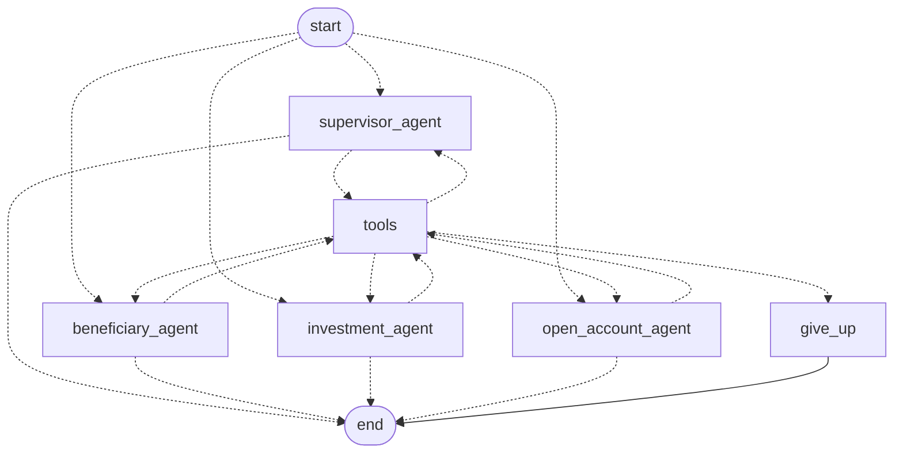

# Wealth Management Agent Demo: LangGraph

A multi-agent banking chat that shows what Temporal adds to an AI agent. A customer lists, adds
and deletes beneficiaries, and lists, opens and closes investment accounts. Opening an account
starts a child workflow with KYC, a human compliance approval and a saga.

This version uses [LangGraph](https://langchain-ai.github.io/langgraph/): the four agents are nodes
of one graph ([lg_agents/graph.py](lg_agents/graph.py)), the routing between them is the graph's
edges, and the model is Gemini through LangChain (`langchain-google-genai`). The Temporal version runs
the graph with Temporal's official LangGraph plugin,
[temporalio-langgraph](https://docs.temporal.io/develop/python/integrations/langgraph) (Public
Preview). It implements the same demo as the other frameworks and keeps their Temporal contracts, so
the same web UI, scripts and compliance tooling work with it.

It shares `src/python/common`, the [API](../api/README.md), the [web application](../../../frontend/README.md),
the [Java worker](../../../interop/open_account/java/README.md), `scripts/` and `data/` with the other frameworks.

Its chat workflows run on the `LangGraph-Supervisor` task queue by default (`DEFAULT_TASK_QUEUE` in
`durable/task_queues.py`), so its worker can run next to another framework's. Start the API for it with
`./startlocalapi.sh langgraph_agents`; the web app then names its chats
`langgraph-temporal-agent-session-<session>-chat-<random>`. The folder isn't named `langgraph`, so it can
never hide the real library.

The demo is implemented twice:

* **[Standalone](standalone/README.md)**: the same graph as a command-line chat, with plain LangGraph
  and no Temporal. Accounts are opened directly, without KYC, compliance review or a saga.
* **[Temporal](durable/README.md)**: the graph runs inside a workflow. Each agent node is a durable
  activity (every model call), and the tools node runs in the workflow, where its tools run activities
  and start the account-opening child workflow. Includes the web UI, the account-opening child workflow
  and the chaos panel for failure demos.

## How the agents work as a graph



```
Supervisor Agent ──► Beneficiary Agent   (list_beneficiaries, add_beneficiary, delete_beneficiary)
       │  ▲
       ▼  │
Investment Agent    (list_investments, close_investment)
       │  ▲
       ▼  │
Open Account Agent  (open_new_investment_account, get_account_opening_status,
                     get_current_client_info, approve_kyc, update_client_details)
```

* **One run of the graph handles one customer message.** It starts at the node of the agent that
  answered last. The caller passes the whole conversation in and keeps what comes back, so the graph
  needs no checkpointer.
* **An agent node** makes one model call with that agent's instructions, the conversation and its
  tools ([lg_agents/agents.py](lg_agents/agents.py)).
* **The tools node** runs the tools the model asked for and follows its handoff. A handoff is offered to
  the model as one more tool, `transfer_to_<agent_name>`: the tools node makes that agent the active one,
  and the edge after it routes to that agent's node, so the new agent answers the same message.
* **The edges** read the graph's state only: an agent that called tools goes to the tools node, one that
  answered ends the run, and after 10 model calls in one message the graph gives up with an apology.
* **The pieces differ by version.** The standalone version calls Gemini and the data files directly.
  The Temporal version's node metadata (`execute_in`, the activity's task queue, timeout and retry
  policy) tells the plugin to run each agent node as an activity and the tools node in the workflow;
  plain LangGraph ignores it.

## Scenarios

* List, add and delete beneficiaries (delete asks for confirmation first).
* List and close investment accounts (close asks for confirmation first).
* Open an investment account: deposit validation ($100 to $1,000,000), KYC confirmation or
  update of the customer's details, compliance approval from outside the chat, then a saga that
  creates, funds and registers the account, rolling back on failure.
* Failure demos from the UI's chaos panel: tool outage, model outage, model rate limiting,
  custodian rejection (saga rollback), slow saga steps, and a bug in workflow code that is fixed
  by editing one line while the workflow waits. See the
  [Temporal README](durable/README.md#failure-scenarios-chaos-panel).

## Prerequisites

| Tool | Version used | Needed for |
|------|--------------|------------|
| [Python](https://www.python.org/) | 3.13 | Everything |
| [uv](https://docs.astral.sh/uv/) | 0.13 | Everything |
| [Temporal CLI](https://docs.temporal.io/cli) | 1.9 | Temporal version (local dev server) |
| [Redis](https://redis.io/) | 8 | Temporal version (UI event stream, chaos flags) |
| [Node.js](https://nodejs.org/) | 26 (any LTS from 20 should work) | Web UI |
| [Java JDK](https://adoptium.net/) | 25 | Optional Java open-account worker only |
| A Gemini API key | | Both versions |

Install the Python dependencies (`temporalio-langgraph` needs Python 3.11 or later and Temporal's
Python SDK 1.36 or later):

```bash
cd src/python/langgraph_agents
uv sync
```

## Model key setup

From the repository root, copy the example key file and fill in your Gemini key.
`scripts/setgeminikey.sh` is ignored by git, and the other Gemini frameworks use it too.

```bash
cp scripts/setgeminikey.example scripts/setgeminikey.sh
```

Every start script sources `scripts/setgeminikey.sh` if it exists. To use it in your own shell (from
`src/python/langgraph_agents`):

```bash
source ../../../scripts/setgeminikey.sh
```

`GEMINI_MODEL` picks the model (default `gemini-3.8-flash`, the same as the other Gemini frameworks).

## Running the demo

Quick start for the Temporal version with the web UI. Each command runs in its own terminal, from
the repository root:

```bash
temporal server start-dev
```

```bash
redis-server
```

```bash
./src/python/langgraph_agents/durable/startlocalworker.sh
```

```bash
./src/python/api/startlocalapi.sh langgraph_agents
```

```bash
cd frontend && npm install && npm start
```

Or start the worker, the API and the web UI in one terminal with `scripts/startdemo.sh langgraph_agents`
(see the [scripts README](../../../scripts/README.md)).

Open http://localhost:3000 and chat. To approve an account opening as the compliance officer, click
**Approve compliance review** in the status line, or:

```bash
./src/python/langgraph_agents/durable/localsendcomplianceapproval.sh "<open-account workflow ID>"
```

The [Temporal README](durable/README.md) covers the details, and the
[standalone README](standalone/README.md) covers the command-line chat.

## Demo data

The JSON files in [data/](../../../data) (beneficiaries, clients, funding accounts, investments) are the
system of record, and the demo changes them. They are tracked by git, so after a demo you can reset
them with (from the repository root):

```bash
git checkout data/
```

Tests and demo scripts rely on client 123 (Don Doe, 123 Main Street), with Checking, Savings and
401K accounts and a $250,000 linked bank account.

## Tests

The tests need no model key, no Redis and no running Temporal service. They use Temporal's local test
server (downloaded on first run), stub activities and a scripted model, and run the real chat workflow
through the real LangGraph plugin:

```bash
cd src/python/langgraph_agents
uv run pytest
```

See [Tests](durable/README.md#tests) in the Temporal README. The web UI has its own tests:

```bash
cd frontend && CI=true npm test
```

## Optional components

The Temporal version works with the shared optional components:

* the [Java open-account worker](../../../interop/open_account/java/README.md), which runs the
  open-account workflow in Java (start it with `TEMPORAL_TASK_QUEUE=LangGraph-Supervisor`);
* the Temporal Cloud scripts. See
  [Running on Temporal Cloud](durable/README.md#running-on-temporal-cloud);
* the Redis claim check (the shared codec in `src/python/common/claim_check`) and this framework's codec
  server. See [Claim check and codec server](durable/README.md#claim-check-and-codec-server-optional).

## Layout

| Path | Holds |
|------|-------|
| [standalone/](standalone) | Standalone version and its README |
| [durable/](durable) | Temporal version: workflows, the graph's Temporal tools, activities, worker, runners, scripts, README |
| [lg_agents/](lg_agents) | The agents, the graph and the Gemini caller, used by both versions |
| [prompts/](prompts) | The agents' instructions |
| [tests/](tests) | Tests |
