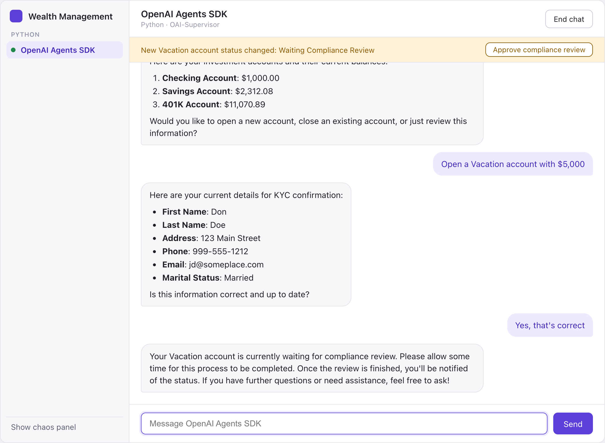
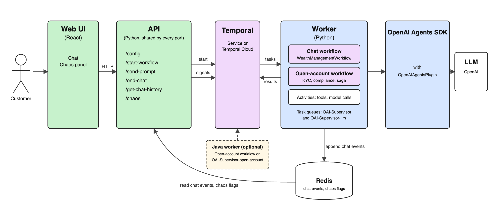
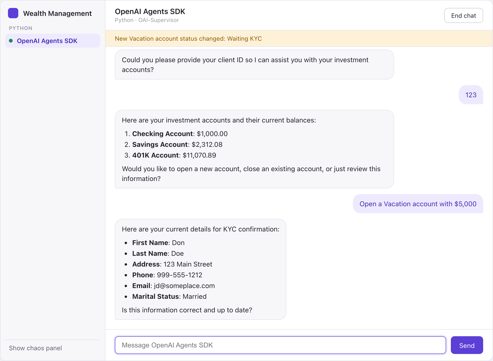
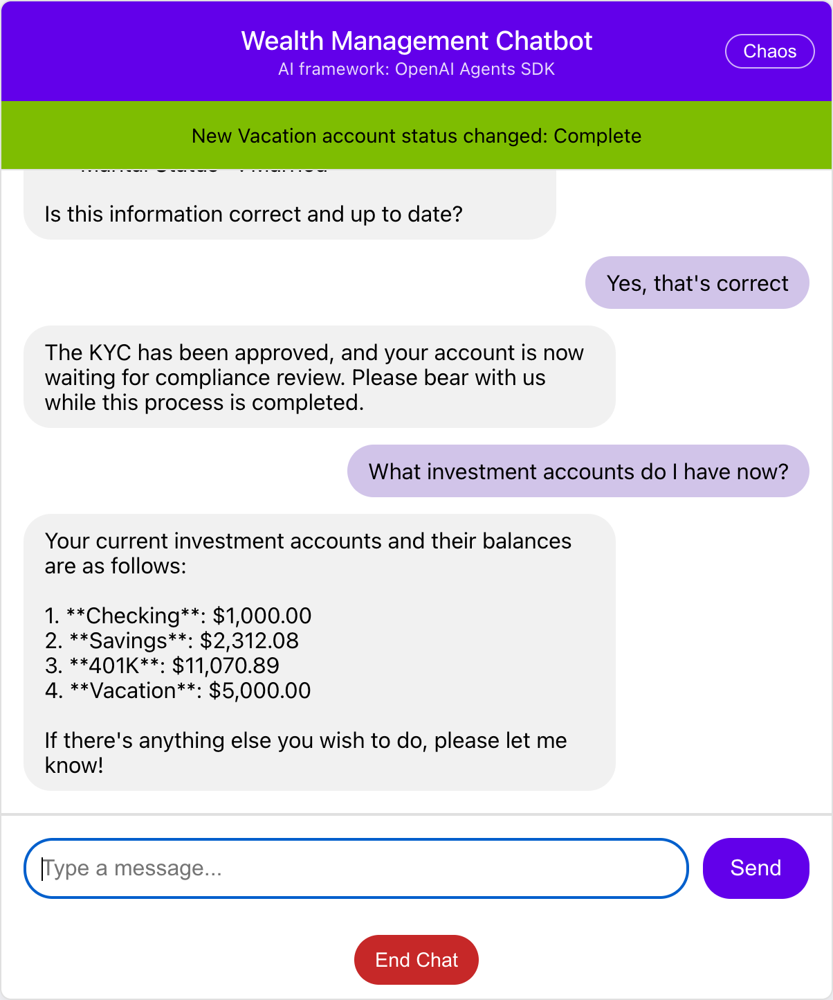
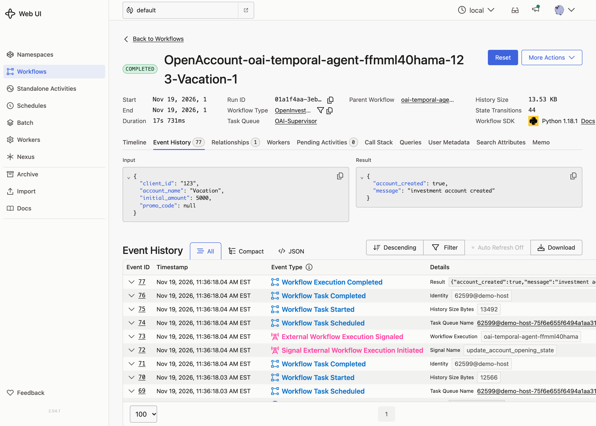

# OpenAI Agents SDK: Temporal version

In this version the OpenAI Agents SDK agents run inside a Temporal workflow, so every model call and
every tool call is durable: it is recorded in the workflow's history, retried when it fails, and never
repeated once it has succeeded. A supervisor agent hands the conversation off to a Beneficiary Agent,
an Investment Agent and an Open Account Agent. The Temporal integration is the Temporal Python SDK's
`OpenAIAgentsPlugin` (`temporalio.contrib.openai_agents`), which turns every model call into an
activity and lets activities be used as agent tools.

Setup (prerequisites, `uv sync`, the OpenAI key in `scripts/setoaikey.sh`) is in the
[framework's README](../README.md).



## Architecture



- **Web UI and API.** The customer chats in the web UI (`frontend/`), which calls the shared
  [API](../../api/README.md) to start, message and end the chat workflow and polls it for new events.
- **Chat workflow** (`WealthManagementWorkflow`, `workflows/supervisor_workflow.py`). One workflow
  per chat (`oai-temporal-agent-<random>`). Each customer message runs the current agent with
  `Runner.run`, handoffs included. Model and tool calls run as activities. The conversation stays in
  one workflow run (production would use continue-as-new; see the TODO in the workflow).
  A chat with no customer message and no account-opening status update for an hour ends by itself, as on
  End Chat (`common/chat_idle.py`), so chats abandoned without End Chat don't run forever.
- **Open-account workflow** (`OpenInvestmentAccountWorkflow`, `workflows/open_account_workflow.py`).
  A child workflow per account opening: KYC, compliance approval, then a saga that opens the
  account. It runs in Python by default, or in [Java](#java-open-account-worker-optional).
- **Worker** (`run_worker.py`). Runs both workflows and the tool activities on `OAI-Supervisor`, and
  the model activity on `OAI-Supervisor-llm`.
- **Redis.** Holds the chat's event stream (messages and account-opening status updates) that the
  web UI reads through the API, the chaos panel's flags, and, optionally, the
  [claim check](#claim-check-and-codec-server-optional) payloads.

### How the agents work

| Agent | Tools | Hands off to |
|---|---|---|
| Supervisor | none | Beneficiary Agent, Investment Agent |
| Beneficiary Agent | `list_beneficiaries`, `add_beneficiary`, `delete_beneficiary` | Supervisor |
| Investment Agent | `list_investments`, `close_investment` | Open Account Agent, Supervisor |
| Open Account Agent | `open_new_investment_account`, `get_account_opening_status`, `get_current_client_info`, `approve_kyc`, `update_client_details` | Investment Agent |

- **Model calls.** The `OpenAIAgentsPlugin` runs every model call in its model activity on
  `OAI-Supervisor-llm` (60 second timeout, `LLM_RETRY_POLICY`). The model is
  `ChaosAwareOpenAIModel` (`model_config.py`), an OpenAI chat completions model that also raises
  the chaos panel's LLM failures. The OpenAI client's own retries are off (`max_retries=0`), so
  Temporal decides.
- **Tools.** Most tools are activities wrapped with `activity_as_tool` (5 second timeout,
  `TOOL_RETRY_POLICY`). `open_new_investment_account`, `get_current_client_info`, `approve_kyc` and
  `get_account_opening_status` are `@function_tool`s that run in the workflow: they start the child
  workflow, call activities themselves, or read the workflow's state.
- **Handoffs** are the SDK's own: the agent the run ends on (`result.last_agent`) answers the
  customer's next message.
- **Shared context** (`WealthManagementContext`). `ClientIdHooks` saves the client ID from the
  first tool call that has one, and every agent's instructions then include it. The context also
  holds each opening's latest state, the KYC guard's message count, and the openings started.
- **Off-topic questions** are declined by the prompts (`prompts/agent_constants.py`): the
  specialists hand them back to the supervisor, which declines them. There are no guardrails.
- **Max turns.** Don't ask the agent to poll an account opening over and over: each poll is a turn,
  and `Runner.run` raises a max-turns exception after 10. The limit is a parameter of `Runner.run`.

## Running locally

Each command runs in its own terminal, from the repository root.

### Start Temporal and Redis

```bash
temporal server start-dev
```

```bash
redis-server
```

### Start the worker

```bash
./src/python/openai_agents/durable/startlocalworker.sh
```

The worker polls `OAI-Supervisor` (the chat workflow, the open-account workflow and the tools) and
`OAI-Supervisor-llm` (the model calls). The queues are this framework's own, so the worker can run next to
other frameworks' workers on the same Temporal service.

### Start the API

```bash
./src/python/api/startlocalapi.sh openai_agents
```

### Start the web UI

```bash
cd frontend && npm install && npm start
```

Click **Start Chat** in the browser window that opens. Client ID `123` has demo data.

### Approve compliance

The quickest way: while the status bar says **Waiting Compliance Review**, click **Approve compliance review**
in it. The API (`POST /approve-compliance`) finds the chat's account openings that wait for review and sends
them the `compliance_approved` signal. To send the signal yourself, as a compliance system would, use the
script below.

An account opening waits for a compliance officer's approval after KYC. Its child workflow ID has the
format `OpenAccount-<chat workflow ID>-<client ID>-<account name>-<n>`, where `<n>` numbers the account
openings started in the chat (1, 2, 3, ...), for example
`OpenAccount-oai-temporal-agent-k3j9x2m1q8-123-Vacation-1`.

The chat doesn't show the ID. Find the running `OpenInvestmentAccountWorkflow` (a child of your chat
workflow) in the Temporal UI (http://localhost:8233), or list the running ones, newest first:

```bash
temporal workflow list --query "WorkflowType='OpenInvestmentAccountWorkflow' AND ExecutionStatus='Running'"
```

Then send the approval (quote the ID if the account name contains a space):

```bash
./src/python/openai_agents/durable/localsendcomplianceapproval.sh "<child workflow ID>"
```

### What you'll see

Waiting for the customer to confirm their details (KYC):



Waiting for compliance approval:


The account opened:



The open-account workflow in the Temporal UI:



### Resetting the demo data

Beneficiary changes, account openings and closings, KYC updates and the saga's transfers change the
JSON files in `data/`. To reset them:

```bash
git checkout data/
```

## How account opening works

The Investment Agent hands off to the Open Account Agent, which drives the open-account workflow.

1. **Validation.** The `open_new_investment_account` tool runs in the chat workflow. It checks the
   business rules with the `validate_new_account` activity (an initial deposit between $100 and
   $1,000,000). A violation is a non-retryable error, and its reason goes back to the agent, which
   explains it.
2. **Starting the child workflow.** The tool looks up any promotion with the `find_promotion`
   activity, then starts `OpenInvestmentAccountWorkflow` with `workflow.start_child_workflow()` on the
   open-account task queue (`ParentClosePolicy.TERMINATE`). It returns the child workflow ID, which
   the agent passes to the other tools.
3. **KYC.** The child loads the client (`get_client`) and waits in `Waiting KYC`. The agent calls
   `get_current_client_info` (an activity that runs the child's `get_client_details` update) and shows
   the customer their details. If the customer confirms them in a later message, the agent calls
   `approve_kyc` (the `verify_kyc` signal). If something changed, it calls `update_client_details`
   (an update that saves the changes with `update_client` and completes KYC).
4. **KYC guard.** `approve_kyc` refuses until this opening's details have been shown and the
   customer has replied since, so a confirmation given for an earlier opening can't approve a new one.
5. **Status updates.** The child signals every state change to the chat workflow
   (`update_account_opening_state`). The chat workflow streams it to the web UI as a status update,
   and the agent reads the latest state with `get_account_opening_status`.
6. **Compliance approval.** The child waits in `Waiting Compliance Review` for the
   `compliance_approved` signal, sent outside the chat (see [Approve compliance](#approve-compliance)).
7. **Saga.** The child creates the account record (`open_investment`), transfers the initial deposit
   from the client's linked bank account (`debit_linked_account`, `data/funding_accounts.json`), and
   registers the account with the custodian (`register_account`). If a step fails with a
   non-retryable error, the completed steps are undone in reverse order (`credit_linked_account`,
   then `remove_investment`) and the state becomes `Rolled back. ...`. On success it becomes
   `Complete`, and the Open Account Agent hands back to the Investment Agent.
8. **A new opening per request.** Every request starts a new child workflow with its own KYC, even
   for an account name opened, or still being opened, earlier in the chat. The count in the ID is
   kept in the chat workflow's state, so it survives replay.

### Testing the open-account workflow on its own

`startlocalopenaccount.sh` starts a local worker without the `OpenAIAgentsPlugin`
(`SKIP_OPENAI_PLUGIN=True`, so no OpenAI key is needed) in the background and runs
`run_open_account_workflow.py`, which starts `OpenInvestmentAccountWorkflow` directly, with no chat and
no model, for three scenarios: KYC approved, client details updated, and one that waits for you to
approve compliance. It stops the worker when they finish. Temporal and Redis must be running.

```bash
./src/python/openai_agents/durable/startlocalopenaccount.sh
```

When it asks you to approve the third workflow:

```bash
./src/python/openai_agents/durable/localsendcomplianceapproval.sh testing-open-investment-account-workflow3
```

With the argument `java`, the scenarios run on `OAI-Supervisor-open-account` against the Java
workflow (start the [Java worker](#java-open-account-worker-optional) first):

```bash
./src/python/openai_agents/durable/startlocalopenaccount.sh java
```

## Java open-account worker (optional)

The open-account workflow also exists in Java ([interop/open_account/java](../../../../interop/open_account/java/README.md)).
Start this framework's worker with the argument `java`:

```bash
./src/python/openai_agents/durable/startlocalworker.sh java
```

The chat workflow then starts account openings on `OAI-Supervisor-open-account`, and the Python worker
no longer runs the open-account workflow. Start the Java worker for this framework:

```bash
TEMPORAL_TASK_QUEUE=OAI-Supervisor ./interop/open_account/java/startlocalworker.sh
```

Everything else stays on the Python worker, including the open-account activities, which the Java
workflow calls by name on `OAI-Supervisor`.

## Failure scenarios (chaos panel)

The chaos panel (**Chaos** in the chat header) injects failures at runtime: activities and the model
read its flags from Redis on every attempt, so a failure can be turned on and off mid-conversation. It
lists each injected failure; the Temporal UI shows the pending activity, its attempts and last
failure. **Reset all** clears every flag.

| Scenario | How to show it | What Temporal does |
|---|---|---|
| **Tool / API down** | Turn on *Core banking API down*, then ask to list your investments (or open an account, so it fails after compliance approval). Turn it off. | The activity retries (1s backoff, capped at 5s) for as long as the outage lasts. The agent waits mid-turn and answers once the API is back. Nothing is lost or asked again. |
| **LLM down** | Turn on *LLM API down* and send a message. Turn it off. | The model call is an activity, so it retries the same way (capped at 10s). The conversation picks up where it was. |
| **LLM rate limited (reactive)** | Turn on *LLM rate limited (429)* and send a message. | The model raises an `ApplicationError` with `next_retry_delay` (15s, like a `Retry-After` header), which overrides the retry policy's backoff. Real OpenAI 429s are handled the same way: the `OpenAIAgentsPlugin` turns the `Retry-After` header into the next retry delay. |
| **LLM rate limited (proactive)** | Start the worker with `LLM_MAX_CALLS_PER_SECOND=0.2 ./startlocalworker.sh` (in `src/python/openai_agents/durable`), then chat in several browser tabs at once. | Model calls run on `OAI-Supervisor-llm`. The Temporal service dispatches at most that many per second across all workers, so calls queue up instead of hitting the provider's limit. Tools on the main queue aren't slowed down. |
| **Business rule (non-retryable)** | Ask to open an account with $2,000,000 (or less than $100). | `validate_new_account` raises a non-retryable `ApplicationError`: one attempt, no retries. The agent explains the reason. Compare it with *Tool / API down* in the Temporal UI. |
| **Saga** | Turn on *Custodian rejects new accounts* (and *Slow account-opening steps* to watch it), then open an account through compliance approval. Without flags: as client `123`, open an account with $300,000 (the linked bank account has $250,000). | The completed steps are undone in reverse order (refund, then remove the account). Compensations are activities, so they are retried until they succeed; kill the worker mid-rollback and the rollback still finishes. Transfers are idempotent (keyed by the workflow and run ID), so a retried debit or refund never moves money twice. |
| **Bug in workflow code** | Turn on *Bug in workflow code*, then open an account through compliance approval. | The workflow pauses at the failing line, keeping all its state, until a worker with fixed code picks it up. See below. |

All the scenarios work the same way with the Java open-account workflow: the failures are injected in
the Python activities and the model activity, which the Java workflow uses too.

### Bug in workflow code

While **Bug in workflow code** is on, `find_promotion` gives new account openings the `WELCOME-BONUS`
promo code, which becomes part of the open-account workflow's input. The welcome-bonus code
(`_welcome_bonus` in `workflows/open_account_workflow.py`) reads `inputs.initial_deposit`, a field that
doesn't exist. Right after compliance approval it raises `AttributeError: 'OpenInvestmentAccountInput'
object has no attribute 'initial_deposit'`. In the Python SDK an ordinary exception fails the workflow
task, not the workflow, so the workflow stays **Running**, paused with the approval intact. The
Temporal UI shows the failing workflow task and its stack trace. Other chats, and openings without the
promo code, keep working.

Turning the switch off doesn't help: the promo code is in the workflow's input. To fix it, use the
line commented out above it (`inputs.initial_amount`) and restart the worker. The workflow resumes on
the next workflow-task retry (these back off up to 10 minutes) with the bonus. Re-arm the bug:

```bash
git checkout src/python/openai_agents/durable/workflows/open_account_workflow.py
```

The Java workflow's bug is a `NullPointerException` from a misspelled `BONUS_RATES` key; see
[its README](../../../../interop/open_account/java/README.md#bug-in-the-workflow-code-chaos-panel).

## Claim check and codec server (optional)

With the claim check, the payloads sent to Temporal (workflow and activity inputs and results) are
stored in Redis and replaced by an ID, using a custom payload codec. To turn it on:

```bash
cp scripts/setclaimcheck.example scripts/setclaimcheck.sh
```

It sets `USE_CLAIM_CHECK=true` and the Redis location. Every start script (including the Java
worker's) sources it when it exists, and every component must agree, so restart them all after
changing it. It costs a Redis call per payload, and Redis downtime stops your workflows.

To see the real payloads in the Temporal UI, start the codec server (it listens on
http://127.0.0.1:8081):

```bash
./src/python/openai_agents/durable/startcodecserver.sh
```

Open the Temporal UI at exactly http://localhost:8233 (not 127.0.0.1; the codec server only accepts
requests from that origin and https://cloud.temporal.io). Click the glasses icon in the upper right,
choose "Use my browser setting and ignore Cluster-level setting", enter `http://127.0.0.1:8081` (no
trailing spaces), turn off "Pass the user access token" and "Include cross-origin credentials", and
click **Apply**.


## Running on Temporal Cloud

```bash
cp scripts/setcloudenv.example scripts/setcloudenv.sh
```

Edit `scripts/setcloudenv.sh`: `TEMPORAL_ADDRESS`, `TEMPORAL_NAMESPACE`, and either the mTLS
certificate and key (`TEMPORAL_TLS_CLIENT_CERT_PATH`, `TEMPORAL_TLS_CLIENT_KEY_PATH`) or
`TEMPORAL_API_KEY`. The cloud scripts source it. Start Redis, then:

```bash
./src/python/openai_agents/durable/startcloudworker.sh
```

```bash
./src/python/api/startcloudapi.sh openai_agents
```

Start the web UI as for [running locally](#start-the-web-ui). Approve compliance with the child
workflow ID from the Temporal Cloud UI (https://cloud.temporal.io):

```bash
./src/python/openai_agents/durable/cloudsendcomplianceapproval.sh "<child workflow ID>"
```

For the Java open-account workflow, start the worker with `./startcloudworker.sh java`, then:

```bash
TEMPORAL_TASK_QUEUE=OAI-Supervisor ./interop/open_account/java/startcloudworker.sh
```

The Java cloud worker needs the client key in PKCS8 format; see
[its README](../../../../interop/open_account/java/README.md#running-with-temporal-cloud).

## Environment variables

The start scripts set most of these. The Python components read them through
`src/python/common/client_helper.py`, `src/python/common/redis_config.py` and the Temporal
environment configuration.

| Variable | Default | Purpose |
|---|---|---|
| `OPENAI_API_KEY` | none | OpenAI API key (`scripts/setoaikey.sh`) |
| `TEMPORAL_ADDRESS` | `127.0.0.1:7233` | Temporal service address |
| `TEMPORAL_NAMESPACE` | `default` | Temporal namespace |
| `TEMPORAL_TLS_CLIENT_CERT_PATH`, `TEMPORAL_TLS_CLIENT_KEY_PATH` | none | mTLS certificate and key for Temporal Cloud (`scripts/setcloudenv.sh`) |
| `TEMPORAL_API_KEY` | none | API key for Temporal Cloud, instead of mTLS (`scripts/setcloudenv.sh`) |
| `TEMPORAL_TASK_QUEUE` | `OAI-Supervisor` (`task_queues.py`) | Task queue of the chat workflow and the tools. The worker, the API and the Java worker must agree. |
| `TEMPORAL_TASK_QUEUE_OPEN_ACCOUNT` | value of `TEMPORAL_TASK_QUEUE` | Task queue of the open-account workflow. `java` means `<TEMPORAL_TASK_QUEUE>-open-account`. Set from the worker scripts' argument (through `scripts/setsplitworkflows.sh`) and by `startlocalopenaccount.sh`; when it differs from `TEMPORAL_TASK_QUEUE`, the Python worker doesn't run the open-account workflow. |
| `TEMPORAL_TASK_QUEUE_LLM` | `<TEMPORAL_TASK_QUEUE>-llm` | Task queue of the model calls |
| `LLM_MAX_CALLS_PER_SECOND` | unlimited | Most model calls per second the Temporal service dispatches, across all workers |
| `REDIS_URL` | none | `redis://:<password>@<host>:<port>/<db>`; wins over the three below |
| `REDIS_HOST`, `REDIS_PORT`, `REDIS_PASSWORD` | `localhost`, `6379`, none | Redis for the event stream, chaos flags and claim check (Python components) |
| `USE_CLAIM_CHECK` | `false` | Turns on the claim check codec (`scripts/setclaimcheck.sh`) |
| `CLAIM_CHECK_TTL_SECONDS` | `604800` (7 days) | How long Redis keeps claim-checked payloads; `0` keeps them forever. A workflow needs its payloads to replay, and the Temporal UI to show its history, so keep it well beyond how long a chat runs |
| `SKIP_OPENAI_PLUGIN` | `False` | Runs the worker without the `OpenAIAgentsPlugin` (set by `startlocalopenaccount.sh`) |

## Tests

### Default tests

The workflow tests start their own Temporal test server (downloaded on the first run), with stub
activities and, for the chat workflow, a scripted model instead of OpenAI. Nothing needs to be
running, and no OpenAI key or Redis is needed.

```bash
cd src/python/openai_agents && uv run pytest
```

| File | What it covers |
|---|---|
| `tests/test_failure_scenarios.py` | Retries, business rules, the LLM failures, the saga and its rollback, and the bug in workflow code |
| `tests/test_kyc_guard.py` | `approve_kyc` only approves after the customer has seen and confirmed their details |
| `tests/test_repeat_opening.py` | Opening the same account name twice starts two child workflows (`...-Vacation-1`, `...-Vacation-2`), each with its own KYC |
| `tests/test_client_id.py` | Every agent is told the client ID once a tool has used it |
| `tests/test_off_topic.py` | The supervisor prompt (Temporal and standalone versions) declines off-topic questions |
| `tests/test_api_client.py` | The shared API's Temporal calls (`src/python/api/client.py`) start, message and end the real chat workflow |

The [Java workflow](../../../../interop/open_account/java/README.md#tests) and the
[web UI](../../../../frontend/README.md#tests) have their own tests.

### Live tests

These call the paid OpenAI API, so they are not part of `uv run pytest` and are skipped without
`OPENAI_API_KEY`. They run the real chat workflow, model and read-only activities, with an in-memory
event stream instead of Redis. `LIVE_TEST_RUNS=<n>` repeats each conversation n times (default 1),
since model output varies, and each run's transcript is printed.

- `tests/live_agent_handoffs.py`: the customer asks "Who are my beneficiaries?", gives client ID
  `123`, then asks "What investments do I have?". The beneficiaries must be listed, and in the same
  turn the Beneficiary Agent must hand off to the supervisor, which hands off to the Investment Agent,
  which lists the Checking, Savings and 401K accounts, without asking for the client ID again and
  without any agent mentioning a transfer.
- `tests/live_repeat_opening.py`: after the same start, the customer says "Open Vacation with
  $13,000", confirms with "Yes", then says "Open Vacation with $13,000" again. Both replies must show
  the client's details for KYC (Don, 123 Main Street), and two child workflows, ending `-Vacation-1`
  and `-Vacation-2`, must be started. It also runs the real `OpenInvestmentAccountWorkflow` on the
  test server; client detail updates aren't saved.

```bash
cd src/python/openai_agents && source ../../../scripts/setoaikey.sh && LIVE_TEST_RUNS=10 uv run pytest tests/live_agent_handoffs.py tests/live_repeat_opening.py -s
```

## Temporal contracts

**Chat workflow** `WealthManagementWorkflow` (no input), on `OAI-Supervisor`:

| Kind | Name | Payload |
|---|---|---|
| Signal | `process_user_message` | `ProcessUserMessageInput`: `{user_input}` |
| Signal | `update_account_opening_state` | `UpdateAccountOpeningStateInput`: `{account_name, state, workflow_id}` (`workflow_id` optional) |
| Signal | `end_workflow` | none |
| Query | `get_chat_history` | returns a list of `ChatInteraction`: `{user_prompt, text_response, json_response, agent_trace}` |

**Open-account workflow** `OpenInvestmentAccountWorkflow`, on the open-account task queue; it
reports every state to its parent with `update_account_opening_state`. Input
`OpenInvestmentAccountInput`: `{client_id, account_name, initial_amount, promo_code}` (`promo_code`
optional). Result `OpenInvestmentAccountOutput`: `{account_created, message}`.

| Kind | Name | Payload |
|---|---|---|
| Signal | `verify_kyc` | none |
| Signal | `compliance_approved` | none (waits until KYC is done) |
| Update | `get_client_details` | returns `WealthManagementClient`: `{first_name, last_name, address, phone, email, marital_status}` |
| Update | `update_client_details` | a client dict; saves it, completes KYC, returns a message |
| Query | `get_current_state` | returns the state string |

**Activities** (Python method names, called by name from the Java workflow), on `OAI-Supervisor`:

- Tools: `list_beneficiaries`, `add_beneficiary`, `delete_beneficiary`, `list_investments`,
  `close_investment`, `validate_new_account`, `find_promotion`, `get_current_client_info`,
  `approve_kyc`, `update_client_details`. The worker also registers `add_client`.
- Open-account workflow: `get_client`, `update_client`, `open_investment`, `debit_linked_account`,
  `register_account`, and the compensations `credit_linked_account` and `remove_investment`.
- Chat event stream (local activities): `append_chat_interaction`, `append_status_update`,
  `delete_conversation`.
- Model calls: the `OpenAIAgentsPlugin`'s model activity, on `OAI-Supervisor-llm`.

## Framework notes

- Locally, without the claim check, you can also approve compliance with the Temporal CLI:

```bash
temporal workflow signal --workflow-id "<child workflow ID>" --name compliance_approved
```
