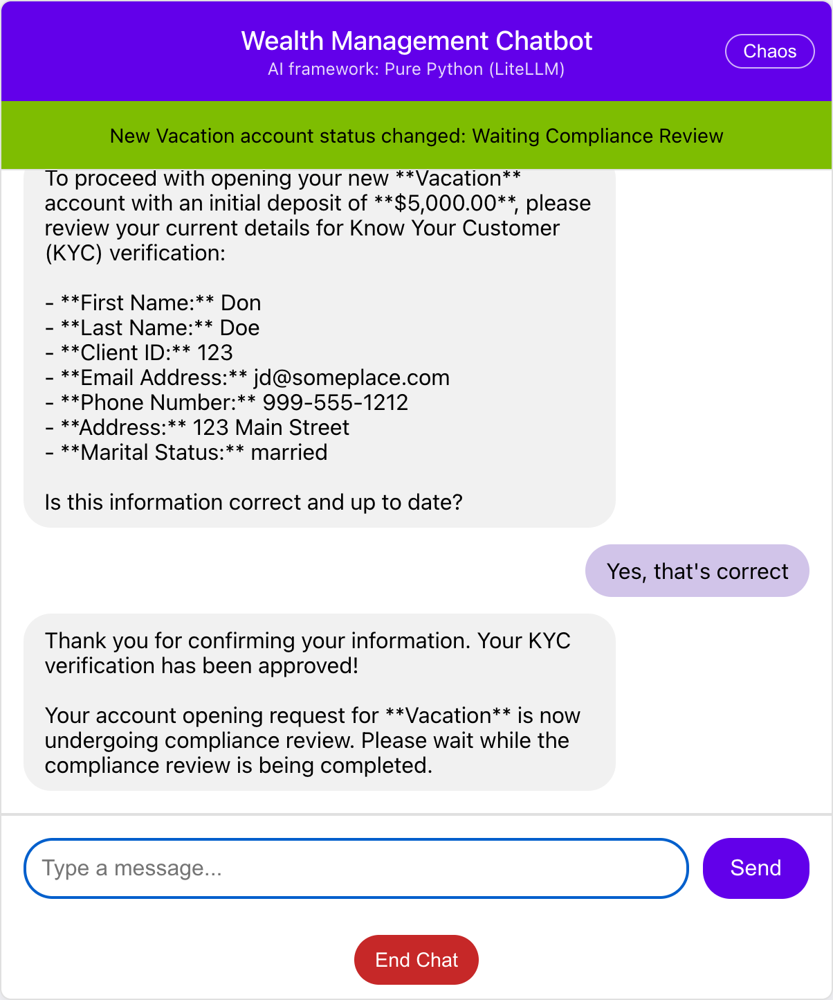
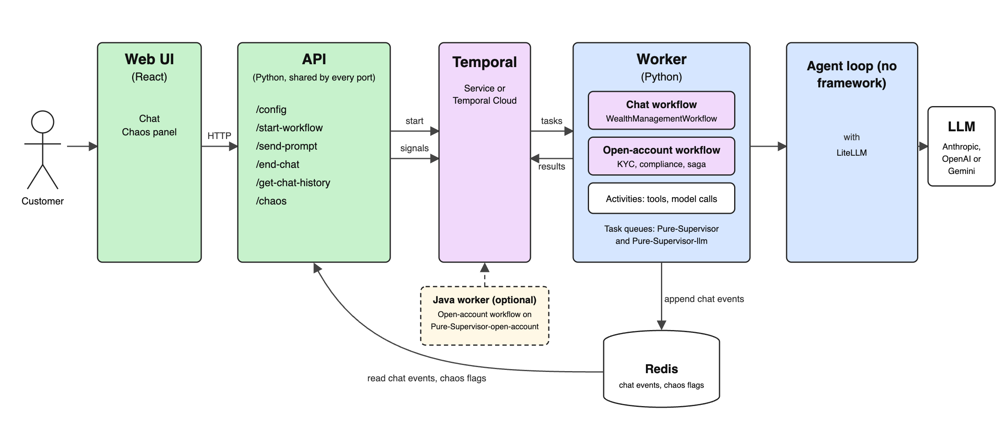
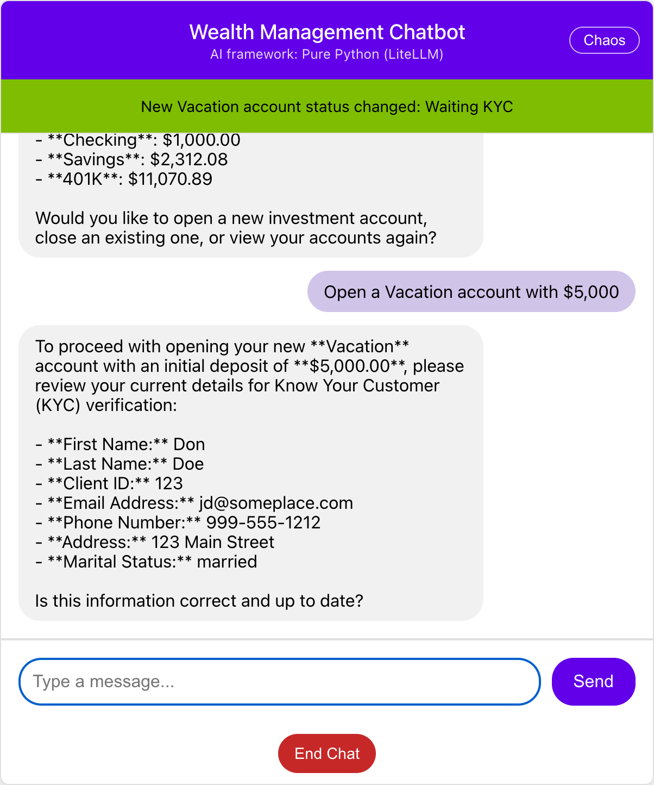
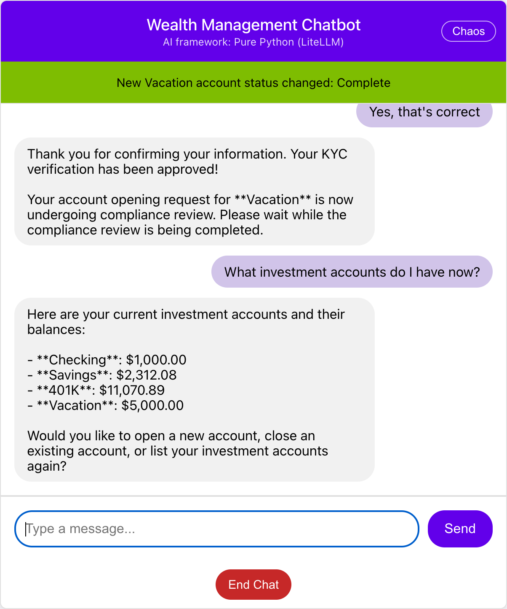
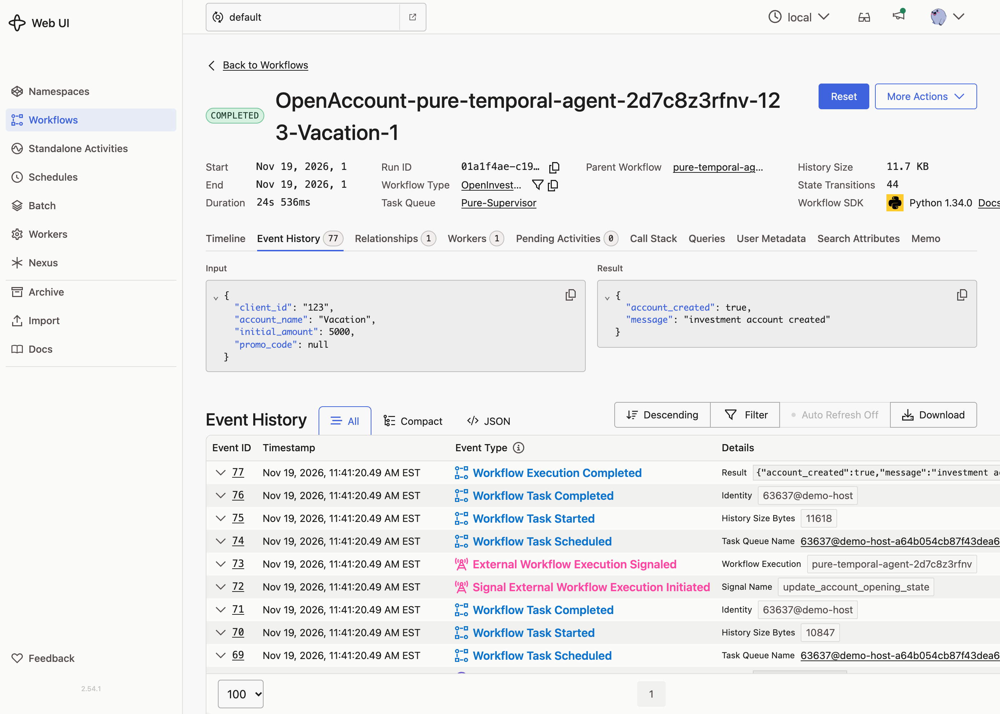

# Pure Python (LiteLLM): Temporal version

In this version the four agents run inside a Temporal workflow, and every model call and every tool call
that touches a system is durable. A worker crash, a model outage or a tool outage pauses the conversation
instead of losing it, and Temporal resumes the turn where it stopped.

There is no agent framework and no Temporal AI integration: the agent loop
([pure_agents/agent_loop.py](../pure_agents/agent_loop.py)) is ordinary workflow code, the model call is
the `invoke_model` activity, and the model is called through [LiteLLM](https://docs.litellm.ai/), so you can
switch between Anthropic, OpenAI and Gemini with one environment variable. Prerequisites, installing the
dependencies and the model key are in the [port README](../README.md).



## Architecture



* **The web UI and the API.** The web UI ([frontend/](../../../../frontend/README.md)) talks to the shared
  [API](../../../python/api/README.md), started with the `pure` AI framework. The API starts a chat workflow
  per conversation (IDs `pure-temporal-agent-<random>`), sends it the customer's messages, and serves the
  conversation from Redis.
* **The chat workflow** `WealthManagementWorkflow` runs for the whole conversation and runs the agent loop.
  Customer messages arrive as the `process_user_message` signal and are processed one at a time. Every
  model call is the `invoke_model` activity, and every tool that touches a system is an activity. The
  conversation (messages, active agent, client ID, account openings) is workflow state, so it survives
  replay. After each turn, the reply is appended to the Redis list `events:<workflow ID>` by a local
  activity.
* **The open-account workflow** `OpenInvestmentAccountWorkflow` is a child workflow, one per account
  opening: KYC, compliance approval, then a saga. It reports each state change to the chat workflow with
  the `update_account_opening_state` signal.
* **The worker** ([run_worker.py](run_worker.py)) runs two workers on one connection: the workflows and
  tool activities on `Pure-Supervisor`, and `invoke_model` on `Pure-Supervisor-llm`, so model calls can be
  rate limited apart from the tools.
* **Redis** holds the chat's event stream that the web UI reads (through the API), the chaos flags, and,
  optionally, the claim check payloads.

### How the agents work

The agents, tools and handoffs are a small agent loop in plain Python, shared with the standalone version:

| Agent | Tools | Hands off to |
|---|---|---|
| Supervisor Agent | none | Beneficiary Agent, Investment Agent |
| Beneficiary Agent | `list_beneficiaries`, `add_beneficiary`, `delete_beneficiary` | Supervisor Agent |
| Investment Agent | `list_investments`, `close_investment` | Open Account Agent, Supervisor Agent |
| Open Account Agent | `open_new_investment_account`, `get_account_opening_status`, `get_current_client_info`, `approve_kyc`, `update_client_details` | Investment Agent |

* An **agent** is a name, instructions ([prompts/agent_constants.py](../prompts/agent_constants.py)), a list
  of tools and a list of agents it can hand off to ([pure_agents/wealth_agents.py](../pure_agents/wealth_agents.py)).
* A **tool** is an async Python function; its JSON schema is built from its signature. In the Temporal
  version, the tools ([workflows/supervisor_workflow.py](workflows/supervisor_workflow.py)) run activities,
  or read the conversation's state.
* A **handoff** is offered to the model as one more tool, `transfer_to_<agent_name>`. When the model calls
  it, the loop switches the active agent and carries on in the same turn, so the new agent answers the
  customer's message.
* `run_turn` runs one customer message to completion and does no I/O of its own: the model call and the
  tools are passed in. The Temporal version passes functions that run activities, which makes the same
  loop deterministic workflow code.
* **Model calls** go through LiteLLM with its own retries off, so Temporal's retry policy decides when a
  failed call is retried. `LLM_MODEL` picks the provider and model (see the [port README](../README.md)).
* Once a tool has used the client ID, every agent is told it on every model call, so an agent that is
  handed the conversation doesn't ask for it again. Every agent is also told each account opening started
  in the chat and its current state.

## Running locally

Each command runs in its own terminal, from the repository root.

### Start Temporal and Redis

```bash
temporal server start-dev
```

```bash
redis-server
```

### Start the worker

```bash
./src/python/pure/durable/startlocalworker.sh
```

The worker polls `Pure-Supervisor` (`DEFAULT_TASK_QUEUE` in [task_queues.py](task_queues.py)) for the
workflows and tools, and `Pure-Supervisor-llm` for the model calls, so it can run next to other ports'
workers. It sources `scripts/setllmkey.sh` and, if it exists, `scripts/setclaimcheck.sh`.

### Start the API

```bash
./src/python/api/startlocalapi.sh pure
```

The endpoints are in the [API README](../../../python/api/README.md).

### Start the web UI

```bash
cd frontend && npm install && npm start
```

Open http://localhost:3000 for the chat, and http://localhost:8233 for the Temporal UI.

### Approve compliance

Each account opening waits for compliance approval, which comes from outside the chat. The open-account
workflow ID is `OpenAccount-<chat workflow ID>-<client ID>-<account name>-<n>`, where `<n>` counts the
openings started in this chat (a refused request doesn't use up a number), for example
`OpenAccount-pure-temporal-agent-k3j9x2m1q8-123-College Fund-1`. Find it in the Temporal UI (a running
`OpenInvestmentAccountWorkflow`, child of the chat's `WealthManagementWorkflow`), or with:

```bash
temporal workflow list --query "WorkflowType='OpenInvestmentAccountWorkflow' AND ExecutionStatus='Running'"
```

Then approve it. Account names can contain spaces, so quote the ID:

```bash
./src/python/pure/durable/localsendcomplianceapproval.sh "<open-account workflow ID>"
```

### What you'll see

Waiting for the customer to confirm their details (KYC):



Waiting for compliance approval:


The account opened:



The open-account workflow in the Temporal UI:



### Resetting the demo data

Opening and closing accounts, changing client details during KYC, and adding or deleting beneficiaries
change the JSON files in [data/](../../../../data), which every port shares and git tracks. To reset them:

```bash
git checkout data/
```

## How account opening works

1. The customer asks to open an account, for example "Open Vacation with $13,000". The Investment Agent
   hands off to the Open Account Agent, which calls `open_new_investment_account`.
2. The tool checks the deposit rules first (`validate_new_account`: $100 to $1,000,000). A refusal is a
   non-retryable error: it goes back to the agent, which explains it, and nothing is started.
3. The tool starts the child workflow `OpenAccount-<chat workflow ID>-<client ID>-<account name>-<n>`,
   on the chat's task queue or, with `java`, on `Pure-Supervisor-open-account`.
4. The child loads the client's details and moves to `Waiting KYC`. The agent shows the customer their
   details (`get_current_client_info`, which runs the child's `get_client_details` update). It approves
   KYC (`approve_kyc`, which sends `verify_kyc`) only after the customer confirms in a later message: the
   tool refuses in the turn the details were shown, or for an opening whose details weren't shown. If the
   customer changes a detail instead, `update_client_details` saves it and completes KYC.
5. Every state change is sent to the chat workflow with the `update_account_opening_state` signal. The
   chat workflow keeps the latest state of each opening and writes
   `New <account> account status changed: <state>` to the event stream, which the web UI shows. The agent
   reads the state with `get_account_opening_status`, never from memory.
6. The opening moves to `Waiting Compliance Review` and waits for the `compliance_approved` signal. The
   signal handlers wait for the steps before them, so an early signal is not lost or applied out of order.
7. The saga creates the account record (`open_investment`), transfers the deposit from the linked bank
   account (`debit_linked_account`), and registers the account with the custodian (`register_account`).
   If a step fails with a non-retryable error, the completed steps are undone in reverse order
   (`credit_linked_account`, then `remove_investment`) and the state ends with
   `Rolled back. The account was not opened: <reason>.` Transfer IDs include the workflow and run IDs,
   so a retried transfer never moves money twice. On success the state is `Complete`.
8. **Every request starts a new opening**, with its own KYC and compliance approval, even for an account
   name opened before in the same chat: opening "Vacation" twice gives `...-Vacation-1` and
   `...-Vacation-2`.

Ending the chat terminates any opening still running (`ParentClosePolicy.TERMINATE`).

### Testing the open-account workflow on its own

`startlocalopenaccount.sh` starts a worker in the background (no model key needed), runs the open-account
workflow directly with no chat for three scenarios for client 123, and stops the worker on exit:

1. KYC approved (`verify_kyc`), then compliance approved.
2. Client details read (`get_client_details`) and changed (`update_client_details`, which completes KYC:
   the last name becomes "Doenut"), then compliance approved.
3. KYC approved, then the workflow waits until you send compliance approval yourself. The script prints
   the workflow ID, `testing-open-investment-account-workflow3`.

```bash
./src/python/pure/durable/startlocalopenaccount.sh
```

For the third scenario, in another terminal:

```bash
./src/python/pure/durable/localsendcomplianceapproval.sh testing-open-investment-account-workflow3
```

With the argument `java`, the scenarios run on `Pure-Supervisor-open-account`, against the Java worker
(start it first, as in [Java open-account worker](#java-open-account-worker-optional)):

```bash
./src/python/pure/durable/startlocalopenaccount.sh java
```

These scenarios change the demo data; reset it with `git checkout data/`.

## Java open-account worker (optional)

The open-account workflow can run on the shared
[Java worker](../../../../interop/open_account/java/README.md) instead. Start this port's worker with the
argument `java`:

```bash
./src/python/pure/durable/startlocalworker.sh java
```

The open-account workflow then runs on `Pure-Supervisor-open-account`, and this worker doesn't register
it. Start the Java worker for this port, so it polls that queue and calls this port's activities:

```bash
TEMPORAL_TASK_QUEUE=Pure-Supervisor ./interop/open_account/java/startlocalworker.sh
```

The chat workflow, the tools and the model calls stay on the Python worker; the open-account workflow
runs in Java, and its activities (client details, the saga steps) still run on the Python worker. Any
other argument names the open-account task queue. On Temporal Cloud, use `startcloudworker.sh java` and
the Java worker's `startcloudworker.sh`.

## Failure scenarios (chaos panel)

Click **Chaos** in the web UI's chat header to open the chaos panel. Activities and the model call read
the flags from the Redis hash `chaos:flags` on every attempt, so you can turn a failure on and off
mid-conversation with no restart. If Redis can't be reached, the flags read as off. Each injected failure
is logged to `chaos:events` and listed in the panel.

| Scenario | How to show it | What Temporal does |
|---|---|---|
| Tool / API down | Turn on **Core banking API down**, ask to list your investments, wait, turn it off | Beneficiary and investment activities raise a connection error and are retried (at most 5 s apart) until the flag is off. The reply waits mid-turn: nothing is lost or asked again. |
| LLM down | Turn on **LLM API down** and send a message | Every model call raises a connection error. The model activity is retried (at most 10 s apart) and the turn resumes where it stopped. |
| LLM rate limited | Turn on **LLM rate limited (429)** and send a message | The model call fails with a next retry delay of 15 s, which overrides the backoff like a `Retry-After` header. A real 429 from the provider is handled the same way, using its own `Retry-After`. |
| Proactive rate limit | Restart the worker with `LLM_MAX_CALLS_PER_SECOND=0.2` set and chat in several tabs | Model calls run on `Pure-Supervisor-llm`, which the Temporal service rate limits across all workers. Calls queue up instead of hitting the provider's limit. |
| Business rule | Open an account with under $100 or over $1,000,000 | `validate_new_account` fails on the first attempt, non-retryably, and the agent explains why. No opening is started. |
| Saga rollback | Turn on **Custodian rejects new accounts** (and **Slow account-opening steps**), then open an account through compliance approval. Without flags: as client 123, open an account with $300,000 (the linked bank account holds $250,000) | `register_account` (or the debit) fails non-retryably. The saga refunds the deposit, then removes the account record. With slow steps on (4 s per step), you can kill the worker mid-saga and restart it. |
| Bug in workflow code | Turn on **Bug in workflow code** and open an account through compliance approval | New openings get the `WELCOME-BONUS` promo code, whose code path has a bug. The workflow task fails, not the workflow: it stays Running with its state, and Temporal retries the task. |

Notes:

* The flags live in Redis, so every worker using that Redis sees them. To avoid disturbing someone else's
  demo, use a different Redis or Temporal service.
* Tool and model retries are unlimited, so a wrong model key or model name stalls a turn instead of
  failing it. Check the pending activity in the Temporal UI.
* If you change which activities or child workflows a workflow runs, end the chats started on the old
  code; they would fail on replay.

### Bug in workflow code

After compliance approval, the welcome-bonus calculation in `_welcome_bonus`
([workflows/open_account_workflow.py](workflows/open_account_workflow.py)) reads `inputs.initial_deposit`,
a field that doesn't exist (it's `initial_amount`), and raises an `AttributeError`. The Temporal UI shows
the stack trace.

Turning the flag off doesn't unstick an opening that already has the promo code, since it is part of the
workflow's input. To fix it, edit the line marked `*** Bug-In-Workflow-Code ***`: uncomment the fix
directly above it and comment out the buggy line. Then restart the worker. On the next workflow task
retry, the workflow resumes and opens the account with the bonus (1% of the deposit, up to $500). To
re-arm the demo, put the line back (or `git checkout` the file).

The Java open-account workflow has its own version of this bug (a `NullPointerException` from its
`BONUS_RATES` lookup); see its
[README](../../../../interop/open_account/java/README.md#bug-in-the-workflow-code-chaos-panel).

## Claim check and codec server (optional)

With claim check on, Temporal never sees the demo's data. Every payload (workflow and activity inputs and
results, signals, updates and queries, including the model calls) is stored in Redis under a new UUID, and
Temporal stores only the UUID. This is the
[Claim Check pattern](https://www.enterpriseintegrationpatterns.com/patterns/messaging/StoreInLibrary.html),
implemented as a [payload codec](https://docs.temporal.io/payload-codec) in the shared
[common/claim_check](../../common/claim_check) package. The other ports and the Java worker use the same
format, so they read each other's payloads.

To turn it on, make sure Redis is running and copy the example file:

```bash
cp scripts/setclaimcheck.example scripts/setclaimcheck.sh
```

Every start script sources `scripts/setclaimcheck.sh` if it exists: the workers (Python and Java, local and
cloud), the API, the compliance approval scripts, the open-account runner and the codec server. Every
component must agree on whether claim check is on, so restart them all after creating or deleting it.

Redis now holds part of every workflow's history. If a key is lost, Temporal can't replay that workflow,
so keys are never expired; a non-demo deployment needs durable, highly available Redis.

The Temporal UI then shows only claim check IDs. To see the data, start the codec server, which decodes
payloads for the Temporal UI by looking them up in Redis:

```bash
./src/python/pure/durable/startcodecserver.sh
```

It listens on http://127.0.0.1:8081 and accepts requests only from http://localhost:8233 and
https://cloud.temporal.io. To configure it in the Temporal UI:

1. Open the Temporal UI at http://localhost:8233 (not 127.0.0.1), or at https://cloud.temporal.io.
2. Click the glasses icon at the top right.
3. Choose "Use my browser setting and ignore Cluster-level setting".
4. Enter `http://127.0.0.1:8081`, with no trailing space.
5. Turn off "Pass the user access token" and "Include cross-origin credentials", then click Apply.


## Running on Temporal Cloud

The cloud scripts read the connection settings from `scripts/setcloudenv.sh`, which git ignores. Copy the
example and fill in your namespace, with either an mTLS client certificate and key or an API key:

```bash
cp scripts/setcloudenv.example scripts/setcloudenv.sh
```

Then start the worker and the API against Temporal Cloud (Redis and the web UI run locally as before):

```bash
./src/python/pure/durable/startcloudworker.sh
```

```bash
./src/python/api/startcloudapi.sh pure
```

To approve an account opening, find its workflow ID in the Temporal Cloud UI (https://cloud.temporal.io)
and run:

```bash
./src/python/pure/durable/cloudsendcomplianceapproval.sh "<open-account workflow ID>"
```

Each script prints the address and namespace it connects to, and stops with instructions if
`setcloudenv.sh` is missing. `startcloudworker.sh` takes the same optional `java` argument as
`startlocalworker.sh`. The connection uses Temporal's
[environment configuration](https://docs.temporal.io/develop/environment-configuration). The connection
settings were checked to load for both mTLS and an API key, but this port hasn't been run end to end on
Temporal Cloud.

## Environment variables

| Variable | Default | Purpose |
|---|---|---|
| `LLM_MODEL` | `anthropic/claude-opus-5-5` | LiteLLM model name, `<provider>/<model>` |
| `ANTHROPIC_API_KEY` / `OPENAI_API_KEY` / `GEMINI_API_KEY` | none | The key for the provider in `LLM_MODEL` (`scripts/setllmkey.sh`) |
| `TEMPORAL_ADDRESS` | `127.0.0.1:7233` | Temporal service address |
| `TEMPORAL_NAMESPACE` | `default` | Temporal namespace |
| `TEMPORAL_TLS_CLIENT_CERT_PATH` / `TEMPORAL_TLS_CLIENT_KEY_PATH` | none | mTLS client certificate and key for Temporal Cloud (`scripts/setcloudenv.sh`) |
| `TEMPORAL_API_KEY` | none | API key for Temporal Cloud, instead of mTLS (`scripts/setcloudenv.sh`) |
| `TEMPORAL_TASK_QUEUE` | `Pure-Supervisor` | Task queue of the chat workflow, its tools and, by default, the open-account workflow |
| `TEMPORAL_TASK_QUEUE_OPEN_ACCOUNT` | the chat queue | Task queue of the open-account workflow. `java` means `Pure-Supervisor-open-account`, the Java worker's queue for this port (set by `startlocalworker.sh java`) |
| `TEMPORAL_TASK_QUEUE_LLM` | `<TEMPORAL_TASK_QUEUE>-llm` | Task queue of the model calls |
| `LLM_MAX_CALLS_PER_SECOND` | unlimited | Dispatch rate limit for model calls, across all workers |
| `REDIS_HOST` / `REDIS_PORT` | `localhost` / `6379` | Redis for the event stream, the chaos flags and claim check |
| `USE_CLAIM_CHECK` | `false` | Store payloads in Redis and send Temporal only their IDs (`scripts/setclaimcheck.sh`) |
| `LIVE_TEST_RUNS` / `LIVE_TURN_TIMEOUT` | `1` / `300` | Live tests: conversations to run, and seconds to wait for each reply |

The API has its own settings; see the [API README](../../../python/api/README.md).

## Tests

### Default tests

The default suite needs nothing running: no model key, no Redis and no Temporal service. It uses
Temporal's local test server (downloaded on first run), stub activities and a scripted model, which is
just an activity registered under the name `invoke_model` ([tests/scripted_model.py](../tests/scripted_model.py)).

```bash
cd src/python/pure && uv run pytest
```

| Test file | Checks |
|---|---|
| `test_failure_scenarios.py` | Saga success; rollback in reverse after a custodian rejection and after a failed debit; transient failures retried, not rolled back; transfer IDs include the run ID; the workflow bug pauses the workflow without failing it; deposit rules; idempotent transfers; tool and model outages; the 429 retry delay, from the chaos panel and from a real `Retry-After` |
| `test_kyc_guard.py` | `approve_kyc` refuses until this opening's details were shown in an earlier turn |
| `test_repeat_opening.py` | Two "Vacation" openings in one chat start `...-Vacation-1` and `...-Vacation-2`, both run, the second needs its own KYC, and the children's states reach the event stream |
| `test_client_id.py` | Every agent is told the client ID once a tool has used it |
| `test_opening_status_notes.py` | Every agent is told each account opening's request and current state |
| `test_off_topic.py` | The Supervisor Agent's prompt, in both versions, declines off-topic questions |
| `test_agents.py` | The agents, tools and handoffs match the PRD in both versions, and the open-account prompt has the PRD's lines |
| `test_claim_check.py` | The shared claim check codec, the port's connection (Pydantic JSON, plus the codec only when claim check is on), a workflow whose history holds only claim checks, and the codec server's decoding and CORS |
| `test_agent_loop.py` | The agent loop on its own: same-turn handoffs, tool schemas, tool errors, the client ID |
| `test_api_client.py` | The shared API's Temporal calls start, message and end the real chat workflow, and the API knows this port's task queue |

The web UI (`cd frontend && CI=true npm test`) and the Java worker
(`cd interop/open_account/java && ./gradlew test`) have their own tests.

### Live tests

The live tests call the real, paid model API (`LLM_MODEL`), so they are not part of the default run. They
repeat the conversation `LIVE_TEST_RUNS` times (default 1) and print each transcript. Each reply has
`LIVE_TURN_TIMEOUT` seconds (default 300), since a turn with a slow model such as gpt-5 can take over a
minute:

```bash
cd src/python/pure && source ../../../scripts/setllmkey.sh && LIVE_TEST_RUNS=3 uv run pytest tests/live_*.py -s
```

* `live_agent_handoffs.py`: "Who are my beneficiaries?", "123", "What investments do I have?". In the last
  turn, the Beneficiary Agent hands off to the supervisor, which hands off to the Investment Agent, which
  lists Checking, Savings and 401K without asking for the client ID again. No agent mentions a transfer.
* `live_repeat_opening.py`: the same three messages, then "Open Vacation with $13,000", "Yes" and
  "Open Vacation with $13,000" again. Both open replies show the KYC details, and child workflows ending
  `-Vacation-1` and `-Vacation-2` were started.
* `live_opening_status.py`: two "Vacation" openings, the first rolled back and the second complete.
  Listing the investments afterwards must not claim an opening is still pending or that a duplicate
  account may appear.

## Temporal contracts

The API, the web UI, the scripts and the Java worker rely on these names and payloads.

**Chat workflow** `WealthManagementWorkflow` (no input), on `Pure-Supervisor`:

| Kind | Name | Payload |
|---|---|---|
| Signal | `process_user_message` | `{user_input}` |
| Signal | `update_account_opening_state` | `{account_name, state, workflow_id}` |
| Signal | `end_workflow` | none |
| Query | `get_chat_history` | returns a list of `{user_prompt, text_response, json_response, agent_trace}` |

Each turn's `{user_prompt, text_response, json_response, agent_trace}` and each status update `{status}`
are appended to the Redis list `events:<chat workflow ID>`, which the API serves to the web UI.

**Open-account workflow** `OpenInvestmentAccountWorkflow`, input
`{client_id, account_name, initial_amount, promo_code}`, result `{account_created, message}`, workflow ID
`OpenAccount-<chat workflow ID>-<client ID>-<account name>-<n>`:

| Kind | Name | Payload |
|---|---|---|
| Signal | `verify_kyc` | none |
| Signal | `compliance_approved` | none |
| Query | `get_current_state` | returns the state string |
| Update | `get_client_details` | returns the client record (name, address, phone, email, marital status) |
| Update | `update_client_details` | the changed fields; returns a message and completes KYC |

**Activities:** `list_beneficiaries`, `add_beneficiary`, `delete_beneficiary`, `list_investments`,
`validate_new_account`, `find_promotion`, `open_investment`, `remove_investment`, `close_investment`,
`debit_linked_account`, `credit_linked_account`, `register_account`, `get_client`, `add_client`,
`update_client`, `get_current_client_info`, `update_client_details`, `approve_kyc`,
`append_chat_interaction`, `append_status_update` and `delete_conversation` on `Pure-Supervisor`, and
`invoke_model` on `Pure-Supervisor-llm`. The Java open-account workflow calls the client and saga
activities by these names.

## Port notes

* The chat workflow deletes any earlier conversation stored in Redis under its ID when it starts, since
  the web UI can reuse chat IDs.
* Each chat runs in a single workflow run. A production system would need continue-as-new for long
  conversations (see the TODO in [workflows/supervisor_workflow.py](workflows/supervisor_workflow.py)).
* The [standalone version](../standalone/README.md) runs the same agent loop as a command-line chat with
  no Temporal.
