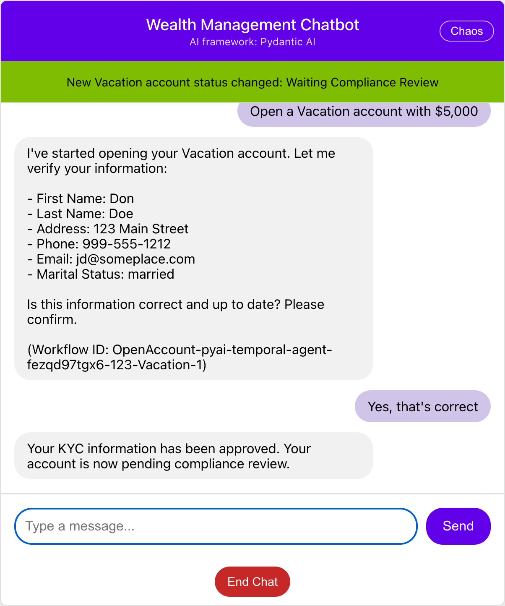
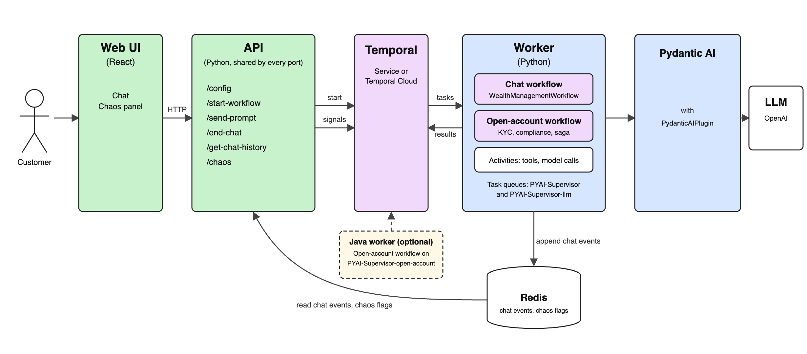
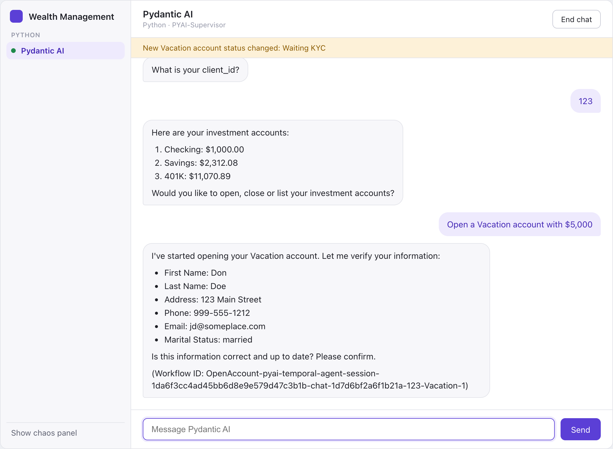
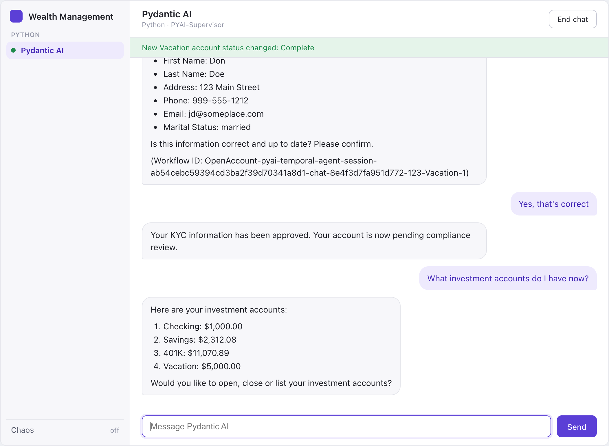
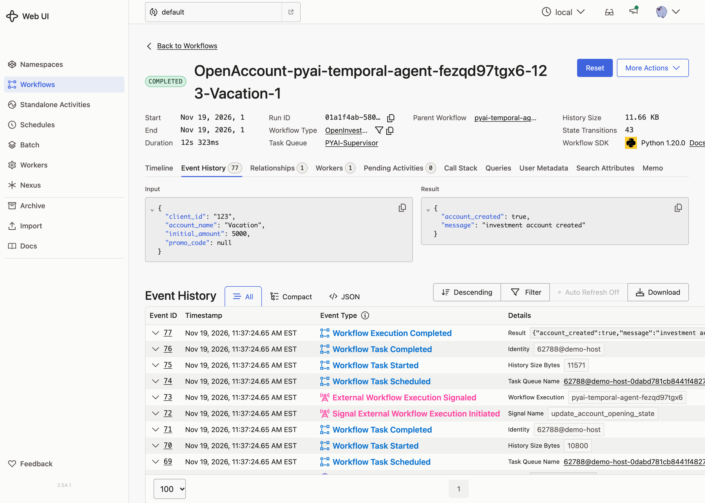

# Pydantic AI: Temporal version

In this version the Pydantic AI agents run inside a Temporal workflow, so every model call and every
tool call is durable: it is recorded in the workflow's history, retried when it fails, and never
repeated once it has succeeded. A supervisor agent routes the conversation to a Beneficiary Agent, an
Investment Agent and an Open Account Agent. The Temporal integration is Pydantic AI's own durable
execution support (`pydantic_ai.durable_exec.temporal`): each agent is wrapped in a `TemporalAgent`,
which runs its model calls and tools as activities, and the worker uses the `PydanticAIPlugin`.

Setup (prerequisites, `uv sync`, the OpenAI key in `scripts/setoaikey.sh`) is in the
[framework's README](../README.md).



## Architecture



- **Web UI and API.** The customer chats in the web UI (`frontend/`), which calls the shared
  [API](../../api/README.md) to start, message and end the chat workflow and polls it for new events.
- **Chat workflow** (`WealthManagementWorkflow`, `workflows/supervisor_workflow.py`). One workflow
  per chat (`pyai-temporal-agent-<random>`). Each customer message runs the current agent, and any
  agent it routes to, in the same turn. Model and tool calls run as activities. The conversation stays
  in one workflow run (production would use continue-as-new; see the TODO in the workflow).
- **Open-account workflow** (`OpenInvestmentAccountWorkflow`, `workflows/open_account_workflow.py`).
  A child workflow per account opening: KYC, compliance approval, then a saga that opens the
  account. It runs in Python by default, or in [Java](#java-open-account-worker-optional).
- **Worker** (`run_worker.py`). Runs both workflows and the tool activities on `PYAI-Supervisor`,
  and the model activities on `PYAI-Supervisor-llm`.
- **Redis.** Holds the chat's event stream (messages and account-opening status updates) that the
  web UI reads through the API, the chaos panel's flags, and, optionally, the
  [claim check](#claim-check-and-codec-server-optional) payloads.

### How the agents work

The agents are defined in `pyai_agents/agents.py` (shared with the standalone version), their
instructions in `prompts/agent_constants.py`, and they use `openai:gpt-4o` (`AGENT_MODEL`).

| Agent | Tools | Output functions (reply or route) |
|---|---|---|
| Supervisor | `get_client_id`, `set_client_id` | `respond_to_user`, `route_to_beneficiary_agent`, `route_to_investment_agent` |
| Beneficiary Agent | `list_beneficiaries`, `add_beneficiaries`, `delete_beneficiaries` | `respond_about_beneficiaries`, `route_from_beneficiary_to_supervisor` |
| Investment Agent | `list_investments`, `close_investment` | `respond_about_investments`, `route_from_investment_to_supervisor`, `route_from_investment_to_open_account` |
| Open Account Agent | `get_account_opening_status`, `approve_client_kyc`, `update_kyc_details` | `respond_about_account_opening`, `route_from_open_account_to_investment_agent` |

- **Handoffs.** Pydantic AI has no built-in handoffs, so each agent ends its run with an output
  function that replies or routes. A route sets the next agent and a trigger message (quoting the
  customer word for word) in the shared `AgentDependencies`, and the chat workflow runs that agent with
  the shared message history. After 10 routes in a turn (`MAX_ROUTING_HOPS`) it replies with a
  fallback. A route to the Investment Agent first fetches the accounts (`list_investments` activity).
- **Model calls.** `TemporalAgent` runs every model call as an activity on `PYAI-Supervisor-llm`
  (`LLM_RETRY_POLICY`). The model is wrapped in `ChaosAwareModel` (`model_config.py`), which raises
  the chaos panel's LLM failures and turns a real OpenAI 429 into a `Retry-After` style delay. The
  OpenAI client's own retries are off (`max_retries=0`), so Temporal decides.
- **Tools.** `TemporalAgent` runs tools as activities (60 second timeout, `TOOL_RETRY_POLICY`). Tools
  that only touch the shared dependencies (`get_client_id`, `set_client_id`,
  `get_account_opening_status`) run in the workflow, where their changes are kept. Output functions run in the workflow, so `respond_about_account_opening` can
  start the child workflow (activities can't).
- **Confirmations.** `delete_beneficiaries` and `close_investment` refuse (with `ModelRetry`) unless
  the customer has confirmed in a later message.
- **Off-topic questions** are declined by the prompts: the specialists hand them back to the
  supervisor, which declines them. There are no guardrails.

## Running locally

Each command runs in its own terminal, from the repository root.

### Start Temporal and Redis

```bash
temporal server start-dev
```

```bash
redis-server
```

### Start the worker

```bash
./src/python/pyai/durable/startlocalworker.sh
```

The worker polls `PYAI-Supervisor` (the chat workflow, the open-account workflow and the tools) and
`PYAI-Supervisor-llm` (the model calls). The queues are this framework's own, so the worker can run next to
other frameworks' workers on the same Temporal service.

### Start the API

```bash
./src/python/api/startlocalapi.sh pyai
```

### Start the web UI

```bash
cd frontend && npm install && npm start
```

Click **Start Chat** in the browser window that opens. Client ID `123` has demo data.

### Approve compliance

An account opening waits for a compliance officer's approval after KYC. Its child workflow ID has the
format `OpenAccount-<chat workflow ID>-<client ID>-<account name>-<n>`, where `<n>` numbers the account
openings started in the chat (1, 2, 3, ...), for example
`OpenAccount-pyai-temporal-agent-abc123-123-Vacation-1`.

The agent shows the ID at the end of its reply asking you to confirm your details, for example
`(Workflow ID: OpenAccount-pyai-temporal-agent-abc123-123-Vacation-1)`. You can also find the running
`OpenInvestmentAccountWorkflow` (a child of your chat workflow) in the Temporal UI
(http://localhost:8233), or list the running ones, newest first:

```bash
temporal workflow list --query "WorkflowType='OpenInvestmentAccountWorkflow' AND ExecutionStatus='Running'"
```

Then send the approval (quote the ID if the account name contains a space):

```bash
./src/python/pyai/durable/localsendcomplianceapproval.sh "<child workflow ID>"
```

### What you'll see

Waiting for the customer to confirm their details (KYC):



Waiting for compliance approval:


The account opened:



The open-account workflow in the Temporal UI:



### Resetting the demo data

Beneficiary changes, account openings and closings, KYC updates and the saga's transfers change the
JSON files in `data/`. To reset them:

```bash
git checkout data/
```

## How account opening works

1. **Handoff.** When the customer asks to open an account, the Investment Agent routes to the Open
   Account Agent (`route_from_investment_to_open_account`) with the account name and initial amount.
2. **Validation.** The Open Account Agent's `respond_about_account_opening` output function runs in
   the chat workflow. It checks the business rules with the `validate_new_account` activity (an
   initial deposit between $100 and $1,000,000). A violation is a non-retryable error, and its reason
   goes back to the customer before any account opening starts.
3. **Starting the child workflow.** It looks up any promotion with the `find_promotion` activity, then
   starts `OpenInvestmentAccountWorkflow` (`start_account_opening_workflow`) on the open-account task
   queue (`ParentClosePolicy.TERMINATE`). This is workflow code, not a tool, because Pydantic AI runs
   tools as activities.
4. **KYC.** The child loads the client (`get_client`) and waits in `Waiting KYC`. The output function
   fetches the details with the `get_current_client_info` activity (the child's `get_client_details`
   update) and shows them to the customer with the child workflow ID. In a later message the customer
   either confirms, and the agent calls `approve_client_kyc` (the `verify_kyc` signal), or gives new
   details, and the agent calls `update_kyc_details` (the `update_client_details` update, which saves
   them with `update_client` and completes KYC).
5. **KYC guard.** Both KYC tools refuse to approve an opening whose details were shown in the same
   message, so a confirmation given for an earlier opening never approves a new one. If the customer
   confirms but the agent replies without calling `approve_client_kyc`, the output function sends the
   model back to call it.
6. **Status updates.** The child signals every state change to the chat workflow
   (`update_account_opening_state`). The chat workflow shows it in the web UI as a status update and
   keeps the latest state per child, which `get_account_opening_status` reads. When the opening ends
   (`Complete` or `Rolled back...`), the chat workflow adds a note to the message history and, if the
   Open Account Agent is active, hands the conversation back to the Investment Agent.
7. **Compliance approval.** The child waits in `Waiting Compliance Review` for the
   `compliance_approved` signal, sent outside the chat (see [Approve compliance](#approve-compliance)).
8. **Saga.** The child creates the account record (`open_investment`), transfers the initial deposit
   from the client's linked bank account (`debit_linked_account`, `data/funding_accounts.json`), and
   registers the account with the custodian (`register_account`). If a step fails with a
   non-retryable error, the completed steps are undone in reverse order (`credit_linked_account`,
   then `remove_investment`).
9. **A new opening per request.** Every request to open an account starts a new child workflow with
   its own KYC, even for an account name opened, or still being opened, earlier in the chat, so two
   openings of the same name can run at once.

### Testing the open-account workflow on its own

`startlocalopenaccount.sh` starts a local worker without the agents (`SKIP_AGENTS=True`, so no
OpenAI key is needed) in the background and runs `run_open_account_workflow.py`, which opens three
accounts for client `123` (`Vacation`, `Vacation2`, `Vacation3`) directly, with no chat and no model.
The third waits for you to approve compliance; the worker stops when they finish. Temporal and Redis
must be running, and no other Python worker should poll the same task queue.

```bash
./src/python/pyai/durable/startlocalopenaccount.sh
```

When it asks you to approve the third workflow:

```bash
./src/python/pyai/durable/localsendcomplianceapproval.sh testing-open-investment-account-workflow3
```

With the argument `java`, the scenarios run on `PYAI-Supervisor-open-account` against the Java
workflow (start the [Java worker](#java-open-account-worker-optional) first):

```bash
./src/python/pyai/durable/startlocalopenaccount.sh java
```

## Java open-account worker (optional)

The open-account workflow also exists in Java ([interop/open_account/java](../../../../interop/open_account/java/README.md)).
Start this framework's worker with the argument `java`:

```bash
./src/python/pyai/durable/startlocalworker.sh java
```

The chat workflow then starts account openings on `PYAI-Supervisor-open-account`, and the Python
worker no longer runs the open-account workflow. Start the Java worker for this framework:

```bash
TEMPORAL_TASK_QUEUE=PYAI-Supervisor ./interop/open_account/java/startlocalworker.sh
```

Everything else stays on the Python worker, including the open-account activities, which the Java
workflow calls by name on `PYAI-Supervisor`.

## Failure scenarios (chaos panel)

The chaos panel (**Chaos** in the chat header) injects failures at runtime: activities, agent tools
and the model read its flags from Redis on every attempt, so a failure can be turned on and off
mid-conversation. It lists each injected failure; the Temporal UI shows the pending activity, its
attempts and last failure. **Reset all** clears every flag.

| Scenario | How to show it | What Temporal does |
|---|---|---|
| **Tool / API down** | Turn on *Core banking API down*, then ask to list your investments or beneficiaries (or open an account, so it fails after compliance approval). Turn it off. | The tool activity retries (1s backoff, capped at 5s) for as long as the outage lasts. The agent waits mid-turn and answers once the API is back. Nothing is lost or asked again. |
| **LLM down** | Turn on *LLM API down* and send a message. Turn it off. | The model call is an activity, so it retries the same way (capped at 10s). The conversation picks up where it was. |
| **LLM rate limited (reactive)** | Turn on *LLM rate limited (429)* and send a message. | The model raises an `ApplicationError` with `next_retry_delay` (15s, like a `Retry-After` header), which overrides the retry policy's backoff. Real OpenAI 429s are handled the same way (`ChaosAwareModel` in `model_config.py`). |
| **LLM rate limited (proactive)** | Start the worker with `LLM_MAX_CALLS_PER_SECOND=0.2 ./src/python/pyai/durable/startlocalworker.sh`, then chat in several browser tabs at once. | Model calls run on `PYAI-Supervisor-llm`. The Temporal service dispatches at most that many per second across all workers, so calls queue up instead of hitting the provider's limit. Tools on the main queue aren't slowed down. |
| **Business rule (non-retryable)** | Ask to open an account with $2,000,000 (or less than $100). | `validate_new_account` raises a non-retryable `ApplicationError`: one attempt, no retries. The reason goes back to the customer before any account opening starts. Compare it with *Tool / API down* in the Temporal UI. |
| **Saga** | Turn on *Custodian rejects new accounts* (and *Slow account-opening steps* to watch it), then open an account through compliance approval. Without flags: as client `123`, open an account with $300,000 (the linked bank account has $250,000). | The completed steps are undone in reverse order (refund, then remove the account). Compensations are activities, so they are retried until they succeed; kill the worker mid-rollback and the rollback still finishes. Transfers are idempotent (keyed by the workflow and run ID), so a retried debit or refund never moves money twice. |
| **Bug in workflow code** | Turn on *Bug in workflow code*, then open an account through compliance approval. | The workflow pauses at the failing line, keeping all its state, until a worker with fixed code picks it up. See below. |

All the scenarios work the same way with the Java open-account workflow: the failures are injected in
the Python activities, which the Java workflow calls too, and both workflows implement the same saga.

### Bug in workflow code

While **Bug in workflow code** is on, `find_promotion` gives new account openings the `WELCOME-BONUS`
promo code, which becomes part of the open-account workflow's input. The welcome-bonus code
(`_welcome_bonus` in `workflows/open_account_workflow.py`) reads `inputs.initial_deposit`, a field that
doesn't exist. Right after compliance approval it raises `AttributeError: 'OpenInvestmentAccountInput'
object has no attribute 'initial_deposit'`. In the Python SDK an ordinary exception fails the workflow
task, not the workflow, so the workflow stays **Running**, paused with the approval intact. The
Temporal UI shows the failing workflow task and its stack trace. Other chats, and openings without the
promo code, keep working.

Turning the switch off doesn't help: the promo code is in the workflow's input. To fix it, use the
line commented out above it (`inputs.initial_amount`) and restart the worker. The workflow resumes on
the next workflow-task retry (these back off up to 10 minutes) with the bonus. Re-arm the bug:

```bash
git checkout src/python/pyai/durable/workflows/open_account_workflow.py
```

The Java workflow's bug is a `NullPointerException` from a misspelled `BONUS_RATES` key; see
[its README](../../../../interop/open_account/java/README.md#bug-in-the-workflow-code-chaos-panel).

## Claim check and codec server (optional)

With the claim check, the payloads sent to Temporal (workflow and activity inputs and results) are
stored in Redis and replaced by an ID, using a custom payload codec. To turn it on:

```bash
cp scripts/setclaimcheck.example scripts/setclaimcheck.sh
```

It sets `USE_CLAIM_CHECK=true` and the Redis location. Every start script (including the Java
worker's) sources it when it exists, and every component must agree, so restart them all after
changing it. It costs a Redis call per payload, and Redis downtime stops your workflows.

To see the real payloads in the Temporal UI, start the codec server (it listens on
http://127.0.0.1:8081):

```bash
./src/python/pyai/durable/startcodecserver.sh
```

Open the Temporal UI at exactly http://localhost:8233 (not 127.0.0.1; the codec server only accepts
requests from that origin and https://cloud.temporal.io). Click the glasses icon in the upper right,
choose "Use my browser setting and ignore Cluster-level setting", enter `http://127.0.0.1:8081` (no
trailing spaces), turn off "Pass the user access token" and "Include cross-origin credentials", and
click **Apply**.


## Running on Temporal Cloud

```bash
cp scripts/setcloudenv.example scripts/setcloudenv.sh
```

Edit `scripts/setcloudenv.sh`: `TEMPORAL_ADDRESS`, `TEMPORAL_NAMESPACE`, and either the mTLS
certificate and key (`TEMPORAL_TLS_CLIENT_CERT_PATH`, `TEMPORAL_TLS_CLIENT_KEY_PATH`) or
`TEMPORAL_API_KEY`. The cloud scripts source it. Start Redis, then:

```bash
./src/python/pyai/durable/startcloudworker.sh
```

```bash
./src/python/api/startcloudapi.sh pyai
```

Start the web UI as for [running locally](#start-the-web-ui). Approve compliance with the child
workflow ID from the agent's reply or the Temporal Cloud UI (https://cloud.temporal.io):

```bash
./src/python/pyai/durable/cloudsendcomplianceapproval.sh "<child workflow ID>"
```

For the Java open-account workflow, start the worker with `startcloudworker.sh java`, then:

```bash
TEMPORAL_TASK_QUEUE=PYAI-Supervisor ./interop/open_account/java/startcloudworker.sh
```

The Java cloud worker needs the client key in PKCS8 format; see
[its README](../../../../interop/open_account/java/README.md#running-with-temporal-cloud).

## Environment variables

The start scripts set most of these.

| Variable | Default | Purpose |
|---|---|---|
| `OPENAI_API_KEY` | none | OpenAI API key (`scripts/setoaikey.sh`) |
| `TEMPORAL_ADDRESS` | `127.0.0.1:7233` | Temporal service address |
| `TEMPORAL_NAMESPACE` | `default` | Temporal namespace |
| `TEMPORAL_TLS_CLIENT_CERT_PATH`, `TEMPORAL_TLS_CLIENT_KEY_PATH` | none | mTLS certificate and key for Temporal Cloud (`scripts/setcloudenv.sh`) |
| `TEMPORAL_API_KEY` | none | API key for Temporal Cloud, instead of mTLS (`scripts/setcloudenv.sh`) |
| `TEMPORAL_TASK_QUEUE` | `PYAI-Supervisor` (`task_queues.py`) | Task queue of the chat workflow and the tools. The worker, the API and the Java worker must agree. |
| `TEMPORAL_TASK_QUEUE_OPEN_ACCOUNT` | value of `TEMPORAL_TASK_QUEUE` | Task queue of the open-account workflow. `java` means `<TEMPORAL_TASK_QUEUE>-open-account`. Set from the worker scripts' argument (through `scripts/setsplitworkflows.sh`) and by `startlocalopenaccount.sh`; when it differs from `TEMPORAL_TASK_QUEUE`, the Python worker doesn't run the open-account workflow. |
| `TEMPORAL_TASK_QUEUE_LLM` | `<TEMPORAL_TASK_QUEUE>-llm` | Task queue of the model calls. The old name `TEMPORAL_LLM_TASK_QUEUE` is still accepted. |
| `LLM_MAX_CALLS_PER_SECOND` | unlimited | Most model calls per second the Temporal service dispatches, across all workers |
| `REDIS_URL` | none | `redis://:<password>@<host>:<port>/<db>`; wins over the three below |
| `REDIS_HOST`, `REDIS_PORT`, `REDIS_PASSWORD` | `localhost`, `6379`, none | Redis for the event stream, chaos flags and claim check (Python components) |
| `USE_CLAIM_CHECK` | `false` | Turns on the claim check codec (`scripts/setclaimcheck.sh`) |
| `SKIP_AGENTS` | `False` | Runs the worker without the agents: no chat workflow or model calls, so no OpenAI key (set by `startlocalopenaccount.sh`) |

## Tests

### Default tests

The workflow tests start their own Temporal test server (downloaded on the first run) with stub
activities and, for the chat workflow, a scripted model instead of OpenAI. Nothing needs to be
running, and no OpenAI key or Redis is needed.

```bash
cd src/python/pyai && uv run pytest
```

| File | What it covers |
|---|---|
| `tests/test_failure_scenarios.py` | The saga and its rollback, retries, business rules, idempotent transfers, the LLM failures and 429s, the bug in workflow code, and that the agents call the model on the LLM queue |
| `tests/test_agent_handoffs.py` | The checks that keep the agents on track: KYC confirmations, handoffs quoting the customer word for word |
| `tests/test_account_opening_status.py` | How the chat workflow reacts when an account opening ends, and the status tool |
| `tests/test_repeat_account_opening.py` | Opening the same account name twice starts two child workflows (`...-Vacation-1`, `...-Vacation-2`), each with its own KYC |
| `tests/test_beneficiary_tools.py` | Deleting a beneficiary by its ID, only after the customer confirms |
| `tests/test_investment_tools.py` | The investment tools and the account-opening activities share `investments.json`; closing needs confirmation; open requests are routed, not listed |
| `tests/test_off_topic.py` | The supervisor declines off-topic questions; the specialists hand them back |
| `tests/test_standalone.py` | The standalone (non-Temporal) version, with stand-in models |
| `tests/test_api_client.py` | The shared API's Temporal calls start, message and end the real chat workflow |

The [Java workflow](../../../../interop/open_account/java/README.md#tests) and the
[web UI](../../../../frontend/README.md#tests) have their own tests.

### Live tests

These call the paid OpenAI API, so they are not part of `uv run pytest` (their file names don't match
`test_*.py`) and are skipped without `OPENAI_API_KEY`. They run the real chat workflow, model and
read-only activities, with in-memory event stream activities instead of Redis. `LIVE_TEST_RUNS=<n>`
repeats each conversation n times (default 1), since model output varies, and each run's transcript is
printed.

- `tests/live_agent_handoffs.py`: "Who are my beneficiaries?", "123", then "What investments do I
  have?". The second reply must list client 123's beneficiaries, and the third, in the same turn,
  must route from the Beneficiary Agent to the supervisor and on to the Investment Agent and list the
  Checking, Savings and 401K accounts, without asking for the client ID again and without any agent
  mentioning a transfer.
- `tests/live_repeat_opening.py`: the same start, then "Open Vacation with $13,000", "Yes", and "Open
  Vacation with $13,000" again. Both replies to the open request must show client 123's details (Don,
  123 Main Street), and two child workflows, ending `-Vacation-1` and `-Vacation-2`, must be started.
  It also runs the real `OpenInvestmentAccountWorkflow` (compliance is never approved, so no data file
  is written).

```bash
cd src/python/pyai && source ../../../scripts/setoaikey.sh && LIVE_TEST_RUNS=10 uv run pytest tests/live_agent_handoffs.py tests/live_repeat_opening.py -s
```

## Temporal contracts

**Chat workflow** `WealthManagementWorkflow` (no input), on `PYAI-Supervisor`:

| Kind | Name | Payload |
|---|---|---|
| Signal | `process_user_message` | `ProcessUserMessageInput`: `{user_input}` |
| Signal | `update_account_opening_state` | `UpdateAccountOpeningStateInput`: `{account_name, state, workflow_id}` (`workflow_id` optional) |
| Signal | `end_workflow` | none |
| Query | `get_chat_history` | returns the conversation as Pydantic AI model messages (`list[ModelMessage]`) |

**Open-account workflow** `OpenInvestmentAccountWorkflow`, on the open-account task queue; it
reports every state to its parent with `update_account_opening_state`. Input
`OpenInvestmentAccountInput`: `{client_id, account_name, initial_amount, promo_code}` (`promo_code`
optional). Result `OpenInvestmentAccountOutput`: `{account_created, message}`.

| Kind | Name | Payload |
|---|---|---|
| Signal | `verify_kyc` | none |
| Signal | `compliance_approved` | none (waits until KYC is done) |
| Update | `get_client_details` | returns `WealthManagementClient`: `{client_id, first_name, last_name, address, phone, email, marital_status}` |
| Update | `update_client_details` | a client dict; saves it, completes KYC, returns a message |
| Query | `get_current_state` | returns the state string |

**Activities** (Python method names, called by name from the Java workflow), on `PYAI-Supervisor`:

- Chat workflow: the agents' tool activities, which `TemporalAgent` names after the agent and tool,
  and `validate_new_account`, `find_promotion`, `list_investments` and `get_current_client_info`. The
  worker also registers `close_investment`, `add_client`, `approve_kyc` and `update_client_details`.
- Open-account workflow: `get_client`, `update_client`, `open_investment`, `debit_linked_account`,
  `register_account`, and the compensations `credit_linked_account` and `remove_investment`.
- Chat event stream (local activities): `append_chat_interaction`, `append_status_update`,
  `delete_conversation`; and `get_task_queue_open_account` (local), which reads the open-account task
  queue from the environment.
- Model calls: `TemporalAgent`'s model activities, on `PYAI-Supervisor-llm`.

## Framework notes

You can drive the chat workflow with the Temporal CLI instead of the web UI. With the worker running
(no API or web UI needed), start a chat:

```bash
temporal workflow start --workflow-id ai-chat --type WealthManagementWorkflow --task-queue PYAI-Supervisor
```

Send it messages as signals (then `"123"`, then `"What investments do I have?"`):

```bash
temporal workflow signal --workflow-id ai-chat --name process_user_message --input '{"user_input":"Who are my beneficiaries?"}'
```

Read the conversation (Pydantic AI model messages) from the workflow:

```bash
temporal workflow query --workflow-id ai-chat --type get_chat_history
```

End the chat:

```bash
temporal workflow signal --workflow-id ai-chat --name end_workflow
```
