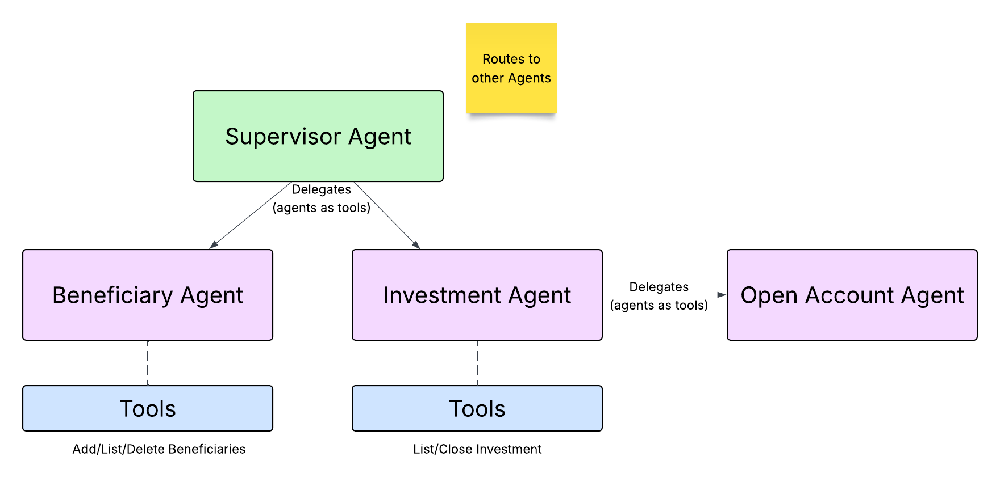

# Wealth Management Agent Example using Strands Agents

Demonstrates how to build a multi-agent wealth management assistant with
[Strands Agents](https://strandsagents.com/) using a supervisor that delegates to
specialized sub-agents (the Strands ["agents as tools"](https://strandsagents.com/latest/documentation/docs/user-guide/concepts/multi-agent/agents-as-tools/) pattern).

It ships in two flavors:

- **Strands only** (command-line) — [`standalone/`](standalone/README.md)
- **Temporal + Strands** (durable execution, with a **React frontend + FastAPI backend**) —
  [`durable/`](durable/README.md), which wraps the agentic flow with
  [Temporal](https://temporal.io) via the
  [`StrandsPlugin`](https://docs.temporal.io/develop/python/integrations/strands-agents).
  The web app is the shared [`frontend/`](../../../frontend/README.md) and the API the shared
  [`src/python/api`](../api/README.md); start it with `./startlocalapi.sh strands_agents`.

This port was imported from [temporal-sa/strands-wealth-management](https://github.com/temporal-sa/strands-wealth-management). It shares `src/python/common`, the API, the web application, the [Java worker](../../../interop/open_account/java/README.md) and `data/` with the other ports. Its own code:

| Folder | What it is |
|---|---|
| `standalone/` | The Strands version without Temporal |
| `durable/` | The Temporal version: workflows, activities, worker, the `StrandsPlugin` client (`client_helper.py`) and scripts |
| `prompts/` | The agents' instructions and the confirmation wording (`approval_prompts.py`) |
| `tests/` | The port's tests |

Its chat workflows run on the `wealth-management-strands` task queue by default (`DEFAULT_TASK_QUEUE` in `durable/model_config.py`), so its worker can run next to another port's, and the web app names them `strands-temporal-agent-<random>`. Unlike the other ports, its chat workflow pauses for the customer's approval before deleting a beneficiary or closing an account; the shared API (`/pending-approval`, `/approve`) and web app support this when the API serves this port.

Scenarios currently implemented include:

* **Add Beneficiary** — add a new beneficiary to your account
* **List Beneficiaries** — show beneficiaries and their relationship to the account owner
* **Delete Beneficiary** — delete a beneficiary from your account
* **Open Investment Account** — open a new investment account (using a **child workflow** in the Temporal version;
  there are Python and Java versions of that workflow, and the Python one is used by default)
* **List Investments** — show accounts and their current balances
* **Close Investment Account** — close an investment account
* **Off-topic questions** — questions that aren't about beneficiaries or investment accounts are politely declined by the supervisor agent (handled in the agents' prompts)

Deleting a beneficiary and closing an account ask the customer to confirm first.
In the Strands-only version, opening an account is a single direct tool call (no
KYC, compliance approval, or saga); the Temporal version runs the full
open-account flow in a child workflow.

The Temporal version also includes a **chaos panel** in the web UI for demonstrating
failures Temporal handles: tool and LLM outages, LLM rate limits, non-retryable
business-rule errors, a saga rollback, and a bug in workflow code. See
[Failure scenarios](durable/README.md#failure-scenarios-chaos-panel).

Optionally, the Temporal version can also:

* run the open-account child workflow in **Java** ([`interop/open_account/java`](../../../interop/open_account/java/README.md)) on its own task queue,
  calling the Python activities — see
  [Run with the Java open-account workflow](durable/README.md#run-with-the-java-open-account-workflow-optional);
* use the **claim check** pattern: payloads are stored in Redis and only their IDs are sent to
  Temporal, with a codec server so the Temporal UI can still show them — see
  [Claim check](durable/README.md#claim-check-optional).

## Architecture

A **Supervisor** agent talks to the customer and routes each request to a specialist:



In the **Temporal** version, opening an investment account is delegated by the
Investment Agent to a dedicated **Open Account Agent** that drives an
`OpenInvestmentAccountWorkflow` child workflow, gating on KYC and a human
compliance-approval signal before creating the account.

In the **Strands-only** (CLI) version there is no separate Open Account Agent:
opening is a single synchronous tool inside the Investment Agent, so that
agent does list / open / close.

## Prerequisites

* [uv](https://docs.astral.sh/uv/) — Python package and project manager
* Python 3.10 or later (`requires-python` in `pyproject.toml`; uv can install it for you)
* [Google / Gemini API key](https://aistudio.google.com/api-keys) — to access Gemini models
* [Temporal CLI](https://docs.temporal.io/cli#install) — local Temporal service (Temporal version only)
* [Redis](https://redis.io/downloads/) — stores conversation history, status updates, chaos flags and, optionally, claim check payloads (Temporal version only)
* [Node.js](https://nodejs.org/) 18+ and npm — for the React frontend (Temporal version only)
* [Java JDK 25](https://adoptium.net/) — optional, only for the Java open-account workflow ([interop/open_account/java/README.md](../../../interop/open_account/java/README.md)); the Gradle wrapper is included

## Set up the Python environment

```bash
cd src/python/strands_agents
uv sync
```

## Set up your Gemini API key

From the repository root:

```bash
cp scripts/setgeminikey.example scripts/setgeminikey.sh
chmod +x scripts/setgeminikey.sh
```

Edit `scripts/setgeminikey.sh` and paste in your key:

```bash
export GEMINI_API_KEY="Your API Key Goes Here"
```

The start scripts source `scripts/setgeminikey.sh` if it exists (and
`scripts/setclaimcheck.sh`, for the optional claim check; see `scripts/setclaimcheck.example`).

## Getting started

* Strands-only CLI version → [standalone/README.md](standalone/README.md)
* Temporal + Strands version → [durable/README.md](durable/README.md)

## Running the tests

```bash
cd src/python/strands_agents
uv run pytest
```

The tests use a scripted model and stub activities, so they need no Gemini API key
and no Redis. The workflow tests start a local Temporal test server, which is
downloaded automatically on first run.

The Java open-account workflow has its own tests (JDK 25): `cd interop/open_account/java && ./gradlew test`.

A separate live test of the agent routing calls the paid Gemini API and is not part
of that run: `source ../../../scripts/setgeminikey.sh && uv run pytest tests/live_agent_handoffs.py -s`
(see [durable/README.md](durable/README.md#live-agent-routing-test-calls-the-paid-gemini-api)).
Live tests of opening an account (reopening it after a rollback, and opening the same
account name twice, each with its own KYC) also call the paid API: `source ../../../scripts/setgeminikey.sh && uv run pytest tests/live_account_opening.py -s`
(see [durable/README.md](durable/README.md#live-account-opening-tests-call-the-paid-gemini-api)).

## Resetting the demo data

Both versions read and write the JSON files in `data/` (beneficiaries, investment
accounts, client details, and linked bank account balances), so adding or deleting
beneficiaries and opening or closing accounts change them. To restore the original
data, from the repository root:

```bash
git checkout data/
```
