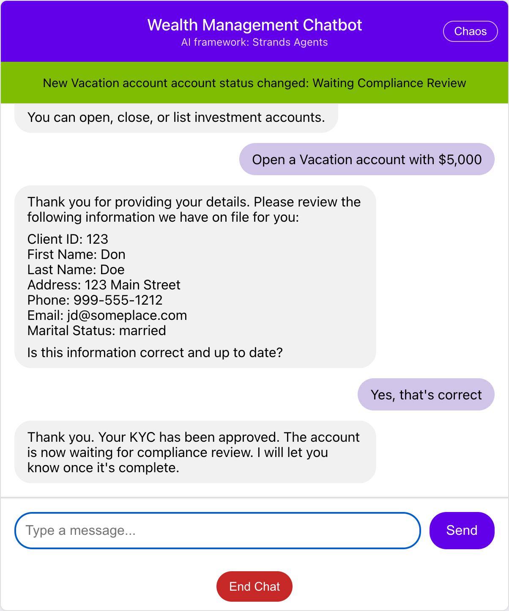
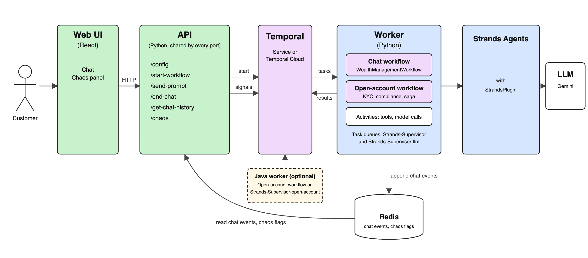
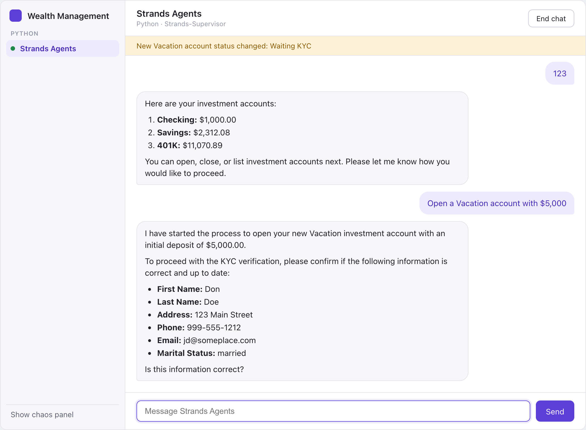
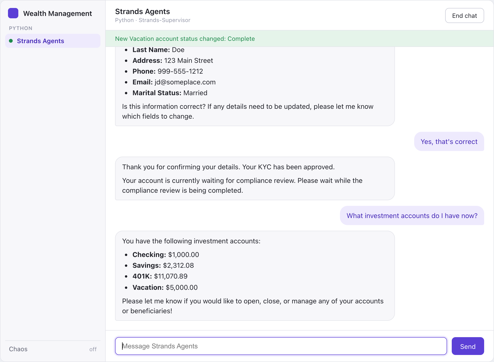
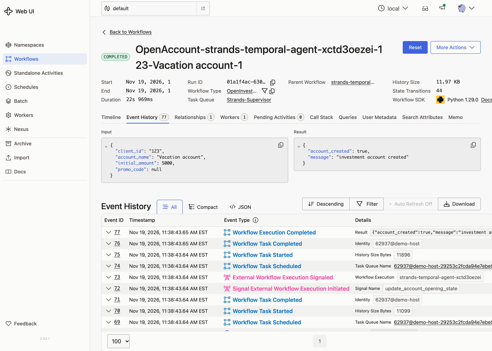

# Strands Agents: Temporal version

This is the [Strands Agents](https://strandsagents.com/) wealth management assistant running inside a
Temporal workflow. The agents run in the chat workflow, and every model call and tool call is a Temporal
activity, so each step is recorded in the workflow history and survives crashes, restarts and outages.
The integration is Temporal's
[`StrandsPlugin`](https://docs.temporal.io/develop/python/integrations/strands-agents)
(`temporalio.contrib.strands`): agents are `TemporalAgent`s and activities become tools with
`activity_as_tool`.

Setup (Python, dependencies and the Gemini key in `scripts/setgeminikey.sh`) is in the
[framework's README](../README.md). The version without Temporal is in [standalone/](../standalone/README.md).



## Architecture



- **Web UI and API.** The customer chats in the shared web UI ([frontend/](../../../../frontend/README.md)).
  It calls the shared [API](../../api/README.md), started with the argument `strands_agents`, which starts
  chat workflows named `strands-temporal-agent-<random>` and sends them the customer's messages as signals.
- **Chat workflow** (`WealthManagementWorkflow`, `workflows/supervisor_workflow.py`). A supervisor
  `TemporalAgent` delegates each request to specialist agents exposed to it as tools (see
  [How the agents work](#how-the-agents-work)). The `StrandsPlugin` runs every model call as an activity on
  the LLM task queue and every activity tool as an activity on the main task queue.
- **Open-account workflow** (`OpenInvestmentAccountWorkflow`, `workflows/open_account_workflow.py`). A child
  workflow that runs KYC, waits for compliance approval and then runs a saga to create, fund and register
  the account. It can also run in Java.
- **Worker** (`run_worker.py`). Polls two task queues: `Strands-Supervisor` for the workflows and tools,
  and `Strands-Supervisor-llm` for the model calls, so model calls can be rate limited on their own.
- **Redis.** Holds the chat's event stream (messages and account-opening status updates) that the web UI
  reads through the API, the chaos flags, and, if turned on, the claim check payloads.

The chat keeps the whole conversation in one workflow run. A production version would need
continue-as-new for long conversations (see the TODO in `workflows/supervisor_workflow.py`).

### How the agents work

Strands has no agent-to-agent handoff, so this framework uses the Strands
["agents as tools"](https://strandsagents.com/latest/documentation/docs/user-guide/concepts/multi-agent/agents-as-tools/)
pattern, nested two levels deep. Each specialist is itself a `TemporalAgent`, wrapped in a Strands `@tool`
(`_make_*_assistant` in `workflows/supervisor_workflow.py`):

| Agent | Called by | Tools |
|---|---|---|
| Supervisor | the chat workflow, once per customer message | `beneficiary_assistant`, `investment_assistant` |
| Beneficiary agent (`beneficiary_assistant`) | Supervisor | `list_beneficiaries`, `add_beneficiary`, `delete_beneficiary` (activities) |
| Investment agent (`investment_assistant`) | Supervisor | `list_investments`, `close_investment` (activities), `open_account_assistant` |
| Open-account agent (`open_account_assistant`) | Investment agent | `open_new_investment_account`, `get_account_opening_status`, `get_current_client_info`, `approve_kyc`, `update_client_details` |

- **Delegation is one way.** A caller passes the client ID and the request to a specialist and relays its
  reply; a specialist never calls back up. Every customer message reaches the supervisor first.
- **The specialists are persistent.** Each is built once per conversation and reused across turns, so it
  remembers the question it asked, like a handoff in the other frameworks. The open-account agent holds the
  open-account workflow ID while it walks the customer through KYC, and it is given the current status of
  every account opening at the start of each turn.
- **Model calls.** Every agent uses the model `gemini` (`gemini-2.5-flash`, `model_config.py`), called in an
  activity on `Strands-Supervisor-llm` with `LLM_RETRY_POLICY`. `ChaosAwareGeminiModel` adds the chaos flags
  and turns Gemini throttling into a rate-limit error.
- **Tools.** Activity tools are wrapped with `activity_as_tool` and `TOOL_RETRY_POLICY`. The open-account
  tools are plain `@tool` functions that run in the workflow and call activities themselves.
- **Off-topic questions** are declined by the supervisor's prompt (`prompts/agent_constants.py`); there is
  no guardrail code.
- **Confirming a delete or close.** As in the other frameworks, deleting a beneficiary or closing an account is
  confirmed in the chat. The agent asks ("Are you sure you want to delete beneficiary John Doe?") and the
  turn ends with the question; the customer's next message answers it. `ConfirmationGuard`, a Strands hook
  on the specialists, makes sure the agent really asked: the first `delete_beneficiary` or
  `close_investment` call is refused with an instruction to ask, and the turn is recorded in workflow
  state. The same call runs only in the customer's next message. A call in the same turn, or for a question
  asked earlier in the conversation, is refused and asked again. If the customer answers no, the agent says
  it wasn't done.

## Running locally

Each command runs in its own terminal, from the repository root.

### Start Temporal and Redis

```bash
temporal server start-dev
```

```bash
redis-server
```

### Start the worker

```bash
./src/python/strands_agents/durable/startlocalworker.sh
```

The worker polls `Strands-Supervisor` and `Strands-Supervisor-llm`, so it can run next to other frameworks'
workers on the same Temporal service. The script sources `scripts/setgeminikey.sh` and
`scripts/setclaimcheck.sh` if they exist.

### Start the API

```bash
./src/python/api/startlocalapi.sh strands_agents
```

The API listens on http://127.0.0.1:8000. Its endpoints are listed in the [API README](../../api/README.md).

### Start the web UI

```bash
cd frontend && npm install && npm start
```

The web UI opens at http://localhost:3000. Click
**Start Chat**, then use client ID `123` or `234`.

### Approve compliance

Compliance approval is sent from a terminal; there is no button in the web UI. The open-account workflow's
ID is `OpenAccount-<chat workflow ID>-<client ID>-<account name>-<n>`, where `<n>` counts the account
openings started in the conversation, this one included, for example
`OpenAccount-strands-temporal-agent-k3j9x2m1q-123-Vacation-1`. The web UI doesn't show it. Find the
**Running** `OpenInvestmentAccountWorkflow` in the [Temporal UI](http://localhost:8233) (a child of your
chat workflow), or list them:

```bash
temporal workflow list --query "WorkflowType='OpenInvestmentAccountWorkflow' AND ExecutionStatus='Running'"
```

Then send the approval:

```bash
./src/python/strands_agents/durable/localsendcomplianceapproval.sh <child workflow ID>
```

Quote the ID if the account name contains spaces. If you asked for the same account name twice, the list
shows both openings (`...-Vacation-1` and `...-Vacation-2`); approve the one whose KYC you confirmed. The
signal waits until KYC is approved, so send it after you have confirmed your details.

### What you'll see

Waiting for the customer to confirm their details (KYC):



Waiting for compliance approval:


The account opened:



The open-account workflow in the Temporal UI:



### Resetting the demo data

Opening and closing accounts, adding and deleting beneficiaries, changing client details during KYC, and
the saga's transfers (balances in `data/funding_accounts.json`) change the JSON files in `data/`. Restore
them from the repository root:

```bash
git checkout data/
```

## How account opening works

1. The customer asks to open an account. The supervisor calls `investment_assistant`, which hands the
   whole flow to the persistent `open_account_assistant`.
2. Its `open_new_investment_account` tool runs `validate_new_account` (at least $100, at most $1,000,000).
   A violation is a non-retryable error, and the reason goes back to the agent. It then looks up any
   promotion (`find_promotion`) and starts `OpenInvestmentAccountWorkflow` as a child workflow with the ID
   `OpenAccount-<chat workflow ID>-<client ID>-<account name>-<n>`. The tool tells the agent that the
   account is not open yet.
3. Every request to open an account starts a new opening with its own KYC, even if an account with the same
   name was opened, or is still being opened, earlier in the conversation: Vacation twice gives
   `...-Vacation-1` and `...-Vacation-2`, which can both be pending. A request refused by the business
   rules starts nothing and doesn't use up a number.
4. **KYC.** The child loads the client and waits in *Waiting KYC*. The agent shows the customer's details
   (`get_current_client_info`, which calls the child's `get_client_details` update) and asks whether they
   are correct. **The KYC guard:** `approve_kyc` (the `verify_kyc` signal) is refused unless this opening's
   details were shown in an earlier customer turn, so the customer must confirm in a later message, and a
   confirmation for one opening doesn't approve another. If details need changing, `update_client_details`
   (an update) saves them and completes KYC.
5. **Status updates.** The child signals each state change to the chat workflow
   (`update_account_opening_state`). The web UI shows it as `New <account> account status changed: <state>`,
   and the agent reads it with `get_account_opening_status`, so it reports the real status, not what it
   remembers.
6. **Compliance approval.** The child waits in *Waiting Compliance Review* for the `compliance_approved`
   signal (see [Approve compliance](#approve-compliance)).
7. **Saga.** The child creates the account record (`open_investment`), transfers the deposit from the
   linked bank account (`debit_linked_account`) and registers the account with the custodian
   (`register_account`). If a step fails non-retryably, the completed steps are undone in reverse order
   (`credit_linked_account`, then `remove_investment`) and the state ends with *Rolled back*. Otherwise it
   ends with *Complete*.

Ending the chat terminates its pending openings (`ParentClosePolicy.TERMINATE`).

### Testing the open-account workflow on its own

`startlocalopenaccount.sh` runs `OpenInvestmentAccountWorkflow` without the chat or the model (no Gemini
key needed). It starts a worker in the background, runs `run_open_account_workflow.py` and stops the worker
when it finishes. It runs three scenarios for client `123`:

1. KYC approved (`verify_kyc`), then compliance approved.
2. Client details read (`get_client_details`) and changed (`update_client_details`, which completes KYC:
   client 123's last name becomes "Doenut"), then compliance approved.
3. KYC approved, then the workflow waits in *Waiting Compliance Review* until you send the approval
   yourself. The script prints the command, for example
   `./src/python/strands_agents/durable/localsendcomplianceapproval.sh testing-open-account-<run>-3`.

Temporal must be running (and Redis, for the chaos flags the activities read).

```bash
./src/python/strands_agents/durable/startlocalopenaccount.sh
```

With the argument `java`, the workflow runs on `Strands-Supervisor-open-account`, so the same scenarios run
on the Java worker (start it first; see [Java open-account worker](#java-open-account-worker-optional)):

```bash
./src/python/strands_agents/durable/startlocalopenaccount.sh java
```

Further arguments go to `run_open_account_workflow.py`: `--scenario N` (repeatable) runs only some
scenarios, and `--amount X` sets the initial deposit, for example `--scenario 1 --amount 300000` to see the
saga roll back. Each run uses new workflow IDs (`testing-open-account-<run>-<scenario>`). Like the demo,
the scenarios change `data/*.json`.

## Java open-account worker (optional)

[interop/open_account/java](../../../../interop/open_account/java/README.md) has a Java version of
`OpenInvestmentAccountWorkflow` with the same states, updates, signals, saga and status updates. It calls
the Python activities by name on `Strands-Supervisor`. Start this framework's worker with the argument `java`:

```bash
./src/python/strands_agents/durable/startlocalworker.sh java
```

The chat workflow then starts the open-account workflow on `Strands-Supervisor-open-account`, and the
Python worker doesn't register its own version (it still runs all the activities). Start the Java worker
for this framework (JDK 25):

```bash
TEMPORAL_TASK_QUEUE=Strands-Supervisor ./interop/open_account/java/startlocalworker.sh
```

Without the argument, everything runs in Python. On Temporal Cloud, use `startcloudworker.sh java` and the
Java worker's `startcloudworker.sh`.

## Failure scenarios (chaos panel)

Click **Chaos** in the chat header to open the chaos panel. Its switches inject failures at runtime: the
activities and the model read the flags from Redis on every attempt, so you can turn a failure on and off
mid-conversation without restarting anything. The panel lists each injected failure as it happens. Open
the [Temporal UI](http://localhost:8233) alongside it to show the pending activity, its attempt count and
the last failure. **Reset all** turns every flag off. The flags are shared by every framework using the same
Redis.

| Scenario | How to show it | What Temporal does |
|---|---|---|
| Tool / API down | Turn on *Core banking API down*, then ask to list your investments (or open an account, so it fails after compliance approval). Turn it off. | The activity retries (1s backoff, capped at 5s) for as long as the outage lasts. The agent waits mid-turn and answers once the API is back. |
| LLM down | Turn on *LLM API down* and send a message. Turn it off. | The model call is an activity, so it retries the same way (capped at 10s). The conversation picks up where it was. |
| LLM rate limited (reactive) | Turn on *LLM rate limited (429)* and send a message. | The model raises an `ApplicationError` with `next_retry_delay` (15s, like a `Retry-After` header), which overrides the retry policy's backoff. Real Gemini throttling is handled the same way (`ChaosAwareGeminiModel` in `model_config.py`). |
| LLM rate limited (proactive) | Start the worker with `LLM_MAX_CALLS_PER_SECOND=0.2 ./src/python/strands_agents/durable/startlocalworker.sh`, then chat in several browser tabs at once. | Model calls run on `Strands-Supervisor-llm`. The Temporal service dispatches at most that many per second across all workers, so calls queue up instead of hitting the provider's limit. Tools aren't slowed down. |
| Business rule (non-retryable) | Ask to open an account with $2,000,000 (or less than $100). | `validate_new_account` raises a non-retryable `ApplicationError`: one attempt, no retries. The agent explains the reason. |
| Saga | Turn on *Custodian rejects new accounts* (and *Slow account-opening steps* to watch), then open an account through compliance approval. Without flags: as client `123`, open an account with $300,000 (the linked bank account has $250,000). | The completed steps are undone in reverse order (refund, then remove the account). Compensations are activities, so they are retried until they succeed; kill the worker mid-rollback and it still finishes. |
| Bug in workflow code | Turn on *Bug in workflow code*, then open an account through compliance approval. | The workflow pauses at the failing line, keeping its state, until a worker with fixed code picks it up. See below. |

Transfers are idempotent: the transfer ID is `<child workflow ID>-<run ID>-initial-deposit` (refunds add
`-refund`), so a retried debit or refund never moves money twice. Opening an account with the same name
after a rollback is a new opening with a new ID, and so a new transfer. All the scenarios work the same
with the Java open-account workflow, because it calls the same Python activities.

### Bug in workflow code

While **Bug in workflow code** is on, `find_promotion` gives new openings the `WELCOME-BONUS` promo code,
which is part of the open-account workflow's input. The welcome-bonus path (`_welcome_bonus` in
`workflows/open_account_workflow.py`) reads `inputs.initial_deposit`, a field that doesn't exist. Right
after compliance approval it raises `AttributeError`. In the Python SDK this fails the workflow task, not
the workflow, so the workflow stays **Running** with the compliance approval intact, and the Temporal UI
shows the failing workflow task and its stack trace. Other chats and openings without the promo code keep
working.

Turning the switch off doesn't help, because the promo code is in the workflow's input. Fix the code:
change `inputs.initial_deposit` to `inputs.initial_amount` and restart the worker. The workflow resumes on
the next workflow-task retry (these back off up to 10 minutes; a fix within a couple of minutes resumes
within about a minute) and opens the account with the bonus. Re-arm the bug afterwards:

```bash
git checkout src/python/strands_agents/durable/workflows/open_account_workflow.py
```

In the Java version, `BONUS_RATES` in `OpenInvestmentAccountWorkflowImpl.java` is keyed by `WELCOME_BONUS`
instead of `WELCOME-BONUS`, so `welcomeBonus` throws a `NullPointerException`; the fix is the commented-out
line above it (see the [Java README](../../../../interop/open_account/java/README.md)).

## Claim check and codec server (optional)

The [claim check pattern](https://www.enterpriseintegrationpatterns.com/patterns/messaging/StoreInLibrary.html)
stores each payload sent to Temporal (workflow and activity inputs and results, signals, updates, model
calls) in Redis and sends only its ID. A
[custom payload codec](https://docs.temporal.io/develop/python/converters-and-encryption#custom-payload-codec)
(`src/python/common/claim_check/`) does the substitution. In this framework, `connect_client` in
`client_helper.py` builds every Temporal client and adds `ClaimCheckPlugin` after the `StrandsPlugin` when
`USE_CLAIM_CHECK=true`. To turn it on:

```bash
cp scripts/setclaimcheck.example scripts/setclaimcheck.sh
```

The worker, API, compliance approval, open-account scenarios, codec server and Java worker scripts source
it if it exists. Every component must agree: a client without the codec can't read claim-checked
payloads. Redis must be running, and every payload costs a round trip to it, so a production deployment
needs a highly available store.

With claim check on, the Temporal UI shows only IDs. To see the payloads, start the codec server
(http://127.0.0.1:8081):

```bash
./src/python/strands_agents/durable/startcodecserver.sh
```

Open the Temporal UI at exactly http://localhost:8233 (not 127.0.0.1; the codec server accepts requests
only from there and from https://cloud.temporal.io). Click the glasses icon in the upper right, choose "Use
my browser setting and ignore Cluster-level setting", enter `http://127.0.0.1:8081` with no trailing
spaces, turn off "Pass the user access token" and "Include cross-origin credentials", and click **Apply**.


## Running on Temporal Cloud

Redis still runs locally. Create the cloud settings file and fill in your namespace, address and mTLS
certificate paths:

```bash
cp scripts/setcloudenv.example scripts/setcloudenv.sh
```

This framework connects with mTLS only (`TEMPORAL_TLS_CLIENT_CERT_PATH` and `TEMPORAL_TLS_CLIENT_KEY_PATH`);
it doesn't read `TEMPORAL_API_KEY`. Start the worker and the API (the web UI starts as before):

```bash
./src/python/strands_agents/durable/startcloudworker.sh
```

```bash
./src/python/api/startcloudapi.sh strands_agents
```

Send the compliance approval with the cloud script, and find the workflow ID in the Temporal Cloud UI:

```bash
./src/python/strands_agents/durable/sendcomplianceapproval.sh <child workflow ID>
```

For the Java open-account worker, start the worker with `startcloudworker.sh java` and the Java worker with
`TEMPORAL_TASK_QUEUE=Strands-Supervisor ./startcloudworker.sh`.

## Environment variables

| Variable | Default | Purpose |
|---|---|---|
| `GEMINI_API_KEY` (or `GOOGLE_API_KEY`) | none | Gemini API key for the worker (`scripts/setgeminikey.sh`) |
| `TEMPORAL_ADDRESS` | `localhost:7233` | Temporal service address |
| `TEMPORAL_NAMESPACE` | `default` | Temporal namespace |
| `TEMPORAL_TLS_CLIENT_CERT_PATH`, `TEMPORAL_TLS_CLIENT_KEY_PATH` | none | mTLS certificate and key for Temporal Cloud (both must be set) |
| `TEMPORAL_TASK_QUEUE` | `Strands-Supervisor` | Main task queue (workflows and tools); `DEFAULT_TASK_QUEUE` in `model_config.py`. The worker, API and Java worker must agree |
| `TEMPORAL_TASK_QUEUE_LLM` | `<TEMPORAL_TASK_QUEUE>-llm` | Task queue for model calls. The older name `TEMPORAL_LLM_TASK_QUEUE` is still accepted |
| `TEMPORAL_TASK_QUEUE_OPEN_ACCOUNT` | `<TEMPORAL_TASK_QUEUE>` | Task queue for the open-account workflow. `java` means `<TEMPORAL_TASK_QUEUE>-open-account`; set by the worker scripts' argument. When it differs from the main queue, the Python worker doesn't register `OpenInvestmentAccountWorkflow` |
| `LLM_MAX_CALLS_PER_SECOND` | unset (no limit) | Most model calls per second dispatched from the LLM queue, across all workers |
| `REDIS_URL` | none | `redis://:<password>@<host>:<port>/<db>`; wins over the three below |
| `REDIS_HOST`, `REDIS_PORT`, `REDIS_PASSWORD` | `localhost`, `6379`, none | Redis for the event stream, chaos flags and claim check payloads |
| `USE_CLAIM_CHECK` | `false` | `true` turns on the claim check codec (`scripts/setclaimcheck.sh`) |

The scripts pass the environment through, so you can prefix any of them, for example
`LLM_MAX_CALLS_PER_SECOND=0.2 ./src/python/strands_agents/durable/startlocalworker.sh`.

## Tests

### Default tests

```bash
cd src/python/strands_agents && uv run pytest
```

Nothing needs to be running: the tests use a scripted model, stub activities and an in-memory stand-in for
Redis, so no Gemini key or Redis is needed. The Temporal test server is downloaded on the first run.

| File | Covers |
|---|---|
| `tests/test_chat_confirmation.py` | Confirming a delete in the chat: yes runs it once, no blocks it, a call in the same turn is refused |
| `tests/test_kyc_guard.py` | The KYC guard, and a new opening (with its own KYC) for every request, even for the same account name |
| `tests/test_account_opening_status.py` | The open-account agent gets the current status of every opening each turn |
| `tests/test_failure_scenarios.py` | Saga rollback, a new transfer ID per run, idempotent transfers, business rules, tool and LLM outages retried until recovery, rate limits, the workflow bug |
| `tests/test_claim_check.py` | The claim check codec, plugin and codec server, and the open-account task-queue split |
| `tests/test_api_client.py` | The shared API's calls (start, message, confirm, end) against the real chat workflow |
| `tests/test_off_topic.py` | Off-topic questions are declined by the supervisor's prompt |

The Java workflow has its own tests; see the [Java README](../../../../interop/open_account/java/README.md).

### Live tests

These run the real `WealthManagementWorkflow` against the real Gemini model, so they call the paid API.
pytest doesn't collect them by default (they aren't named `test_*.py`), and they are skipped when
`GEMINI_API_KEY` isn't set. The Redis event stream and chaos flags are stubbed, so no Redis is needed.
`LIVE_TEST_RUNS=<n>` repeats each conversation n times (default 1). Run them from `src/python/strands_agents`.

```bash
cd src/python/strands_agents && source ../../../scripts/setgeminikey.sh && uv run pytest tests/live_agent_handoffs.py -s
```

Agent routing: the customer asks for their beneficiaries, gives client ID `123`, then asks for their
investments. It checks that the beneficiaries are listed, that in the same turn the supervisor calls
`investment_assistant` and the reply lists Checking, Savings and 401K, and that no agent mentions a
transfer or asks for the client ID again.

```bash
cd src/python/strands_agents && source ../../../scripts/setgeminikey.sh && uv run pytest tests/live_account_opening.py -s
```

Account opening, two tests (add `-k same_account_twice` to run one). `test_open_account_after_a_rollback`:
the custodian rejects a Vacation account, the saga rolls it back, and opening Vacation again starts a new
opening with its own KYC (`...-Vacation-1`, then `...-Vacation-2`), with no agent saying the account is open
before it is. `test_open_the_same_account_twice`: opening Vacation twice shows the client's details for KYC
both times and starts two child workflows. The saga steps and KYC activities are stubbed, so the data files
don't change. These make many more model calls than the routing test.

```bash
cd src/python/strands_agents && source ../../../scripts/setgeminikey.sh && uv run pytest tests/live_confirmations.py -s
```

Confirmations: as client 123, the customer asks to delete beneficiary Jane Doe or close their Savings
account, then answers yes or no. It checks that nothing changes before the answer, that the agent asks
"Are you sure...?" naming the beneficiary or account, that yes deletes or closes exactly that one once,
and that no changes nothing. The delete and close activities only record the call.

## Temporal contracts

| Workflow | Kind | Name | Payload |
|---|---|---|---|
| `WealthManagementWorkflow` | input | | none |
| | signal | `process_user_message` | `{"user_input": str}` |
| | signal | `update_account_opening_state` | `{"account_name": str, "state": str, "workflow_id": str}` |
| | signal | `end_workflow` | none |
| | query | `get_chat_history` | list of `{"user_prompt", "text_response", "json_response", "agent_trace"}` |
| | query | `get_status_updates` | list of status strings (used by the CLI client) |
| `OpenInvestmentAccountWorkflow` | input | | `{"client_id": str, "account_name": str, "initial_amount": float, "promo_code": str or null}` |
| | result | | `{"account_created": bool, "message": str}` |
| | query | `get_current_state` | the current state, a string |
| | update | `get_client_details` | returns the client (`first_name`, `last_name`, `address`, `phone`, `email`, `marital_status`) |
| | update | `update_client_details` | a dict of the fields to change; completes KYC |
| | signal | `verify_kyc` | none |
| | signal | `compliance_approved` | none; waits until KYC is approved |

Activities, by name, on `Strands-Supervisor`:

- Beneficiaries: `list_beneficiaries(client_id)`, `add_beneficiary(client_id, first_name, last_name, relationship)`, `delete_beneficiary(client_id, beneficiary_id)`.
- Investments: `list_investments(client_id)`, `close_investment(client_id, investment_id)`,
  `validate_new_account(client_id, account_name, initial_amount)`, `find_promotion(client_id)`,
  `open_investment({client_id, name, balance})`, `remove_investment(client_id, investment_id)`.
- Saga: `debit_linked_account` and `credit_linked_account(client_id, amount, transfer_id)`,
  `register_account(client_id, investment_id, amount)`.
- Clients and KYC: `get_client(client_id)`, `update_client(client_id, fields)`, `get_current_client_info(workflow_id)`,
  `approve_kyc(workflow_id)`, `update_client_details(workflow_id, fields)`.
- Event stream (local activities): `append_chat_interaction`, `append_status_update`, `delete_conversation`,
  each taking the chat workflow ID (and the event).

## Framework notes

**CLI client.** A command-line client drives the chat workflow without the API or web UI (the worker must
be running):

```bash
./src/python/strands_agents/durable/startchat.sh
```

It starts a chat workflow named `wealth-management-<uuid>` (printed at start), prints status updates as
`[status] ...`, and stops on `exit`, `quit` or `end`. It doesn't source `scripts/setcloudenv.sh`; for
Temporal Cloud, source it in your shell first.

**Standalone version.** The [standalone](../standalone/README.md) version uses the same agents-as-tools
topology without Temporal; there, opening an account is a single synchronous tool in the investment agent
rather than a child workflow.
