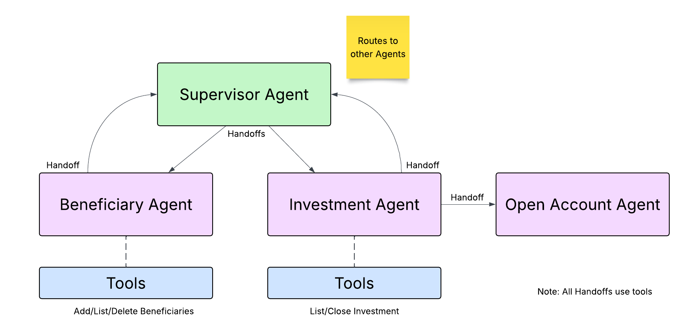
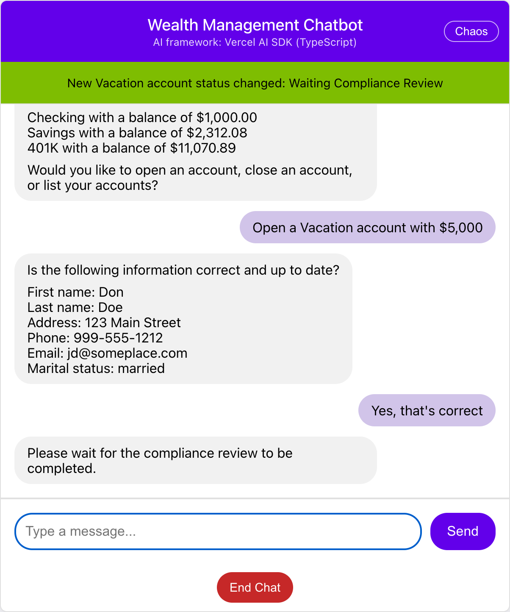
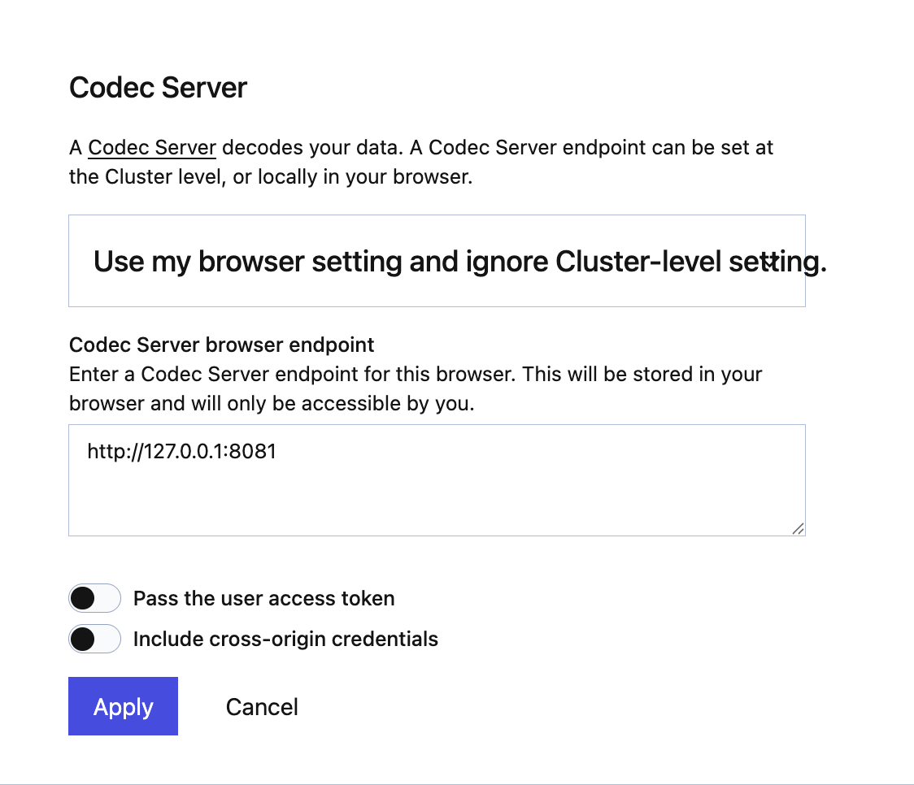

# Temporal version: Google ADK for TypeScript on Temporal

The agents run inside a Temporal workflow with Temporal's
[Google ADK integration](https://docs.temporal.io/develop/typescript/integrations/google-adk-agents)
(`@temporalio/google-adk`). The ADK runner, the agent loop and the handoffs run in the workflow;
every model call is an activity, and every tool that touches the outside world runs an activity. A
turn interrupted by an outage or a worker crash resumes where it stopped, and nothing the customer
said is lost or asked again.

Opening an account starts a child workflow with KYC, a compliance officer's approval and a saga.

## Architecture



* **Chat workflow** (`WealthManagementWorkflow`, [`workflows/wealth-management.ts`](workflows/wealth-management.ts)):
  one long-lived workflow per chat. It builds the ADK agent tree ([`adk_agents/agents.ts`](../adk_agents/agents.ts))
  and runs ADK's `InMemoryRunner` on each customer message, one at a time. Each agent's model is a
  `TemporalModel`, so each model call is the integration's `adk-invokeModel` activity on the model task
  queue. The tools are ADK `FunctionTool`s in workflow code that run the tool activities. After each
  turn the workflow appends a `chat_interaction` event to the Redis stream the UI polls.
* **Open-account workflow** (`OpenInvestmentAccountWorkflow`, [`workflows/open-account.ts`](workflows/open-account.ts)):
  a child per account opening. It signals every state change to the chat workflow, which records it
  for the agent's `get_account_opening_status` tool and appends a `status_update` event to the stream.
* **Worker** ([`worker.ts`](worker.ts)): runs both workflows and every activity on `TEMPORAL_TASK_QUEUE`,
  and the model activity on `<TEMPORAL_TASK_QUEUE>-llm`, where the Temporal service can rate-limit
  model calls. `GoogleAdkPlugin` bundles ADK into the workflow sandbox and registers the model activity.
* **API** ([`src/python/api`](../../../python/api/README.md), the one API every port shares) and the **web UI**
  ([`frontend/`](../../../../frontend/README.md)): the UI talks only to the API, and the API only to Temporal and
  Redis. The API starts this port's chat workflows with `google_adk_ts` as its AI framework.
* A compliance officer approves an opening from outside the chat, with
  [`localsendcomplianceapproval.sh`](localsendcomplianceapproval.sh).

What the integration does, and what this port adds:

| Concern | How |
| --- | --- |
| Agent loop and handoffs | ADK's runner in the workflow; agents hand off with ADK's `transfer_to_agent`, in the same turn |
| Model calls | `new TemporalModel(model, { activity: { taskQueue, startToCloseTimeout, retry } })`: an activity per call, retried by Temporal (the integration turns the Gen AI SDK's own retries off) |
| Tools | `FunctionTool`s that run activities through `proxyActivities`. ADK runs a turn's tool calls one at a time, so the open-account numbering can't collide |
| Client ID | A before-tool callback saves the first `client_id` a tool gets; each agent's instruction function adds it from then on |
| Chaos on the model | The plugin's `modelProvider` wraps Gemini ([`chaos-model.ts`](chaos-model.ts)). An `ApplicationFailure` thrown there reaches Temporal unchanged, so the 429's retry delay is kept with no interceptor |
| State | Client ID, account-opening states and count, the turn number and the KYC guard are workflow variables, deterministic on replay |

## Running locally

Install the dependencies and set up your Gemini key as described in the [port's README](../README.md).

### Start Temporal and Redis

```bash
temporal server start-dev
```

```bash
redis-server
```

### Start the worker

```bash
src/typescript/google_adk/durable/startlocalworker.sh
```

It sources `scripts/setgeminikey.sh` and, if it exists, `scripts/setclaimcheck.sh`. It polls the
`ADK-TS-Supervisor` task queue, so it can run next to another port's worker, and prints the claim-check state,
the task queues and the model at startup.

### Start the API

```bash
src/python/api/startlocalapi.sh google_adk_ts
```

The argument is the AI framework the API serves. The web app names this port's chats
`adk-ts-temporal-agent-<random>`.

### Start the web UI

```bash
cd frontend && npm start
```

Open http://localhost:3000. **Start Chat** starts a chat workflow with the ID `adk-ts-temporal-agent-<random>`.
Watch the workflows in the Temporal UI at http://localhost:8233.

### Send the compliance approval

After the customer confirms their details, the opening waits for compliance review:



Find the opening's workflow ID in the Temporal UI, or list the openings:

```bash
temporal workflow list --query 'WorkflowType="OpenInvestmentAccountWorkflow" AND ExecutionStatus="Running"'
```

Then approve it:

```bash
src/typescript/google_adk/durable/localsendcomplianceapproval.sh "OpenAccount-adk-ts-temporal-agent-<random>-123-Vacation-1"
```

The saga runs, its states appear in the UI, and the agent reports the result when asked.

## How account opening works

1. The customer asks to open an account. The Investment Agent transfers to the Open Account Agent,
   which calls `open_new_investment_account`.
2. The tool checks the deposit with the `validate_new_account` activity first: from $100 to $1,000,000.
   A refusal goes back to the agent, which explains it, and no workflow starts.
3. It starts the child workflow with the ID `OpenAccount-<chat workflow ID>-<client ID>-<account name>-<n>`,
   where the account name is as given and `<n>` counts the openings started in this chat (1, 2, ...).
   **Every request starts a new opening with its own KYC**, even for an account name used earlier
   in the chat. The count goes up only once the child has started, so a refused request doesn't use
   up a number. The child runs on `TEMPORAL_TASK_QUEUE_OPEN_ACCOUNT` (default: the chat's queue),
   with parent close policy `TERMINATE`, and its state is `Initializing` from the start.
4. KYC: the agent shows the customer's details (`get_current_client_info`, the child's
   `get_client_details` update) and asks whether they are correct. It approves KYC
   (`approve_kyc`, the `verify_kyc` signal) only when the customer confirms in a later message: the
   tool refuses until this opening's details appeared in a reply in an earlier turn. If the customer
   changes a detail instead, `update_client_details` saves it and completes KYC.
5. Compliance: the opening waits for a compliance officer's `compliance_approved` signal.
6. The saga: `Creating the account record.` (`open_investment`), `Transferring $<amount> from the linked bank account.`
   (`debit_linked_account`), `Registering the account with the custodian.` (`register_account`), then
   `Complete`. If a step fails for a business reason, the completed steps are undone in reverse order,
   reporting `Rolling back: ...`, and the opening ends `Rolled back. The account was not opened: <reason>.`
   Transfer IDs are `<workflow ID>-<run ID>-initial-deposit` (and `...-refund`), so a retried transfer
   never moves the money twice.

The agent reads an opening's status with `get_account_opening_status`, which returns the latest
state the child reported, never from memory.

To see every opening a chat started:

```bash
temporal workflow list --query 'WorkflowId STARTS_WITH "OpenAccount-adk-ts-temporal-agent-"'
```

### With the Java open-account workflow

Start the worker with a task queue name for the open-account workflow, and the
[Java worker](../../../../interop/open_account/java/README.md) with the same name:

```bash
src/typescript/google_adk/durable/startlocalworker.sh Open-Account-Java
```

```bash
cd interop/open_account/java && TEMPORAL_TASK_QUEUE=ADK-TS-Supervisor ./startlocalworker.sh Open-Account-Java
```

The Java workflow calls this worker's activities by name, so the chaos flags apply unchanged.

### Testing the open-account workflow on its own

[`startlocalopenaccount.sh`](startlocalopenaccount.sh) starts a worker that needs no model key and
runs `OpenInvestmentAccountWorkflow` directly, with no chat, for three scenarios: KYC approved; client
details updated (which completes KYC); and a compliance approval you send by hand. It stops its worker
on exit. With Temporal running:

```bash
src/typescript/google_adk/durable/startlocalopenaccount.sh
```

For scenario 3, send the approval from another terminal with the command it prints. To run the
scenarios against the Java workflow, start the Java worker first and pass its queue:

```bash
src/typescript/google_adk/durable/startlocalopenaccount.sh Open-Account-Java
```

`--scenario N` runs one scenario, and `--amount X` changes the deposit (300000 shows the rollback for
client 123). The scenarios change `data/`; reset it with `git checkout data/`.

## Failure scenarios

Every failure is switched on from the chaos panel in the web UI, at runtime, with no restart. The
activities and the model wrapper read the flags from the Redis hash `chaos:flags` on every attempt; if
Redis can't be reached, the flags read as off. Each injected failure is logged to `chaos:events` for
the panel.

| Flag | Panel label | Injected where | What you see |
| --- | --- | --- | --- |
| `tool_down` | Core banking API down | The beneficiary and investment activities raise a connection error | The activity retries until the flag is off. The agent's reply waits mid-turn; nothing is lost or asked again |
| `llm_down` | Gemini API down | Every model call raises a connection error | The model activity retries; the turn resumes where it stopped |
| `llm_rate_limited` | Gemini rate limited (429) | Every model call fails with a 429 | The failure sets a next retry delay of 15 s, like a `Retry-After` header, overriding the backoff. The Gen AI SDK's own retries are off, so Temporal decides |
| `custodian_rejects` | Custodian rejects new accounts | `register_account` raises a non-retryable `CustodianRejected` | The saga refunds the deposit, then removes the account record |
| `slow_saga` | Slow account-opening steps | Each saga step sleeps 4 s | Watch the saga, or kill the worker partway and restart it |
| `workflow_bug` | Bug in workflow code | `find_promotion` returns the promo code `WELCOME-BONUS` | The opening stops right after compliance approval. See below |

Three more scenarios need no flag:

* **Business rule**: a deposit over $1,000,000 or under $100 fails `validate_new_account` on the first
  attempt (`DepositLimitExceeded`, `DepositBelowMinimum`), and the agent explains why.
* **Insufficient funds**: client 123 opening an account with $300,000 fails the debit
  (`InsufficientFunds`): the linked bank account holds $250,000. The saga rolls back.
* **Proactive rate limiting**: model calls run on their own task queue, so `LLM_MAX_CALLS_PER_SECOND`
  has the Temporal service cap their rate across all workers.

### Bug in workflow code

With the flag on, new openings get the promo code `WELCOME-BONUS`. In
[`workflows/open-account.ts`](workflows/open-account.ts), at the `*** Bug-In-Workflow-Code ***`
comment, the promotion is keyed `WELCOME_BONUS` (an underscore), so `welcomeBonus` reads the rate of
`undefined` and throws a `TypeError` right after compliance approval. In TypeScript a plain error
fails the workflow task, not the workflow: the workflow stays **Running**, with the compliance approval
kept, and Temporal retries the task.

Turning the flag off doesn't unstick an opening that already has the promo code. Fixing the code does:
uncomment the `PROMOTIONS` line above the buggy one, delete the buggy one, and restart the worker. The
opening resumes on the next workflow-task retry and opens the account with the bonus (1% of the
deposit, up to $500). Re-arm the bug afterwards:

```bash
git checkout src/typescript/google_adk/durable/workflows/open-account.ts
```

## Claim check (optional)

With the claim check on, a payload codec stores each payload in Redis and puts only its key in the
event history. Every component must agree: the worker, the API, the scripts, the codec server and the
Java worker all source `scripts/setclaimcheck.sh` if it exists, and each prints at
startup whether the claim check is on, with the `USE_CLAIM_CHECK` value.

```bash
cp scripts/setclaimcheck.example scripts/setclaimcheck.sh
```

`USE_CLAIM_CHECK` accepts `true`, `yes` or `1`. Restart every component after changing it.

### Codec server

To see the payloads in the Temporal UI, start the codec server:

```bash
src/typescript/google_adk/durable/startcodecserver.sh
```

Then, in the Temporal UI at exactly http://localhost:8233 (the codec server allows only that origin
and Temporal Cloud), open the data encoder settings and set the codec server to `http://127.0.0.1:8081`.



## Running on Temporal Cloud

```bash
cp scripts/setcloudenv.example scripts/setcloudenv.sh
```

Fill in `scripts/setcloudenv.sh` (git-ignored) with your namespace address, namespace and either the paths
to your mTLS certificate and key or an API key. Then use the cloud scripts in place of the local ones:

```bash
src/typescript/google_adk/durable/startcloudworker.sh
```

```bash
src/python/api/startcloudapi.sh google_adk_ts
```

```bash
src/typescript/google_adk/durable/cloudsendcomplianceapproval.sh "<open-account workflow ID>"
```

Redis still runs locally. For the Java worker on Temporal Cloud, see the [Java README](../../../../interop/open_account/java/README.md#running-with-temporal-cloud).

## Environment variables

| Variable | Default | Used by |
| --- | --- | --- |
| `GEMINI_API_KEY` | none | The worker's model activity (`GOOGLE_GENAI_API_KEY` and `GOOGLE_API_KEY` also work) |
| `GEMINI_MODEL` | `gemini-3.8-flash` | The Gemini model every agent uses |
| `TEMPORAL_ADDRESS` | `localhost:7233` | Every Temporal client and worker |
| `TEMPORAL_NAMESPACE` | `default` | Every Temporal client and worker |
| `TEMPORAL_TLS_CLIENT_CERT_PATH`, `TEMPORAL_TLS_CLIENT_KEY_PATH` | none | mTLS, for Temporal Cloud |
| `TEMPORAL_TASK_QUEUE` | `ADK-TS-Supervisor` | The chat workflow, the open-account workflow and the activities |
| `TEMPORAL_TASK_QUEUE_OPEN_ACCOUNT` | `TEMPORAL_TASK_QUEUE` | The open-account workflow (set by the worker scripts' argument) |
| `TEMPORAL_TASK_QUEUE_LLM` | `<TEMPORAL_TASK_QUEUE>-llm` | The model calls |
| `LLM_MAX_CALLS_PER_SECOND` | none | A cap on model calls per second across all workers |
| `REDIS_HOST`, `REDIS_PORT` | `localhost`, `6379` | The event stream, the chaos flags and the claim check |
| `USE_CLAIM_CHECK` | off | The claim check (`true`, `yes` or `1`) |
| `DATA_DIR` | the repository's `data/` | The demo data folder |

## Tests

From `src/typescript/google_adk`:

```bash
npm test
```

The default suite runs with no model key, no Redis and no running Temporal service: it uses the SDK's
local test server, the real workflows and activities over a copy of the demo data
([`mocha/fixtures/data`](../tests/fixtures/data)), an in-memory event stream and chaos flags, and a
scripted model in place of Gemini ([`mocha/helpers.ts`](../tests/helpers.ts)).

| Test | Checks |
| --- | --- |
| [`failure-scenarios.test.ts`](../tests/failure-scenarios.test.ts) | Retries through a tool and a model outage; the business-rule refusal; the 429's 15 s retry delay; the saga's success; the rollback after a custodian rejection and after insufficient funds; the saga states reported to the chat; the bug pausing the workflow without failing it |
| [`kyc-guard.test.ts`](../tests/kyc-guard.test.ts) | `approve_kyc` refuses until this opening's details were shown in an earlier turn |
| [`repeat-opening.test.ts`](../tests/repeat-opening.test.ts) | Two "Vacation" openings start `...-Vacation-1` and `...-Vacation-2`, both run, and the second needs its own KYC |
| [`client-id.test.ts`](../tests/client-id.test.ts) | Every agent is told the client ID once a tool used it; handoffs happen in the same turn |
| [`prompts.test.ts`](../tests/prompts.test.ts) | The Supervisor Agent prompt declines off-topic questions in the Temporal and standalone versions; the PRD's prompt lines; the agent tree |

The live tests call the paid Gemini API. They run the real chat workflow and model on the test
server, with an in-memory event stream and the chaos flags off, repeat each conversation
`LIVE_TEST_RUNS` times (default 1), and print every run's transcript:

```bash
source ../../../scripts/setgeminikey.sh && LIVE_TEST_RUNS=3 npm run test:live
```

* [`agent-handoffs.live.ts`](../tests/agent-handoffs.live.ts): "Who are my beneficiaries?", "123", then
  "What investments do I have?" lists the beneficiaries, hands off from the Beneficiary Agent to the
  supervisor to the Investment Agent in the last turn, lists Checking, Savings and 401K without asking
  for the client ID again, and no agent mentions a transfer.
* [`repeat-opening.live.ts`](../tests/repeat-opening.live.ts): the same three messages, then "Open Vacation
  with $13,000", "Yes", and the open request again: both replies show the KYC details, and
  `-Vacation-1` and `-Vacation-2` were started.

## Temporal contracts

The names and payloads match the reference port, in snake_case, so the scripts, the shared UI and the
Java worker work with every port. They are defined in [`shared.ts`](shared.ts) and [`activities.ts`](activities.ts).

* `WealthManagementWorkflow`: signals `process_user_message` (`{user_input}`), `end_workflow`,
  `update_account_opening_state` (`{account_name, state, workflow_id}`); query `get_chat_history`.
* `OpenInvestmentAccountWorkflow` (`{client_id, account_name, initial_amount, promo_code}` →
  `{account_created, message}`): query `get_current_state`; updates `get_client_details`,
  `update_client_details`; signals `verify_kyc`, `compliance_approved`.
* Activities: `list_beneficiaries`, `add_beneficiary`, `delete_beneficiary`, `list_investments`,
  `close_investment`, `validate_new_account`, `find_promotion`, `open_investment`, `remove_investment`,
  `get_client`, `update_client`, `debit_linked_account`, `credit_linked_account`, `register_account`,
  `get_current_client_info`, `approve_kyc`, `update_client_details`, `append_chat_interaction`,
  `append_status_update`, `delete_conversation`. The worker also registers `get_worker_config`, which
  hands the chat workflow its task queues and model, and the integration's `adk-invokeModel`.

Retries: tool activities use a 1 s initial interval, a backoff coefficient of 2, a 5 s maximum interval
and no attempt limit; model calls the same with a 10 s maximum interval. Timeouts are start-to-close
only, so an outage is waited out.

Prompts: the reference prompts with ADK's agent names (`Supervisor_Agent` and so on, since ADK allows
no spaces) and `transfer_to_agent`. One addition to the reference: the Investment Agent is told to
transfer to the Open Account Agent every time the customer asks to open an account, as the PRD allows.
