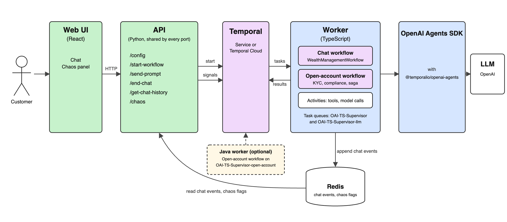

# Wealth Management Agent Demo: OpenAI Agents SDK for TypeScript

A multi-agent banking chat built with the [OpenAI Agents SDK for TypeScript](https://openai.github.io/openai-agents-js/)
(`@openai/agents`) and [Temporal](https://temporal.io), using Temporal's
[OpenAI Agents SDK integration](https://docs.temporal.io/develop/typescript/integrations/openai-agents)
(`@temporalio/openai-agents`).

A customer lists, adds and deletes beneficiaries, and lists, opens and closes investment accounts. A
Supervisor Agent hands each request to a Beneficiary Agent or an Investment Agent, and the Investment Agent
hands account openings to an Open Account Agent. As in the [Python OpenAI Agents framework](../../python/openai_agents/README.md),
the agents use handoffs: an agent hands the conversation to another, which answers the customer itself and hands
it back when the customer asks for something it doesn't handle.

It shares [`src/typescript/common`](../common) with the other TypeScript frameworks, and the
[API](../../python/api/README.md) (written in Python), the [web application](../../../frontend/README.md), the
[Java worker](../../../interop/open_account/java/README.md), `scripts/` and `data/` with every framework. Its chat
workflows keep the same Temporal contract as the other frameworks, which is what lets the Python API serve it.

Its chat workflows run on the `OAI-TS-Supervisor` task queue by default (`DEFAULT_TASK_QUEUE` in
[oai_lib/config.ts](oai_lib/config.ts)), so its worker can run next to another framework's. Start the API
for it with the `openai_agents_ts` AI framework (`./startlocalapi.sh openai_agents_ts`); the web app then names its
chats `oai-ts-temporal-agent-session-<session>-chat-<random>`.

Scenarios:

- List, add and delete beneficiaries (the agent asks for confirmation before deleting)
- List and close investment accounts (the agent asks for confirmation before closing)
- Open an investment account: KYC, a compliance officer's approval from outside the chat, and a saga
  that creates, funds and registers the account, rolling back if a step fails
- Off-topic questions are politely declined by the Supervisor Agent

There are two versions:

- **[Standalone](standalone/README.md)**: the agents with the OpenAI Agents SDK alone, as a command-line chat.
  It opens accounts directly with a tool: no KYC, compliance review or saga.
- **[Temporal](durable/README.md)**: the agents run inside a Temporal workflow, so every
  model and tool call is durable. Each account opening is a child workflow. A web UI with a chaos
  panel switches failures on and off at runtime (outages, a rate limit, a saga rollback, a bug in
  workflow code) to show how Temporal recovers.



## Prerequisites

- [Node.js](https://nodejs.org/) 22.12 or later (tested with 26) and npm
- [Temporal CLI](https://docs.temporal.io/cli) 1.4 or later, for the Temporal version
- [Redis](https://redis.io/) 7 or later, for the Temporal version (the conversation the UI reads, the
  chaos flags, and the optional claim check)
- An [OpenAI API key](https://platform.openai.com/api-keys)
- JDK 25, only for the optional Java worker

Install the dependencies. The TypeScript code (this framework, the other TypeScript frameworks and `common`) is one set of npm
workspaces with one `node_modules`, so from the repository root:

```bash
cd src/typescript
npm install
```

## Set up your OpenAI API key

From the repository root, copy the shared OpenAI key file (the Python OpenAI Agents and Pydantic AI frameworks use it
too) and put your key in it. `scripts/setoaikey.sh` is git-ignored; never commit a real key.

```bash
cp scripts/setoaikey.example scripts/setoaikey.sh
```

The worker start scripts source it; for the standalone chat, source it yourself.

The model is `gpt-4o` by default, as in the Python framework. To use another OpenAI model, set `OPENAI_MODEL` (in
`scripts/setoaikey.sh`, for example `export OPENAI_MODEL=gpt-4.1`). Every agent uses the same model.

## Running the demo

Each command runs in its own terminal, from the repository root:

```bash
temporal server start-dev
```

```bash
redis-server
```

```bash
./src/typescript/openai_agents/durable/startlocalworker.sh
```

```bash
./src/python/api/startlocalapi.sh openai_agents_ts
```

```bash
cd frontend && npm install && npm start
```

Open http://localhost:3000 and chat. To approve an account opening as the compliance officer:

```bash
./src/typescript/openai_agents/durable/localsendcomplianceapproval.sh "<open-account workflow ID>"
```

The [Temporal README](durable/README.md) covers the details, including the Java worker, claim check, the
codec server and Temporal Cloud. The [standalone README](standalone/README.md) covers the command-line chat.

## Demo data

The JSON files in [data/](../../../data) are the system of record: beneficiaries, clients, investment accounts
and each client's linked bank account. They are tracked by git and the demo changes them. Reset them from the
repository root:

```bash
git checkout data/
```

Client `123` (Don Doe, 123 Main Street) has Checking, Savings and 401K accounts and a linked bank
account holding $250,000.

## Tests

From `src/typescript/openai_agents`:

```bash
npm test
```

The suite needs no model key, no Redis and no running Temporal service: it uses the SDK's local test server
(downloaded on the first run), a scripted OpenAI Agents model, and a copy of the demo data in `tests/fixtures/data`. See
[Tests](durable/README.md#tests) for what it covers.

`npm test` in `src/typescript` runs every TypeScript workspace's tests.

## Layout

| Path                         | Holds                                                                                 |
| ---------------------------- | ------------------------------------------------------------------------------------- |
| [standalone/](standalone)    | The standalone version and its README                                                 |
| [durable/](durable)          | The Temporal version: workflows, activities, worker, runners, shell scripts, README   |
| [oai_lib/](oai_lib)          | Code both versions use: settings, the data store, the client record, money formatting |
| [prompts/](prompts)          | The agents' instructions                                                              |
| [tests/](tests)              | Tests (`*.test.ts`), the scripted model and the test copy of the demo data            |
| [package.json](package.json) | This framework's dependencies and npm scripts                                         |

The TypeScript tooling (`tsconfig.json`, ESLint, Prettier, `.nvmrc` and the lock file) is in `src/typescript`,
shared by every TypeScript workspace.
