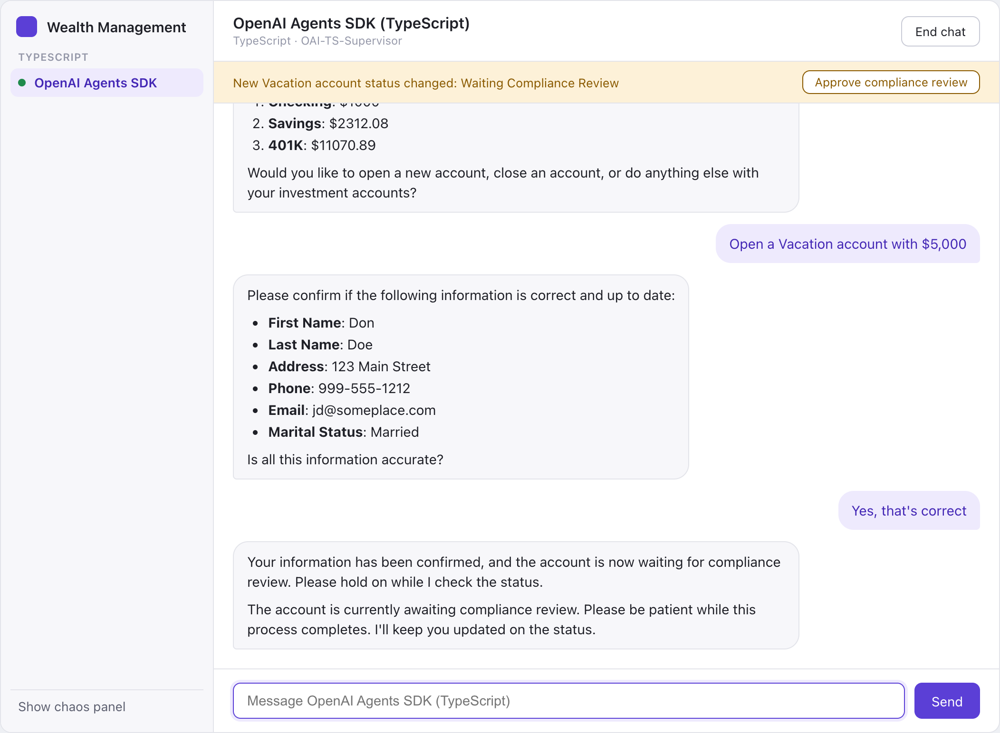
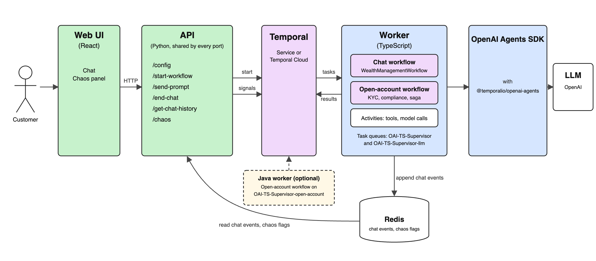
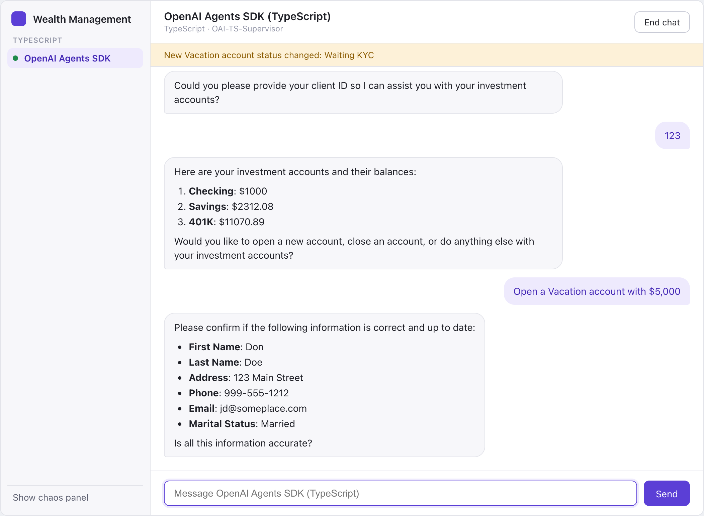
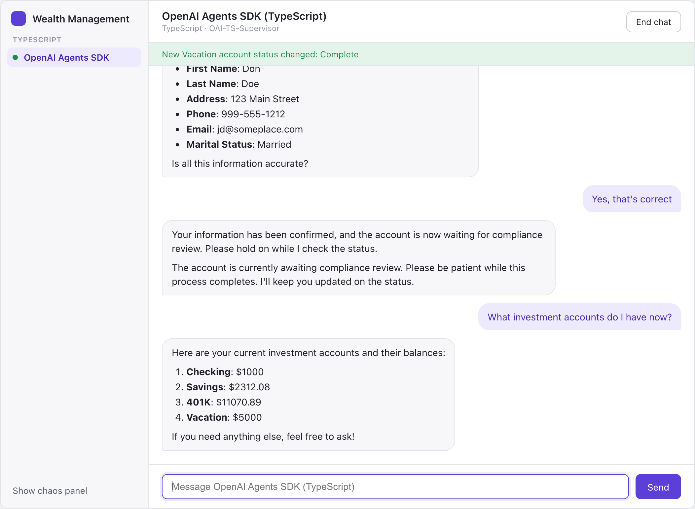
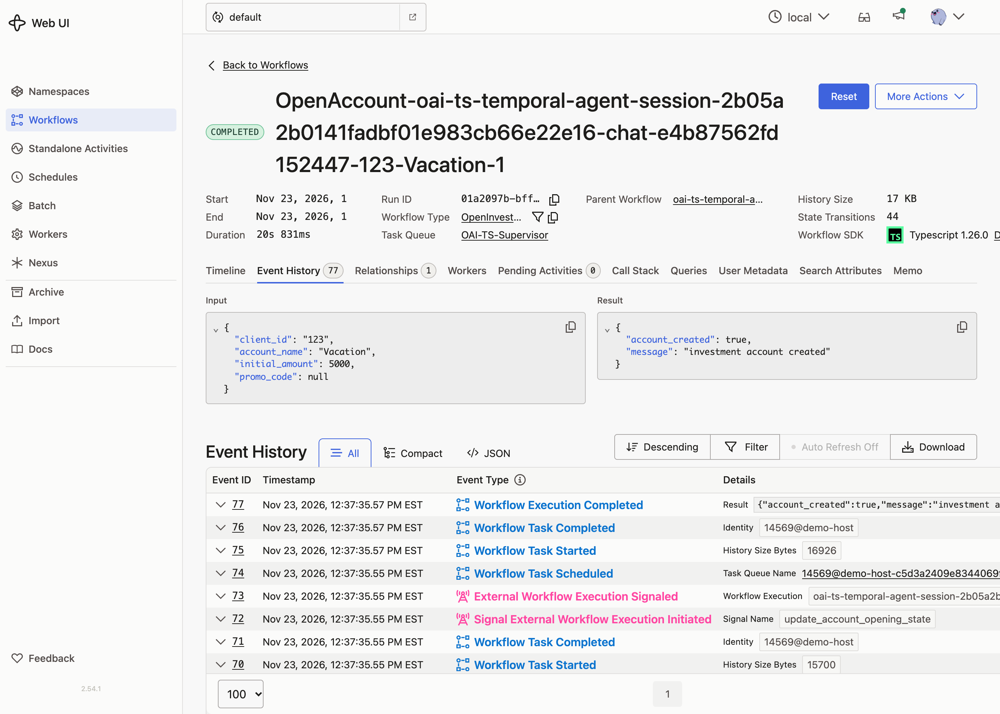

# OpenAI Agents SDK (TypeScript): Temporal version

In this version the agents run inside a Temporal workflow, so every model call and every tool call is
durable. A turn interrupted by an outage or a worker crash resumes where it stopped, and nothing the customer
said is lost or asked again. Opening an account starts a child workflow with KYC, a compliance officer's
approval and a saga.

The agents are built with the [OpenAI Agents SDK for TypeScript](https://openai.github.io/openai-agents-js/)
(`@openai/agents-core`) and run with Temporal's
[OpenAI Agents SDK integration](https://docs.temporal.io/develop/typescript/integrations/openai-agents)
(`@temporalio/openai-agents`). Install the dependencies and set up your OpenAI key as described in the
[framework's README](../README.md).



## Architecture



- **Web UI and API**: the web UI ([`frontend/`](../../../../frontend/README.md)) talks only to the API
  ([`src/python/api`](../../../python/api/README.md), the one API every framework shares), and the API only to
  Temporal and Redis. The API starts this framework's chat workflows with `openai_agents_ts` as its AI framework.
- **Chat workflow** (`WealthManagementWorkflow`, [`workflows/wealth-management.ts`](workflows/wealth-management.ts)):
  one long-lived workflow per chat. It builds the agents and runs each customer message, one at a time, with the
  integration's `TemporalOpenAIRunner`, so each model call is the integration's `invokeModelActivity` on the model
  task queue, while the agent loop, the handoffs and the conversation stay in the workflow. The tools are the
  SDK's `tool()`s in workflow code that run the tool activities. After each turn the workflow appends a
  `chat_interaction` event to the chat's Redis event stream.
  A chat with no customer message and no account-opening status update for an hour ends by itself, as on
  End chat (`common/chat-idle.ts`), so chats abandoned without End chat don't run forever.
- **Open-account workflow** (`OpenInvestmentAccountWorkflow`, [`workflows/open-account.ts`](workflows/open-account.ts)):
  a child workflow per account opening. It signals every state change to the chat workflow, which records
  it for the agent's `get_account_opening_status` tool and appends a `status_update` event to the stream.
- **Worker** ([`worker.ts`](worker.ts)): runs both workflows and every tool activity on `OAI-TS-Supervisor`,
  and the model activity on `OAI-TS-Supervisor-llm`, where the Temporal service can rate-limit model calls.
  `OpenAIAgentsPlugin` installs the SDK's polyfills in the workflow sandbox and registers the model activity,
  which resolves each agent's model name with the plugin's `modelProvider` (OpenAI, with the chaos flags).
- **Redis**: the chat's event stream (`events:<chat workflow ID>`) that the web UI reads through the API,
  the chaos flags (`chaos:<session>:flags`, with injected failures logged to `chaos:<session>:events`, per
  browser session), with `DEMO_DATA_STORE=redis` each session's copy of the sample data
  (`data:<session>:<file>`), and the optional claim check.

### How the agents work

The agents follow the [Python OpenAI Agents framework](../../../python/openai_agents/README.md)'s design: handoffs.
An agent hands the conversation to another (a `transfer_to_<agent>` tool the SDK adds), which then answers the
customer itself. The agent that answered last keeps the conversation for the customer's next message, and hands
it back when the customer asks for something it doesn't handle.

```text
Supervisor Agent      handoffs: Beneficiary Agent, Investment Agent
Beneficiary Agent     tools: list_beneficiaries, add_beneficiary, delete_beneficiary
                      handoffs: Supervisor Agent
Investment Agent      tools: list_investments, close_investment
                      handoffs: Open Account Agent, Supervisor Agent
Open Account Agent    tools: open_new_investment_account, get_account_opening_status,
                             get_current_client_info, approve_kyc, update_client_details
                      handoffs: Investment Agent
```

What the integration does, and what this framework adds:

| Concern | How |
| --- | --- |
| Agent loop | The SDK's own loop, in the workflow: `TemporalOpenAIRunner` runs agents like the SDK's `Runner`, with every model call an activity |
| Delegation | Handoffs, as in the Python framework. The workflow keeps the conversation (`result.history`) and the agent that answered last (`result.lastAgent`) between turns, so the next message goes to that agent |
| Model calls | `new TemporalOpenAIRunner({ defaultModelParams: { taskQueue, startToCloseTimeout, retry } })`: an activity per call, retried by Temporal. Set in the workflow because the chat is started by the Python API, with no client plugin to send them. Each agent names its model (`OPENAI_MODEL`), which the worker's provider resolves inside the activity |
| Tools | The SDK's `tool()`s with zod parameters, run in workflow code, calling activities through `proxyActivities`. (The integration's `activityAsTool` passes the tool input as one object, and the shared activities take positional arguments.) `update_client_details` takes `null` for the fields that don't change, because OpenAI's strict schemas need every field |
| Client ID | Every agent's instructions are a function that adds the customer's client ID once a tool was called with it, as in the Python framework, so an agent handed the conversation doesn't ask for it again |
| Trace | Built from the run's items ([`turn.ts`](turn.ts)): handoffs, tool calls and tool results, for the chat history |
| Chaos on the model | [`chaos-model.ts`](chaos-model.ts) wraps the provider's models, so the model flags of the chat's browser session apply inside the model activity. The integration turns every model error into its own `ApplicationFailure`, so "rate limited" throws the OpenAI SDK's own 429 error with a `Retry-After` of 15 s, which the integration turns into the next retry delay, exactly as for a real 429 from OpenAI |
| Guard | `approve_kyc` only once this opening's details were shown in an earlier turn. Deleting and closing ask for confirmation through the prompts, as in the Python framework |
| State | The conversation, the current agent, the client ID, account-opening states and count, the turn number and the KYC guard are workflow variables, deterministic on replay |
| Prompts | The Python OpenAI Agents framework's prompts ([`prompts/`](../prompts)), with the SDK's recommended handoff prefix |

## Running locally

Each command runs in its own terminal, from the repository root.

### Start Temporal and Redis

```bash
temporal server start-dev
```

```bash
redis-server
```

The Temporal UI is at http://localhost:8233.

### Start the worker

```bash
./src/typescript/openai_agents/durable/startlocalworker.sh
```

It sources `scripts/setoaikey.sh` and, if it exists, `scripts/setclaimcheck.sh`. It polls the
`OAI-TS-Supervisor` and `OAI-TS-Supervisor-llm` task queues, so it can run next to other frameworks' workers, and
prints the claim-check state, the task queues and the model at startup.

### Start the API

```bash
./src/python/api/startlocalapi.sh openai_agents_ts
```

The argument is the AI framework the API serves. See the [API README](../../../python/api/README.md) for its
endpoints.

### Start the web UI

```bash
cd frontend && npm install && npm start
```

Open http://localhost:3000. **Start chat** starts a chat workflow with the ID
`oai-ts-temporal-agent-session-<session>-chat-<random>`. For example: "Who are my beneficiaries?", "123", "What investments do I
have?", then "Open Vacation with $13,000" and "Yes" when the agent shows your details.

### Approve compliance

The quickest way: while the status line says **Waiting Compliance Review**, click **Approve compliance review**
in it. The API (`POST /approve-compliance`) finds the chat's account openings that wait for review and sends
them the `compliance_approved` signal. To send the signal yourself, as a compliance system would, use the
script below.

Once the customer confirms their details, the opening waits for a compliance officer's approval, which comes
from outside the chat. The open-account workflow's ID is

```text
OpenAccount-<chat workflow ID>-<client ID>-<account name>-<n>
```

for example `OpenAccount-oai-ts-temporal-agent-session-<session>-chat-<random>-123-Vacation-1`. Find it in the Temporal UI, or list
the running openings:

```bash
temporal workflow list --query 'WorkflowType="OpenInvestmentAccountWorkflow" AND ExecutionStatus="Running"'
```

Then approve it, quoting the ID:

```bash
./src/typescript/openai_agents/durable/localsendcomplianceapproval.sh "OpenAccount-oai-ts-temporal-agent-session-<session>-chat-<random>-123-Vacation-1"
```

The saga runs, its states appear in the web UI, and the agent reports the result when asked.

### What you'll see

Waiting for the customer to confirm their details (KYC):



Waiting for compliance approval:


The account opened:



The open-account workflow in the Temporal UI:



### Resetting the demo data

The JSON files in `data/` are the system of record, and the demo changes them: adding or deleting a
beneficiary, closing or opening an account, updating client details during KYC, and the open-account
scenarios. Reset them from the repository root:

```bash
git checkout data/
```

## How account opening works

1. The customer asks to open an account. The Investment Agent hands the conversation to the Open Account Agent,
   which calls `open_new_investment_account` and keeps the conversation through KYC.
2. The tool checks the deposit with the `validate_new_account` activity first: from $100 to $1,000,000. A
   refusal goes back to the agent, which explains it, and no workflow starts.
3. It starts the child workflow with the ID `OpenAccount-<chat workflow ID>-<client ID>-<account name>-<n>`,
   where the account name is as given and `<n>` counts the openings started in this chat (1, 2, ...).
   **Every request starts a new opening with its own KYC**, even for an account name used earlier in the
   chat. The count goes up only once the child has started, so a refused request doesn't use up a number.
   The child runs on `TEMPORAL_TASK_QUEUE_OPEN_ACCOUNT` (default: the chat's queue), with parent close
   policy `TERMINATE`, and its state is `Initializing` from the start.
4. KYC: the agent shows the customer's details (`get_current_client_info`, the child's `get_client_details`
   update) and asks whether they are correct. It approves KYC (`approve_kyc`, the `verify_kyc` signal) only
   when the customer confirms in a later message: the tool refuses until this opening's details were shown
   in an earlier turn. If the customer changes a detail instead, `update_client_details` saves it
   and completes KYC.
5. Each state change is signalled to the chat workflow, which shows it in the web UI. The agent reads an
   opening's status with `get_account_opening_status`, which returns the latest state the child reported,
   never from memory.
6. Compliance: the opening waits for a compliance officer's `compliance_approved` signal.
7. The saga: `Creating the account record.` (`open_investment`), `Transferring $<amount> from the linked
bank account.` (`debit_linked_account`), `Registering the account with the custodian.`
   (`register_account`), then `Complete`. If a step fails for a business reason, it reports
   `Failed: <reason>. Rolling back.`, undoes the completed steps in reverse order, reporting
   `Rolling back: ...` before each, and ends `Rolled back. The account was not opened: <reason>.`
   Compensations are activities, retried until they succeed. Transfer IDs are
   `<workflow ID>-<run ID>-initial-deposit` (and `...-refund`), so a retried transfer never moves the money
   twice.

To see every opening a chat started:

```bash
temporal workflow list --query 'WorkflowId STARTS_WITH "OpenAccount-oai-ts-temporal-agent-"'
```

### Testing the open-account workflow on its own

[`startlocalopenaccount.sh`](startlocalopenaccount.sh) starts a worker that needs no model key and runs
`OpenInvestmentAccountWorkflow` directly, with no chat, for three scenarios: KYC approved; client details
updated (which completes KYC); and a compliance approval you send by hand. It stops its worker on exit. With
Temporal running:

```bash
./src/typescript/openai_agents/durable/startlocalopenaccount.sh
```

For scenario 3, send the approval from another terminal with the command it prints. `--scenario N` runs one
scenario, and `--amount X` changes the deposit (300000 shows the rollback for client 123). The scenarios
change `data/`; reset it afterwards.

To run the scenarios on the Java worker, start the Java worker for this framework first (below) and pass `java`:

```bash
./src/typescript/openai_agents/durable/startlocalopenaccount.sh java
```

## Java open-account worker (optional)

The [Java worker](../../../../interop/open_account/java/README.md) runs `OpenInvestmentAccountWorkflow` in
Java and calls this worker's activities by name, so the chaos flags apply unchanged. Start this framework's worker
with the argument `java`, so the open-account workflow runs on `OAI-TS-Supervisor-open-account` and this
worker doesn't run it:

```bash
./src/typescript/openai_agents/durable/startlocalworker.sh java
```

Then start the Java worker for this framework:

```bash
TEMPORAL_TASK_QUEUE=OAI-TS-Supervisor ./interop/open_account/java/startlocalworker.sh
```

The chat workflow, the tool activities and the model calls stay on this framework's worker. On Temporal Cloud,
use `startcloudworker.sh java` and the Java worker's `startcloudworker.sh`.

## Failure scenarios (chaos panel)

Every failure is switched on from the chaos panel in the web UI, at runtime, with no restart. The activities
and the model read the flags from the Redis hash `chaos:<session>:flags` on every attempt (the browser session comes from
the workflow ID, see `common/session-scope.ts`); if Redis can't be reached, the flags read as off. Each
injected failure is logged to `chaos:<session>:events` for the panel.

| Scenario                       | How to show it                                                                     | What Temporal does                                                                                                            |
| ------------------------------ | ---------------------------------------------------------------------------------- | ----------------------------------------------------------------------------------------------------------------------------- |
| Core banking API down          | `tool_down`: the beneficiary and investment activities raise a connection error    | The activity retries until the flag is off. The agent's reply waits mid-turn; nothing is lost or asked again                  |
| OpenAI API down                | `llm_down`: every model call raises a connection error                             | The model activity retries; the turn resumes where it stopped                                                                 |
| OpenAI rate limited (429)      | `llm_rate_limited`: every model call fails with a 429                              | The 429's `Retry-After` header sets a next retry delay of 15 s, overriding the backoff                                        |
| Custodian rejects new accounts | `custodian_rejects`: `register_account` raises a non-retryable `CustodianRejected` | The saga refunds the deposit, then removes the account record                                                                 |
| Slow account-opening steps     | `slow_saga`: each saga step sleeps 4 s                                             | Watch the saga, or kill the worker partway and restart it: the opening carries on                                             |
| Bug in workflow code           | `workflow_bug`: `find_promotion` returns the promo code `WELCOME-BONUS`            | The workflow task fails and is retried; the opening stays Running. See below                                                  |
| Business rule                  | Open an account with more than $1,000,000 or less than $100                        | `validate_new_account` fails on the first attempt (`DepositLimitExceeded`, `DepositBelowMinimum`), and the agent explains why |
| Insufficient funds             | Client 123 opens an account with $300,000 (the linked bank account holds $250,000) | The debit fails with a non-retryable `InsufficientFunds`, and the saga rolls back                                             |
| Proactive rate limiting        | Set `LLM_MAX_CALLS_PER_SECOND` for the worker                                      | Model calls run on their own task queue, so the Temporal service caps their rate across all workers                           |

The 429's retry delay needs no interceptor in this framework: the model throws the OpenAI SDK's `RateLimitError` with a
`Retry-After` header, and the integration's model activity turns it into an `ApplicationFailure` of type
`ModelInvocationError.RateLimit` with that delay, as it does for a real 429.

### Bug in workflow code

With the flag on, new openings get the promo code `WELCOME-BONUS`. In
[`workflows/open-account.ts`](workflows/open-account.ts), at the `*** Bug-In-Workflow-Code ***` comment, the
promotion is keyed `WELCOME_BONUS` (an underscore), so `welcomeBonus` reads the rate of `undefined` and throws
a `TypeError` right after compliance approval. In TypeScript a plain error fails the workflow task, not the
workflow: the workflow stays **Running**, with the compliance approval kept, and Temporal retries the task.

Turning the flag off doesn't unstick an opening that already has the promo code. Fixing the code does:
uncomment the `PROMOTIONS` line above the buggy one, delete the buggy one, and restart the worker. The opening
resumes on the next workflow-task retry and opens the account with the bonus (1% of the deposit, up to $500).
Re-arm the bug afterwards:

```bash
git checkout src/typescript/openai_agents/durable/workflows/open-account.ts
```

The Java version has its own bug in workflow code: see the
[Java README](../../../../interop/open_account/java/README.md#bug-in-the-workflow-code-chaos-panel).

## Claim check and codec server (optional)

With the claim check on, a payload codec stores each payload in Redis and puts only its key in the event
history. Every component must agree: the worker, the API, the scripts, the codec server and the Java worker
all source `scripts/setclaimcheck.sh` if it exists, and each prints at startup whether the claim check is on,
with the `USE_CLAIM_CHECK` value. To turn it on:

```bash
cp scripts/setclaimcheck.example scripts/setclaimcheck.sh
```

`USE_CLAIM_CHECK` accepts `true`, `yes` or `1`. Restart every component after changing it.

To see the payloads in the Temporal UI, start the codec server:

```bash
./src/typescript/openai_agents/durable/startcodecserver.sh
```

Then, in the Temporal UI at exactly http://localhost:8233 (the codec server allows only that origin and
https://cloud.temporal.io), open the data encoder settings and set the codec server to
`http://127.0.0.1:8081` (`CODEC_SERVER_HOST` and `CODEC_SERVER_PORT` change it).


## Running on Temporal Cloud

```bash
cp scripts/setcloudenv.example scripts/setcloudenv.sh
```

Fill in `scripts/setcloudenv.sh` (git-ignored) with your namespace address, namespace and either the paths to
your mTLS certificate and key or an API key. Redis still runs locally. Then use the cloud scripts in place of
the local ones:

```bash
./src/typescript/openai_agents/durable/startcloudworker.sh
```

```bash
./src/python/api/startcloudapi.sh openai_agents_ts
```

```bash
./src/typescript/openai_agents/durable/cloudsendcomplianceapproval.sh "<open-account workflow ID>"
```

For the Java worker on Temporal Cloud, see the
[Java README](../../../../interop/open_account/java/README.md#running-with-temporal-cloud).

## Environment variables

| Variable                                                        | Default                     | Purpose                                                                                                                                                                                                                                             |
| --------------------------------------------------------------- | --------------------------- | --------------------------------------------------------------------------------------------------------------------------------------------------------------------------------------------------------------------------------------------------- |
| `OPENAI_API_KEY`                                                | none                        | The worker's model activity. Set in `scripts/setoaikey.sh`                                                                                                                                                                                          |
| `OPENAI_MODEL`                                                  | `gpt-4o`                    | The OpenAI model every agent uses                                                                                                                                                                                                                   |
| `TEMPORAL_ADDRESS`                                              | `localhost:7233`            | Every Temporal client and worker                                                                                                                                                                                                                    |
| `TEMPORAL_NAMESPACE`                                            | `default`                   | Every Temporal client and worker                                                                                                                                                                                                                    |
| `TEMPORAL_TLS_CLIENT_CERT_PATH`, `TEMPORAL_TLS_CLIENT_KEY_PATH` | none                        | mTLS, for Temporal Cloud. Set in `scripts/setcloudenv.sh`                                                                                                                                                                                           |
| `TEMPORAL_API_KEY`                                              | none                        | An API key, for Temporal Cloud, in place of mTLS                                                                                                                                                                                                    |
| `TEMPORAL_TASK_QUEUE`                                           | `OAI-TS-Supervisor`     | The chat workflow, the open-account workflow and the tool activities                                                                                                                                                                                |
| `TEMPORAL_TASK_QUEUE_OPEN_ACCOUNT`                              | `TEMPORAL_TASK_QUEUE`       | The open-account workflow. `java` means `<TEMPORAL_TASK_QUEUE>-open-account`, the Java worker's queue for this framework (set by the worker scripts' argument)                                                                                      |
| `TEMPORAL_TASK_QUEUE_LLM`                                       | `<TEMPORAL_TASK_QUEUE>-llm` | The model calls                                                                                                                                                                                                                                     |
| `LLM_MAX_CALLS_PER_SECOND`                                      | none                        | A cap on model calls per second across all workers                                                                                                                                                                                                  |
| `REDIS_URL`                                                     | none                        | `redis://:<password>@<host>:<port>/<db>`; wins over the three below                                                                                                                                                                                 |
| `REDIS_HOST`, `REDIS_PORT`, `REDIS_PASSWORD`                    | `localhost`, `6379`, none   | The event stream, the chaos flags and the claim check                                                                                                                                                                                               |
| `DEMO_DATA_STORE`                                               | `file`                      | Where the sample data (`data/*.json`) lives: `file` uses the files themselves; `redis` gives each browser session its own copy in Redis (`data:<session>:<name>`, starting from the files, expiring a day after its last change), for a shared demo |
| `USE_CLAIM_CHECK`                                               | off                         | The claim check (`true`, `yes` or `1`). Set in `scripts/setclaimcheck.sh`                                                                                                                                                                           |
| `CLAIM_CHECK_TTL_SECONDS`                                       | `604800` (7 days)           | How long Redis keeps claim-checked payloads; `0` keeps them forever. A workflow needs its payloads to replay, and the Temporal UI to show its history, so keep it well beyond how long a chat runs                                                  |
| `CODEC_SERVER_HOST`, `CODEC_SERVER_PORT`                        | `127.0.0.1`, `8081`         | Where the codec server listens                                                                                                                                                                                                                      |
| `DATA_DIR`                                                      | the repository's `data/`    | The demo data folder                                                                                                                                                                                                                                |

## Tests

```bash
cd src/typescript/openai_agents && npm test
```

The suite needs no model key, no Redis and no running Temporal service: it uses the SDK's local test server,
the real workflows and activities over a copy of the demo data ([`tests/fixtures/data`](../tests/fixtures/data)),
an in-memory event stream and chaos flags, and a scripted OpenAI Agents model in place of OpenAI
([`tests/helpers.ts`](../tests/helpers.ts), [`tests/scripts.ts`](../tests/scripts.ts)), given to `OpenAIAgentsPlugin`
as its model provider and run like OpenAI, on its own `-llm` task queue.

| Test                                                              | Checks                                                                                                                                                                                                                                                                                                                                     |
| ----------------------------------------------------------------- | ------------------------------------------------------------------------------------------------------------------------------------------------------------------------------------------------------------------------------------------------------------------------------------------------------------------------------------------ |
| [`chat.test.ts`](../tests/chat.test.ts)                           | The supervisor hands off to an agent and the trace records it; every model call runs on the model task queue; the next message goes to the agent that answered last, which hands back for anything else; the client ID in the instructions; a delete; the KYC guard; the business-rule refusal                                                      |
| [`failure-scenarios.test.ts`](../tests/failure-scenarios.test.ts) | Retries through a tool and a model outage; the 429's 15 s retry delay; the model flags read for the chat's own browser session inside the model activity; the saga's success; the rollback after a custodian rejection and after insufficient funds; the saga states reported to the chat; the bug pausing the workflow without failing it |
| [`repeat-opening.test.ts`](../tests/repeat-opening.test.ts)       | Two "Vacation" openings start `...-Vacation-1` and `...-Vacation-2`, both run, and the second needs its own KYC                                                                                                                                                                                                                            |
| [`chat-idle.test.ts`](../tests/chat-idle.test.ts)                 | A chat ends by itself after an hour with no message or status update                                                                                                                                                                                                                                                                       |
| [`sessions.test.ts`](../tests/sessions.test.ts)                   | With `DEMO_DATA_STORE=redis`, each browser session gets its own copy of the sample data                                                                                                                                                                                                                                                    |

## Temporal contracts

The names and payloads match the other frameworks, in snake_case, so the scripts, the API, the web UI and the Java
worker work with every framework. They are defined in [`shared.ts`](shared.ts) and [`activities.ts`](activities.ts).

- `WealthManagementWorkflow`: signals `process_user_message` (`{user_input}`), `end_workflow`,
  `update_account_opening_state` (`{account_name, state, workflow_id}`); query `get_chat_history`.
- `OpenInvestmentAccountWorkflow` (`{client_id, account_name, initial_amount, promo_code}` →
  `{account_created, message}`): query `get_current_state`; updates `get_client_details`,
  `update_client_details`; signals `verify_kyc`, `compliance_approved`.
- Activities: `list_beneficiaries`, `add_beneficiary`, `delete_beneficiary`, `list_investments`,
  `close_investment`, `validate_new_account`, `find_promotion`, `open_investment`, `remove_investment`,
  `get_client`, `update_client`, `debit_linked_account`, `credit_linked_account`, `register_account`,
  `get_current_client_info`, `approve_kyc`, `update_client_details`, `append_chat_interaction`,
  `append_status_update`, `delete_conversation`. The worker also registers `get_worker_config`, which hands
  the chat workflow its task queues and model, and the integration's model activities (`invokeModelActivity` and
  `invokeModelStreamActivity`, registered by `OpenAIAgentsPlugin`).

Retries: tool activities use a 1 s initial interval, a backoff coefficient of 2, a 5 s maximum interval and
no attempt limit; model calls the same with a 10 s maximum interval. Timeouts are start-to-close only, so an
outage is waited out.
