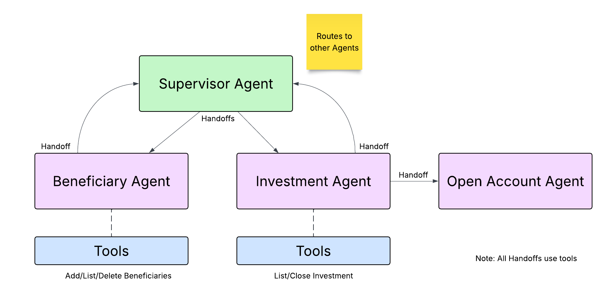

# Wealth Management Agent Demo: Vercel AI SDK (TypeScript)

A multi-agent banking chat built with the [Vercel AI SDK](https://ai-sdk.dev) and [Temporal](https://temporal.io).
A customer lists, adds and deletes beneficiaries, and lists, opens and closes investment accounts. Opening an
account starts a child workflow with KYC, a human compliance approval and a saga.

A supervisor agent routes requests to specialist agents (beneficiaries, investments, open account), which hand
off to each other with tools. The model is Gemini (`GEMINI_MODEL`, default `gemini-3.8-flash`). In the Temporal version, every model call
runs as an activity through Temporal's AI SDK plugin (`@temporalio/vercel-ai-sdk`).

This framework was imported from [temporal-sa/vai-wealth-management](https://github.com/temporal-sa/vai-wealth-management).
It is the first TypeScript framework: it shares [`src/typescript/common`](../common) with the TypeScript frameworks to
come, and the [API](../../python/api/README.md) (written in Python), the [web application](../../../frontend/README.md),
the [Java worker](../../../interop/open_account/java/README.md), `scripts/` and `data/` with every framework. Its chat
workflows keep the same Temporal contract as the Python frameworks, which is what lets the Python API serve it.

Its chat workflows run on the `VAI-Supervisor` task queue by default (`DEFAULT_TASK_QUEUE` in
[durable/task-queues.ts](durable/task-queues.ts)), so its worker can run next to another framework's. Start the API
for it with the `vercel_ai` AI framework (`./startlocalapi.sh vercel_ai`); the web app then names its chats
`vai-temporal-agent-session-<session>-chat-<random>`.

The demo is implemented twice:

* **[Standalone](standalone/README.md)**: the agents as a command-line chat, with no Temporal. Accounts are
  opened directly, without KYC, compliance review or a saga.
* **[Temporal](durable/README.md)**: the agent loop running inside a workflow as a durable, long-running
  conversation. Includes the web UI, the account-opening child workflow (which can run in Java) and the chaos
  panel for failure demos.



## Prerequisites

| Tool | Needed for |
|------|------------|
| [Node.js](https://nodejs.org/) 20 or later, and npm | Everything |
| [Temporal CLI](https://docs.temporal.io/cli) | Temporal version (local dev server) |
| [Redis](https://redis.io/) | Temporal version (chat history, chaos flags, optional claim check) |
| [Java JDK](https://adoptium.net/) 25 | Optional Java open-account worker only |
| A [Gemini API key](https://aistudio.google.com/app/apikey) | Both versions, and the live tests |

Install the dependencies. The TypeScript code (this framework and `common`) is one set of npm workspaces
with one `node_modules`, so from the repository root:

```bash
cd src/typescript
npm install
```

## Gemini key setup

From the repository root, copy the shared Gemini key file (the Strands Agents and Google ADK frameworks use it too)
and fill in your key. `scripts/setgeminikey.sh` is ignored by git.

```bash
cp scripts/setgeminikey.example scripts/setgeminikey.sh
```

It sets `GEMINI_API_KEY`; the Vercel AI SDK's own `GOOGLE_GENERATIVE_AI_API_KEY` also works. The worker start
scripts source it.

## Running the demo

Quick start for the Temporal version with the web UI. Each command runs in its own terminal, from the
repository root:

```bash
temporal server start-dev
```

```bash
redis-server
```

```bash
./src/typescript/vercel_ai/durable/startlocalworker.sh
```

```bash
./src/python/api/startlocalapi.sh vercel_ai
```

```bash
cd frontend && npm install && npm start
```

Open http://localhost:3000 and chat. To approve an account opening as the compliance officer:

```bash
./src/typescript/vercel_ai/durable/localsendcomplianceapproval.sh "<open-account workflow ID>"
```

The [Temporal README](durable/README.md) covers the details, including running the open-account workflow on the
Java worker, claim check, the codec server and Temporal Cloud. The [standalone README](standalone/README.md)
covers the command-line chat.

## Demo data

The JSON files in [data/](../../../data) are the system of record, and the demo changes them. They are tracked
by git, so after a demo you can reset them with (from the repository root):

```bash
git checkout data/
```

## Tests

The default suite needs no Gemini key, no Redis and no running Temporal service. It uses Temporal's local test
server (downloaded on first run), stub activities and a scripted model. From `src/typescript/vercel_ai`:

```bash
npm test
```

`npm test` in `src/typescript` runs every TypeScript workspace's tests. The live
tests call Gemini and are not part of the default run; see
[Running the tests](durable/README.md#tests).

## Layout

| Path | Holds |
|------|-------|
| [standalone/](standalone) | Standalone version (`main.ts`) and its README |
| [durable/](durable) | Temporal version: workflows, activities, worker, runners, scripts, README |
| [prompts/](prompts) | The agents' instructions |
| [tests/](tests) | Default tests (`*.test.ts`) and live tests (`*.live.ts`) |
| [gemini.ts](gemini.ts) | The Gemini provider and API key, used by both versions |
| [package.json](package.json) | This framework's dependencies and npm scripts |

The TypeScript tooling (`tsconfig.json`, ESLint, Prettier, `.nvmrc` and the lock file) is in `src/typescript`,
shared by every TypeScript workspace.
