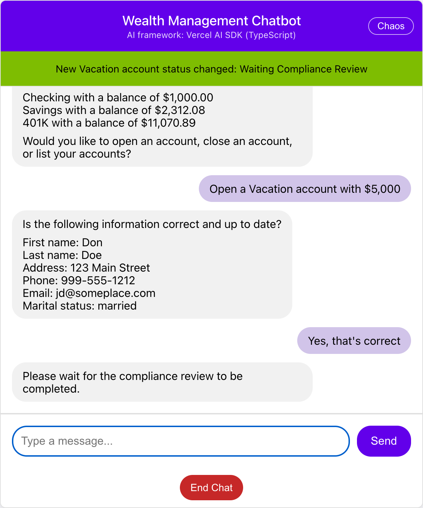
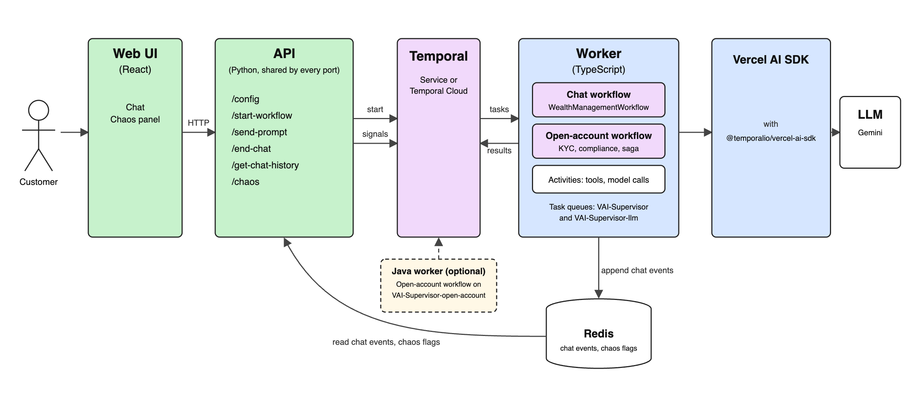
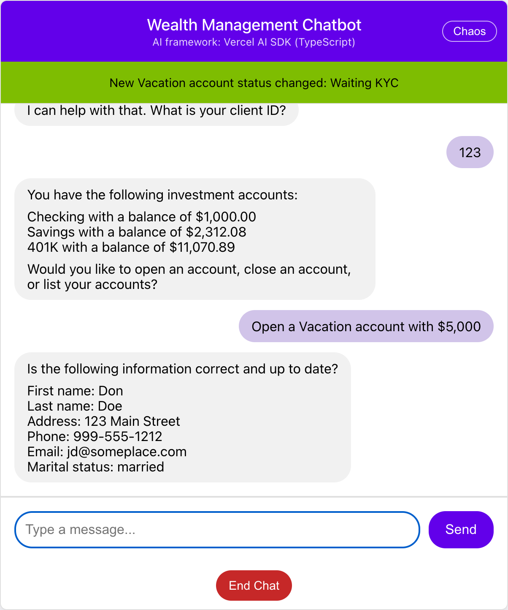
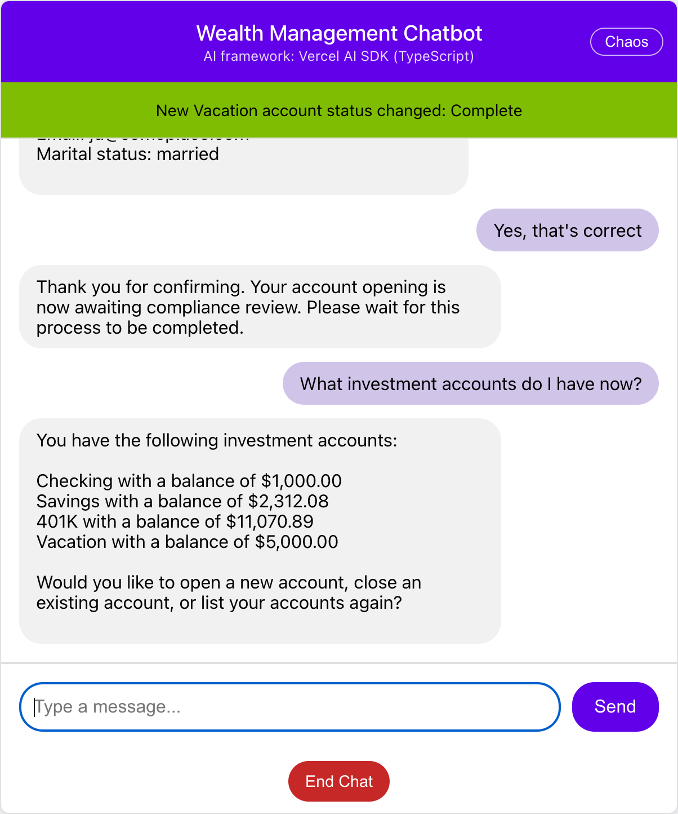
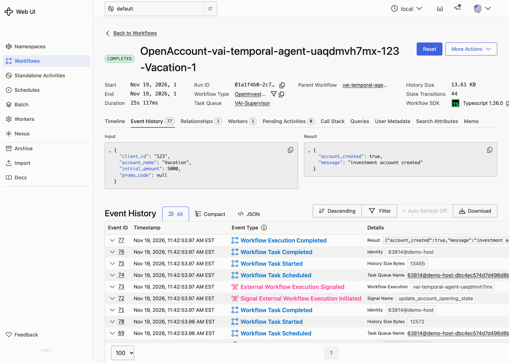

# Vercel AI SDK (TypeScript): Temporal version

In this version the agents run inside a Temporal workflow as a durable, replayable, long-running
conversation, and every model call and tool call is durable. A worker crash, a model outage or a tool
outage pauses the conversation instead of losing it, and Temporal resumes the turn where it stopped.

The agents are built with the [Vercel AI SDK](https://ai-sdk.dev/) (AI SDK v7, `generateText` with tools)
and hand off to each other with tools. Temporal's AI SDK integration,
[`@temporalio/vercel-ai-sdk`](https://www.npmjs.com/package/@temporalio/vercel-ai-sdk) (with the Temporal
TypeScript SDK 1.26), runs each model call as an activity. The model is Gemini (`gemini-2.5-pro`).
Prerequisites, installing the dependencies and the Gemini key are in the [framework README](../README.md).



## Architecture



* **The web UI and the API.** The web UI ([frontend/](../../../../frontend/README.md)) talks to the shared
  [API](../../../python/api/README.md), written in Python and started with the `vercel_ai` AI framework.
  The API starts a chat workflow per conversation (IDs `vai-temporal-agent-<random>`), sends it the
  customer's messages, and serves the conversation from Redis. This framework's workflows keep the same
  Temporal contracts as the Python frameworks, which is what lets the Python API serve them.
* **The chat workflow** `WealthManagementWorkflow`
  ([workflows/wealth-management.ts](workflows/wealth-management.ts)) runs for the whole conversation.
  Customer messages arrive as the `process_user_message` signal and are processed one at a time by the
  agent loop ([workflows/agent-loop.ts](workflows/agent-loop.ts)), which runs in workflow code. Each
  `generateText` model call becomes an activity through the `TemporalProvider`, and every tool that
  touches a system calls an activity. After each turn, the reply is appended to the Redis list
  `events:<workflow ID>`.
* **The open-account workflow** `OpenInvestmentAccountWorkflow`
  ([workflows/open-account.ts](workflows/open-account.ts)) is a child workflow, one per account opening:
  KYC, compliance approval, then a saga. It reports each state change to the chat workflow with the
  `update_account_opening_state` signal.
* **The worker** ([worker.ts](worker.ts)) runs two workers on one connection: the workflows and tool
  activities on `VAI-Supervisor`, and the model activities on `VAI-Supervisor-llm`, so model calls can be
  rate limited apart from the tools. Both get the `AiSdkPlugin`, which registers the model activities.
* **Redis** holds the chat's event stream that the web UI reads (through the API), the chaos flags, and,
  optionally, the claim check payloads.

### How the agents work

| Agent | Tools | Hands off to |
|---|---|---|
| Supervisor Agent | none | Beneficiary Agent, Investment Agent |
| Beneficiary Agent | `list_beneficiaries`, `add_beneficiary`, `delete_beneficiary` | Supervisor Agent |
| Investment Agent | `list_investments`, `close_investment` | Supervisor Agent, Open Account Agent |
| Open Account Agent | `open_new_investment_account`, `get_current_client_info`, `update_client_details`, `approve_kyc`, `get_account_opening_status` | Investment Agent |

* Each agent is instructions ([prompts/agent-constants.ts](../prompts/agent-constants.ts)) and a
  `ToolSet` of AI SDK `tool()`s with Zod input schemas. Tool `execute` functions run in workflow context,
  so anything non-deterministic goes through an activity.
* A **handoff** is a tool named `handoff_to_<agent>_agent` (the Beneficiary and Investment handoffs take
  the client ID). Each `generateText` call stops when the model calls a handoff tool (`stopWhen` with
  `hasToolCall`); the loop then switches the active agent and calls `generateText` again, so the new agent
  answers the customer's message in the same turn. A shared system prompt prefix tells every agent to hand
  off without asking or announcing it.
* **Model calls:** the `TemporalProvider` in the workflow turns each model call into the plugin's
  `invokeModel` activity, on `VAI-Supervisor-llm` with a 2-minute timeout per attempt and unlimited
  retries. On the worker, the plugin calls the real Gemini provider ([gemini.ts](../gemini.ts)), wrapped
  by [chaos-model.ts](chaos-model.ts) to inject the chaos panel's model failures and to turn a real HTTP
  429 into a retry after 15 s.
* Once the client ID is known, every agent's instructions include it, so an agent that is handed the
  conversation doesn't ask for it again.
* Off-topic questions are declined by the Supervisor Agent, through the agents' prompts only.

## Running locally

Each command runs in its own terminal, from the repository root.

### Start Temporal and Redis

```bash
temporal server start-dev
```

```bash
redis-server
```

### Start the worker

```bash
./src/typescript/vercel_ai/durable/startlocalworker.sh
```

The worker polls `VAI-Supervisor` (`DEFAULT_TASK_QUEUE` in [task-queues.ts](task-queues.ts)) for the
workflows and tools, and `VAI-Supervisor-llm` for the model calls, so it can run next to other frameworks'
workers. It needs `scripts/setgeminikey.sh` and sources `scripts/setclaimcheck.sh` if it exists.

### Start the API

```bash
./src/python/api/startlocalapi.sh vercel_ai
```

The endpoints are in the [API README](../../../python/api/README.md).

### Start the web UI

```bash
cd frontend && npm install && npm start
```

Open http://localhost:3000 for the chat, and http://localhost:8233 for the Temporal UI.

### Approve compliance

Each account opening waits for compliance approval, which comes from outside the chat. The open-account
workflow ID is `OpenAccount-<chat workflow ID>-<client ID>-<account name>-<n>`, with the account name as
the customer gave it and `<n>` the number of openings started in the chat so far, this one included (1, 2,
3, ...). For example, opening "College Fund" for client 123 as the chat's first opening gives
`OpenAccount-vai-temporal-agent-k3j9x2m1q8-123-College Fund-1`. The web UI doesn't show this ID (it logs
the chat's workflow ID in the browser console). Find it in the Temporal UI (a running
`OpenInvestmentAccountWorkflow`, child of the chat's `WealthManagementWorkflow`), or with:

```bash
temporal workflow list --query "WorkflowType='OpenInvestmentAccountWorkflow' AND ExecutionStatus='Running'"
```

Then approve it. Account names can contain spaces, so quote the ID:

```bash
./src/typescript/vercel_ai/durable/localsendcomplianceapproval.sh "<open-account workflow ID>"
```

If more than one opening is running, pick the one whose ID ends with the number you want.

### What you'll see

Waiting for the customer to confirm their details (KYC):



Waiting for compliance approval:


The account opened:



The open-account workflow in the Temporal UI:



### Resetting the demo data

Opening and closing accounts, changing client details during KYC, and adding or deleting beneficiaries
change the JSON files in [data/](../../../../data), which every framework shares and git tracks. The linked bank
balances and the transfer ledger are in `data/funding_accounts.json`. To reset them:

```bash
git checkout data/
```

## How account opening works

1. The Investment Agent hands off to the Open Account Agent, which calls `open_new_investment_account`
   with the client ID, account name and initial amount. The tool first checks the business rules
   (`validate_new_account`: a deposit from $100 to $1,000,000). If one is broken, the agent explains why
   and no workflow is started.
2. Otherwise the tool starts the `OpenInvestmentAccountWorkflow` child workflow
   ([workflows/start-open-account.ts](workflows/start-open-account.ts)) on the chat's task queue, or on
   `VAI-Supervisor-open-account` when the Java worker runs it, and returns its workflow ID.
3. The child loads the client's details and moves to `Waiting KYC`. Every state change is sent to the chat
   workflow with the `update_account_opening_state` signal. The chat workflow keeps the latest state of
   each opening and writes `New <account> account status changed: <state>` to the event stream, which the
   web UI shows. The agent learns the status with `get_account_opening_status(workflow_id)`, which reads
   the state the chat workflow kept (an unknown ID gets
   `No account opening with workflow ID <id> was found in this conversation.`), when the customer asks.
4. KYC: the agent calls `get_current_client_info` (the child's `get_client_details` update, which waits
   until the details are loaded), shows the details and asks if they are correct. If the customer confirms
   in a later message, `approve_kyc` sends the `verify_kyc` signal. The tool refuses in the turn the details
   were shown, or for an opening whose details weren't shown. If the details are wrong, the agent calls
   `update_client_details` (an update that saves them to `data/clients.json` and also approves KYC).
5. The opening moves to `Waiting Compliance Review` and waits for the `compliance_approved` signal. The
   signal handlers wait for the steps before them (`verify_kyc` until the details are loaded,
   `compliance_approved` until KYC is approved), so an early signal is not lost or applied out of order.
6. The saga creates the account record (`open_investment`), transfers the deposit from the linked bank
   account (`debit_linked_account`), and registers the account with the custodian (`register_account`).
   If a step fails non-retryably, the completed steps are undone in reverse order
   (`credit_linked_account`, then `remove_investment`, which counts an account already gone as removed)
   and the final state starts with `Rolled back`. Transfer IDs include the workflow and run IDs, so a
   retried transfer never moves money twice. On success the state is `Complete`, and the Open Account
   Agent hands back to the Investment Agent.
7. **Every request starts a new opening**, with its own KYC and compliance approval, even if an account
   with the same name was opened, or is still being opened, earlier in the chat: opening "Vacation" twice
   gives `...-123-Vacation-1` and `...-123-Vacation-2`, which can both be pending at once.

Ending the chat terminates any opening still running, because a child workflow is terminated when its
parent closes.

### Testing the open-account workflow on its own

`startlocalopenaccount.sh` runs `OpenInvestmentAccountWorkflow` without the chat, the API, the web UI or
the model (no Gemini key needed). It starts a worker in the background, runs
[run_open_account_workflow.ts](run_open_account_workflow.ts), and stops the worker when it finishes. Three
scenarios for client 123 each print every state (from the `get_current_state` query) and the result:

1. KYC approved (`verify_kyc`), then compliance approved.
2. Client details read (`get_client_details`) and changed (`update_client_details`, which completes KYC:
   the last name becomes "Doenut"), then compliance approved.
3. KYC approved, then the workflow waits in `Waiting Compliance Review` until you send the approval
   yourself. The script prints the command, with an ID like
   `OpenAccount-standalone-<run>-123-Vacation3`.

```bash
./src/typescript/vercel_ai/durable/startlocalopenaccount.sh
```

With the argument `java`, the scenarios run on `VAI-Supervisor-open-account`, against the Java worker
(start it first, as in [Java open-account worker](#java-open-account-worker-optional)):

```bash
./src/typescript/vercel_ai/durable/startlocalopenaccount.sh java
```

Further arguments go to the runner: `--scenario N` (repeatable) runs only some scenarios, and `--amount X`
sets the initial deposit, for example `--scenario 1 --amount 300000` to see the saga roll back. The
workflow has no parent here, so it skips its status updates. The scenarios change the demo data; reset it
with `git checkout data/`.

## Java open-account worker (optional)

The open-account workflow can run on the shared
[Java worker](../../../../interop/open_account/java/README.md) instead. Start this framework's worker with the
argument `java`:

```bash
./src/typescript/vercel_ai/durable/startlocalworker.sh java
```

The argument sets `TEMPORAL_TASK_QUEUE_OPEN_ACCOUNT=java`, which the worker turns into this framework's own
`VAI-Supervisor-open-account` queue ([common/task-queues.ts](../../common/task-queues.ts)). The worker
then registers only the chat workflow ([workflows/supervisor-only.ts](workflows/supervisor-only.ts))
instead of both ([workflows/index.ts](workflows/index.ts)). Start the Java worker for this framework, so it
polls that queue and calls this framework's activities:

```bash
TEMPORAL_TASK_QUEUE=VAI-Supervisor ./interop/open_account/java/startlocalworker.sh
```

The chat workflow, the tools and the model calls stay on the TypeScript worker; the open-account workflow
runs in Java, and its activities (client details, the saga steps) still run on the TypeScript worker. Any
other argument names the open-account task queue. On Temporal Cloud, use `startcloudworker.sh java` and
the Java worker's `startcloudworker.sh`.

## Failure scenarios (chaos panel)

Click **Chaos** in the web UI's chat header to open the chaos panel. Activities and the model read the
flags from Redis (`chaos:flags`) on every attempt, so you can turn a failure on and off mid-conversation
with no restart. If Redis can't be reached, the flags read as off. The panel lists each injected failure
(activity and attempt number); **Reset all** turns every flag off and clears the log. Open the Temporal
UI alongside it to show the pending activity, its attempt count and the last failure.

| Scenario | How to show it | What Temporal does |
|---|---|---|
| Tool / API down | Turn on **Core banking API down**, ask to list your investments, wait, turn it off | The investment and beneficiary activities fail with a connection error and are retried (at most 5 s apart) until the flag is off. The agent waits mid-turn; nothing is lost or asked again. |
| LLM down | Turn on **LLM API down** and send a message | The model call is an activity, so it is retried (at most 10 s apart) and the conversation resumes where it was. |
| LLM rate limited | Turn on **LLM rate limited (429)** and send a message | The model activity fails with `nextRetryDelay: 15s`, which overrides the backoff like a `Retry-After` header: attempts are 15 s apart. A real 429 from Gemini is handled the same way. |
| Proactive rate limit | Restart the worker with `LLM_MAX_CALLS_PER_SECOND=0.2` set and chat in several tabs | Model calls run on `VAI-Supervisor-llm`, which the Temporal service rate limits across all workers. Calls queue up instead of failing. |
| Business rule | Open an account with $2,000,000 (over the $1,000,000 limit), or under $100 | Validation fails once, non-retryably, and the agent explains why. No opening is started. |
| Saga rollback | Turn on **Custodian rejects new accounts** (and **Slow account-opening steps**), then open an account through compliance approval. Without flags: as client 123, open an account with $300,000 (the linked bank account has $250,000) | A non-retryable failure undoes the completed steps in reverse: refund, then remove the account. With slow steps on (4 s per step), you can kill the worker mid-rollback and it picks up where it left off. |
| Bug in workflow code | Turn on **Bug in workflow code** and open an account through compliance approval | New openings get a `WELCOME-BONUS` promo code, whose code path has a bug. The workflow task fails with a `TypeError`, and the workflow stays Running with its state while other chats keep working. |

Notes:

* The flags live in Redis, so every worker using that Redis sees them. To avoid disturbing someone else's
  demo, use a different Redis or Temporal service.
* Retries are unlimited, so a bad Gemini API key stalls a turn instead of failing it. Check the pending
  activity in the Temporal UI.
* If you change which activities or child workflows a workflow runs, end the chats started on the old
  code; they would fail on replay. The workflow bug fix below is safe because it doesn't change the steps.

### Bug in workflow code

The promo code is `WELCOME-BONUS` (hyphen), but `PROMOTIONS` in
[workflows/open-account.ts](workflows/open-account.ts) is keyed by `WELCOME_BONUS` (underscore), so the
lookup in `welcomeBonus` returns `undefined` and reading its rate throws a `TypeError` after compliance
approval. Turning the flag off doesn't help, because the promo code is part of the workflow's input.

To fix it, swap the two `PROMOTIONS` lines below the `*** Bug-In-Workflow-Code ***` comment (uncomment
the first, comment out the second) and restart the worker. Workflow task retries back off (to as much as
10 minutes), so the workflow can take from a few seconds to a minute or so to resume. Afterwards,
`git checkout` the file to re-arm the bug.

The Java open-account workflow has its own version of this bug (a `NullPointerException` from its
`BONUS_RATES` lookup); see its
[README](../../../../interop/open_account/java/README.md#bug-in-the-workflow-code-chaos-panel).

## Claim check and codec server (optional)

With claim check on, Temporal never sees the demo's data. Every payload is stored in Redis under a random
ID, and Temporal stores only the ID. This is the
[Claim Check pattern](https://www.enterpriseintegrationpatterns.com/patterns/messaging/StoreInLibrary.html),
implemented as a [payload codec](https://docs.temporal.io/develop/typescript/converters-and-encryption) in
[common/claim-check-codec.ts](../../common/claim-check-codec.ts). The payloads use the same format as the
Python frameworks and the Java worker (encoding `claim-checked`), so they read each other's.

To turn it on, make sure Redis is running and copy the example file:

```bash
cp scripts/setclaimcheck.example scripts/setclaimcheck.sh
```

The worker, API, compliance approval, open-account runner and codec server scripts source
`scripts/setclaimcheck.sh` if it exists. Every component must agree on whether claim check is on, so
restart them all after creating or deleting it. Every payload now costs a Redis call, and Redis holds part
of every workflow's history: if it is down or loses a key, the workflows are affected.

The Temporal UI then shows only the claim check IDs. To see the data, start the codec server, which
decodes payloads for the Temporal UI by looking them up in Redis:

```bash
./src/typescript/vercel_ai/durable/startcodecserver.sh
```

It listens on http://127.0.0.1:8081 (`CODEC_SERVER_HOST`, `CODEC_SERVER_PORT`) and accepts requests only
from http://localhost:8233 and https://cloud.temporal.io. To configure it in the Temporal UI:

1. Open the Temporal UI at http://localhost:8233 (not 127.0.0.1), or at https://cloud.temporal.io.
2. Click the glasses icon at the top right.
3. Choose "Use my browser setting and ignore Cluster-level setting".
4. Enter `http://127.0.0.1:8081`, with no trailing space.
5. Turn off "Pass the user access token" and "Include cross-origin credentials", then click Apply.


## Running on Temporal Cloud

The cloud scripts read the connection settings from `scripts/setcloudenv.sh`, which git ignores. Copy the
example and fill in your namespace, with either an mTLS client certificate and key or an API key:

```bash
cp scripts/setcloudenv.example scripts/setcloudenv.sh
```

Then start the worker and the API against Temporal Cloud (Redis and the web UI run locally as before):

```bash
./src/typescript/vercel_ai/durable/startcloudworker.sh
```

```bash
./src/python/api/startcloudapi.sh vercel_ai
```

To approve an account opening, find its workflow ID in the Temporal Cloud UI (https://cloud.temporal.io)
and run:

```bash
./src/typescript/vercel_ai/durable/cloudsendcomplianceapproval.sh "<open-account workflow ID>"
```

The scripts stop with instructions if `setcloudenv.sh` is missing. `startcloudworker.sh` takes the same
optional `java` argument as `startlocalworker.sh`.

## Environment variables

The worker and scripts read these (see [common/client-helper.ts](../../common/client-helper.ts) and
[common/redis-config.ts](../../common/redis-config.ts)):

| Variable | Default | Purpose |
|---|---|---|
| `GEMINI_API_KEY` (or `GOOGLE_GENERATIVE_AI_API_KEY`) | none | Gemini API key (`scripts/setgeminikey.sh`) |
| `TEMPORAL_ADDRESS` | `localhost:7233` | Temporal service address |
| `TEMPORAL_NAMESPACE` | `default` | Temporal namespace |
| `TEMPORAL_API_KEY` | none | API key for Temporal Cloud (`scripts/setcloudenv.sh`) |
| `TEMPORAL_TLS_CLIENT_CERT_PATH` / `TEMPORAL_TLS_CLIENT_KEY_PATH` | none | mTLS client certificate and key for Temporal Cloud (`scripts/setcloudenv.sh`) |
| `TEMPORAL_TASK_QUEUE` | `VAI-Supervisor` | Task queue of the chat workflow, the activities and, by default, the open-account workflow |
| `TEMPORAL_TASK_QUEUE_OPEN_ACCOUNT` | unset (the chat queue) | Task queue of the open-account workflow. `java` means `VAI-Supervisor-open-account`, the Java worker's queue for this framework (set by `startlocalworker.sh java`). When it differs from `TEMPORAL_TASK_QUEUE`, this worker doesn't register the open-account workflow |
| `TEMPORAL_TASK_QUEUE_LLM` | `<TEMPORAL_TASK_QUEUE>-llm` | Task queue of the model calls |
| `LLM_MAX_CALLS_PER_SECOND` | unset (no limit) | Server-side rate limit for the model calls' task queue, across all workers |
| `REDIS_HOST` / `REDIS_PORT` | `localhost` / `6379` | Redis for the event stream, the chaos flags and claim check |
| `USE_CLAIM_CHECK` | `false` | `true`, `1` or `yes` (any case) turns on claim check (`scripts/setclaimcheck.sh`) |
| `CODEC_SERVER_HOST` / `CODEC_SERVER_PORT` | `127.0.0.1` / `8081` | Codec server bind address |
| `LIVE_TEST_RUNS` | `1` | Live tests: how many times to repeat the conversation |

The API has its own settings; see the [API README](../../../python/api/README.md).

## Tests

### Default tests

The default tests need nothing running: no Gemini key, no Redis and no worker. They run the workflows
against Temporal's local test server (downloaded on first run), with stub activities and a scripted model.
From `src/typescript` instead, `npm test` runs every TypeScript workspace's tests.

```bash
cd src/typescript/vercel_ai && npm test
```

| Test file | Checks |
|---|---|
| `failure-scenarios.test.ts` | The saga (success, with and without a parent, rollback in reverse, undoing only completed steps, transient failures retried, early approvals applied in order, a reused workflow ID moving money again); client details read and updated; the promo-code bug pausing the workflow; a new opening per request and its workflow ID; the business rules; `remove_investment` as a compensation; which workflows the worker registers; `USE_CLAIM_CHECK` values; idempotent transfers; the 429 handling |
| `kyc-guard.test.ts` | `approve_kyc` refuses until this opening's details were shown in an earlier turn, also in the real chat workflow; `get_account_opening_status`; a second "Vacation" opening needs its own KYC |
| `agent-instructions.test.ts` | The agents' prompts: off-topic questions declined, handoffs, the status tool, no guardrail code |
| `task-queues.test.ts` | The open-account task queue rules, including `java` |
| `claim-check.test.ts` | The claim check payload format shared with the Python frameworks and the Java worker |
| `example.test.ts` | A workflow retries one failed activity |

The web UI (`cd frontend && CI=true npm test`) and the Java worker
(`cd interop/open_account/java && ./gradlew test`) have their own tests.

### Live tests

The live tests run the real chat workflow against Gemini, so they call the paid model API and are not part
of `npm test`. `LIVE_TEST_RUNS` repeats the conversation, since model output varies:

```bash
cd src/typescript/vercel_ai && source ../../../scripts/setgeminikey.sh && LIVE_TEST_RUNS=3 npm run test:live
```

* `agent-handoffs.live.ts`: "Who are my beneficiaries?", "123", "What investments do I have?". The
  Beneficiary Agent must hand the conversation to the Investment Agent (through the supervisor) in the same
  turn, without asking whether to transfer or announcing it, and the reply must list the investment
  accounts. Redis is optional (without it, the chaos flags read as off).
* `repeat-opening.live.ts`: the same three messages, then "Open Vacation with $13,000", "Yes" and
  "Open Vacation with $13,000" again. Both open replies must show the client's details for KYC (Don, 123
  Main Street), and two open-account workflows must be started, ending `-Vacation-1` and `-Vacation-2`. It
  stubs the activities that would write `data/*.json`, use Redis or connect to another Temporal service.

## Temporal contracts

The API, the web UI, the scripts and the Java worker rely on these names and payloads
([common/shared.ts](../../common/shared.ts)).

**Chat workflow** `WealthManagementWorkflow` (no input), on `VAI-Supervisor`:

| Kind | Name | Payload |
|---|---|---|
| Signal | `process_user_message` | `{user_input}` |
| Signal | `update_account_opening_state` | `{account_name, state, workflow_id}` |
| Signal | `end_workflow` | none |

Each turn's `{user_prompt, text_response, agent_trace}` and each status update `{status}` are appended to
the Redis list `events:<chat workflow ID>`, which the API serves to the web UI.

**Open-account workflow** `OpenInvestmentAccountWorkflow`, input
`{client_id, account_name, initial_amount, promo_code}`, result `{account_created, message}`, workflow ID
`OpenAccount-<chat workflow ID>-<client ID>-<account name>-<n>`:

| Kind | Name | Payload |
|---|---|---|
| Signal | `verify_kyc` | none |
| Signal | `compliance_approved` | none |
| Query | `get_current_state` | returns the state string |
| Update | `get_client_details` | returns the client record (name, address, phone, email, marital status) |
| Update | `update_client_details` | the changed fields; returns a message and completes KYC |

**Activities:** `list_beneficiaries`, `add_beneficiary`, `delete_beneficiary`, `list_investments`,
`validate_new_account`, `find_promotion`, `open_investment`, `remove_investment`, `close_investment`,
`debit_linked_account`, `credit_linked_account`, `register_account`, `get_client`, `add_client`,
`update_client`, `get_current_client_info`, `update_client_details`, `approve_kyc`,
`append_chat_interaction`, `append_status_update` and `delete_conversation` on `VAI-Supervisor`, and the
plugin's `invokeModel` on `VAI-Supervisor-llm`. The Java open-account workflow calls the client and saga
activities by these names. `get_open_account_task_queue` and `get_llm_task_queue` (workflow code can't read
the environment) are this framework's own, not part of the shared contracts.

## Framework notes

* The chat workflow has no `get_chat_history` query; the API reads the conversation from Redis.
* The chat workflow deletes its conversation from Redis when it starts and again when it ends. The delete
  at the start matters when a chat workflow ID is used again after its workflow was terminated (which
  skips the delete at the end).
* Each chat runs in a single workflow run. A production system would need continue-as-new for long
  conversations (see the TODO in [workflows/wealth-management.ts](workflows/wealth-management.ts)).
* The [standalone version](../standalone/README.md) runs the agents as a command-line chat with no
  Temporal.
